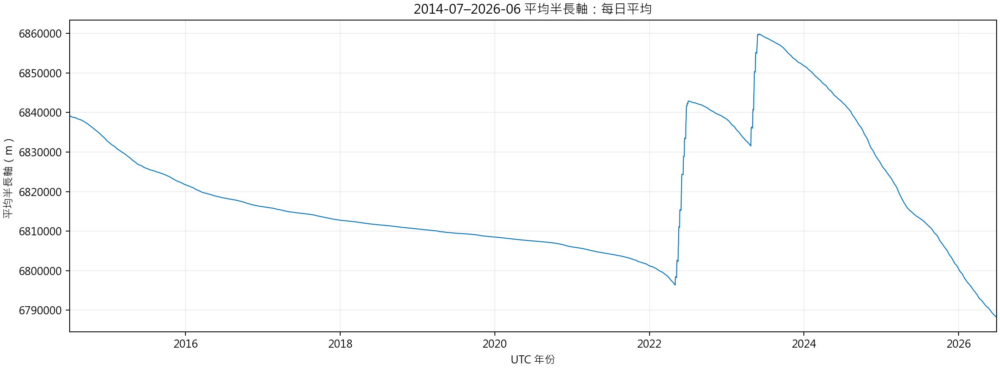
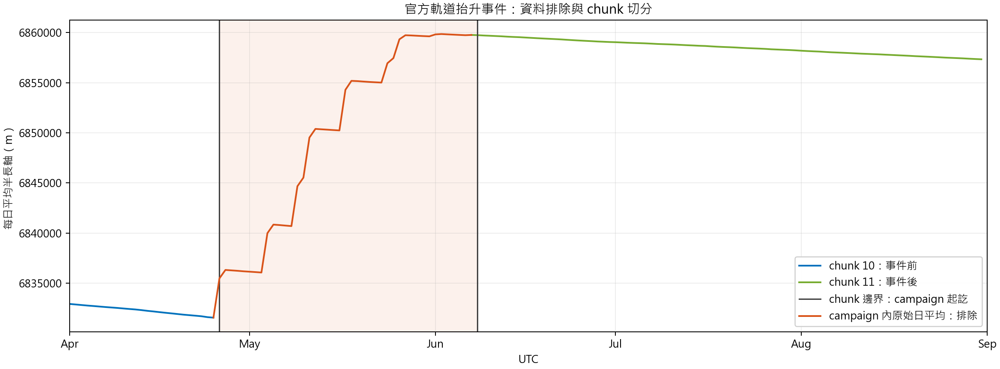
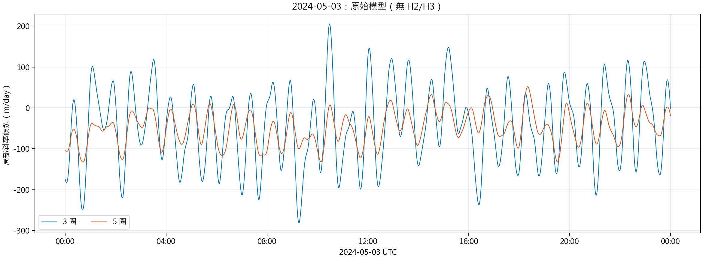
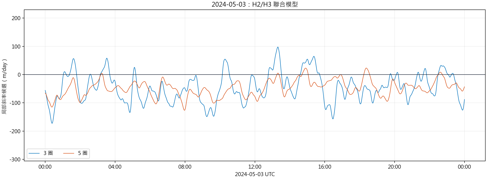

# Swarm-A 軌道分析流程報告：2014-07–2026-06 工作版

## 研究定位與資料範圍

本階段建立可追溯的 Swarm-A 局部軌道衰減率候選資料，供後續分析地磁活動與軌道衰減的關係。候選斜率不是已校準的大氣阻力，也不能單靠時間相關性宣稱地磁暴造成衰減。

本版分析期間為 2014-07-01 至 2026-07-01 UTC（左含右不含），實際涵蓋十二年。2014 年上半年屬任務初期定軌階段，依本研究的分析範圍決定整段排除；這不是 ESA 公布的逐次點火區間。[ESA 任務操作說明](https://www.esa.int/Enabling_Support/Operations/Swarm_operations)記載早期定軌操作，不能把圖上的每個轉折自行指定為一次點火。所有圖表與筆數須依此範圍重算，不能把三年版結果乘四。

資料來源為 `data/sqlite/swarm_a_analysis_2014_2026_phase_candidate_working_v2.sqlite`。該工作庫仍保留 2014 年上半年資料；本報告在讀取時排除，沒有刪除原始 POD 或改寫既有候選表。全庫已完成逐 10 秒的 3／5 圈 raw B-L／joint H2/H3 候選、P1.6 v2 feature 與 P1.7 v2 audit；6 項 violation 均為 0。此 audit 的 scope 是全庫，並非本報告 2014-07 起的篩選範圍另行通過稽核；斜率仍未校準成真實 drag。

| 資料層 | 計數單位 | 本版採用數量 | 解讀 |
| --- | --- | ---: | --- |
| 可用相位估計輸入 | 10 秒時間點 | 36,815,038 | 時間為 2014-07-01 00:00:04 至 2026-06-30 23:59:32 UTC；不是均勻無缺口的完整網格 |
| 原始模型，3 圈 | 同一組 10 秒時間點 | 36,815,038 列；36,794,802 個採用斜率 | 視窗起點須從 2014-07-01 起 |
| 原始模型，5 圈 | 同一組 10 秒時間點 | 36,815,038 列；36,781,317 個採用斜率 | 五圈需要較長的連續資料 |
| H2/H3 聯合模型，3 圈 | 同一組 10 秒時間點 | 36,815,038 列；36,794,802 個採用斜率 | 與原始 3 圈使用同一視窗 |
| H2/H3 聯合模型，5 圈 | 同一組 10 秒時間點 | 36,815,038 列；36,781,317 個採用斜率 | 與原始 5 圈使用同一視窗 |

兩張 v2 表各以 `time_us` 為主鍵，各列放 3 圈與 5 圈欄位；因此每個可用輸入點有四個結果位置，不是每圈只產生一筆。上述採用條件是 `time_us >= 2014-07-01`，且斜率非空、對應的 `orbit_3_window_start_time_us` 或 `orbit_5_window_start_time_us >= 2014-07-01`。因此 7 月初跨到 6 月的既有斜率也不採用。四組採用斜率合計 147,152,238 個，不是相同數量的不同時間點。

## 主流程

```text
ESA 精密軌道資料（POD，每 10 秒）
  -> ITRF 狀態向量轉 GCRF
  -> 平均軌道元素與相位 u
  -> 只採用 2014-07-01 UTC 起的分析期間
  -> 品質排除、來源檢查與 chunk 切段
  -> 每個可用時間點向前取精確 3 圈及 5 圈
  -> 原始模型與 H2/H3 聯合模型的 OLS 斜率
  -> 全庫 P1.6 v2 地磁特徵與 P1.7 v2 資料契約稽核
  -> 本報告另以 2014-07-01 UTC 篩選（未獨立稽核）
```

## 1. 從 POD 到平均軌道元素

POD 每 10 秒提供位置與速度。原始狀態向量位於國際地球參考框架（ITRF）；先轉入地心天球參考框架（GCRF），並在讀取與轉換邊界統一單位為 m、m/s 與 UTC。原始觀測保留，不以衍生值覆寫。

由 GCRF 狀態計算瞬時軌道元素，再使用布勞威爾－里登平均化（Brouwer-Lyddane mean elements）取得平均半長軸等元素。本版資料庫的 metadata 記錄平均元素演算法為 `orekit_brouwer_lyddane_j2_to_j5_m2_0_v3`。後續使用：

```text
a = mean_semi_major_axis_m
u = mean_argument_of_perigee_rad + mean_anomaly_rad
```

`u` 是軌道相位，不是 UTC 時鐘。連續資料段內將包回 `2pi` 的相位展開，讓視窗能以實際跨越的相位圈數定界。



圖 1 使用 2014-07-01 起成功算出平均元素的來源列，未套用後續 P1.4 事件排除，因此保留軌道抬升的整體變化。日平均只用於總覽；衰減率仍由品質篩選後、未日平均的 10 秒樣本估計。

## 2. 排除與切段

`swarm_a_pod_quality` 以 `is_usable`、`rejection_reason` 與 `chunk_id` 記錄品質決定。估計器只讀取可用且有 `chunk_id` 的資料，並要求平均半長軸、平均近地點幅角、平均近點角存在且平均元素未被拒絕。

2014 年上半年是本研究另設的分析期間排除條件，不在現有工作庫的 P1.4 官方事件表內，也不能寫成 ESA 已公布 2014-01-01 至 2014-07-01 的操作期間。正式重建候選表時，須讓首個採用視窗從 2014-07-01 起；目前以讀取條件防止跨界視窗進入報告。

來源資料缺口、產品流或座標框架變更，以及已知操作期間，會使計算不能直接跨段。已知操作期間須排除；正常資料在排除區間前後使用不同 `chunk`。本版 metadata 記錄的、落在工作期間內的官方事件如下：

| 事件 | 排除區間（UTC，左含右不含） | 性質 |
| --- | --- | --- |
| Swarm-A 軌道控制 | 2022-01-13 至 2022-01-14 | orbit-control manoeuvre |
| Swarm-A/C 軌道抬升 | 2022-05-03 至 2022-07-09 | orbit-raise campaign |
| Swarm-A/C 避碰 | 2023-01-06 至 2023-01-07 | collision-avoidance manoeuvre |
| Swarm-A/C 第二階段軌道抬升 | 2023-04-26 至 2023-06-08 | orbit-raise campaign |

這些是資料庫實際採用的排除區間，不代表已取得每次推進器點火的精確 UTC。未列出的時段也不能據此宣稱「完全沒有操作」。

事件的官方來源與排除區間依據另見[Swarm-A 官方軌道操作證據](../../plans/phase_1_data_preparation/RESEARCH_OFFICIAL_SWARM_A_EVENTS_2014_2026.md)。



圖 2 是十二年期間內的一個實例：折線可見抬升，排除區間兩側的估計視窗不能相連。完整期間的事件與資料涵蓋概覽仍須另行製圖。

## 3. 每 10 秒建立 3 圈與 5 圈視窗

每個可用的 10 秒輸入點都是視窗右端點。由該點的展開相位向前回看精確 `3 * 2pi` 或 `5 * 2pi`；若起點落在相鄰樣本之間，使用相位內插建立邊界。視窗不能跨 `chunk`、超過 20 秒的來源缺口或相位倒退。三圈約對應較短的局部尺度，五圈包含更長歷史；兩者不是二選一。

沒有足夠完整相位圈數時，該時間點仍留在兩張結果表，受影響的 3 圈或 5 圈欄位為 `NULL`，並標示例如 `insufficient_3_orbits`、`insufficient_5_orbits`、`gap_in_window` 或 `non_monotonic_phase`。這與舊版「每個完整軌道右端點才輸出一列」不同。

## 4. 同一視窗估計兩種局部斜率

原始模型直接對平均半長軸做最小平方法（OLS）：

```text
a(t) = b0 + b1 * (t - t0)
```

H2/H3 聯合模型在同一視窗加入二階、三階相位諧波：

```text
a(t) = b0 + b1 * (t - t0)
     + c2 * cos(2u) + s2 * sin(2u)
     + c3 * cos(3u) + s3 * sin(3u) + residual
```

兩個模型的 `b1` 都是局部斜率候選；v2 表以 `m/s` 儲存，報告圖換算為 `m/day`。同列還保留視窗起點、樣本數、相位跨度、斜率 1-sigma 不確定度與擬合殘差。聯合模型另保留 H2/H3 係數。這些欄位用於判讀候選的可靠性，不應只選看起來較平滑的一條線。

圖 3a、3b 固定藍色為 3 圈、橘色為 5 圈；是否包含 H2/H3 由圖標題區分，兩圖使用相同縱軸範圍。此處使用 2024-05-03 UTC 的逐 10 秒 v2 結果作局部示例，不代表整段十二年都具有相同幅度。





【圖 4：待產出。本版資料庫沒有三年版的每圈 H2/H3 診斷表；若要展示單圈諧波與殘差，須以十二年庫中同一個明確時間視窗重新計算，並標明視窗邊界。不可直接把三年版示例圖改標為十二年結果。】

## 5. 地磁特徵對齊與稽核狀態

本版資料庫已有 `geomagnetic`、`space_weather` 來源表，也已有逐 10 秒、與兩張 v2 rate table 共用 `time_us` 的 `swarm_a_phase_harmonic_features_v2`。SYM-H、Ap、F10.7 與 F10.7A 的來源時間由 P1.7 v2 檢查，不能把候選時間之後的太空天氣觀測當作已知輸入。

全庫 P1.7 v2 已檢查三表時間鍵一致、raw/joint rate 有效性一致、feature source time、非有限斜率與三張表的 SQLite integrity；6 項 violation 全為 0。這不驗證精確 phase span、視窗不跨 source gap、maneuver 或模型偏差；也沒有對本報告 2014-07 起的篩選結果另做稽核。不能稱為完整 release 稽核。

【圖 5：待產出。繪製十二年資料的逐年可用時間覆蓋與各年 3/5 圈有效候選比例。2014 年只計 7–12 月；分母使用各年可用 10 秒輸入時間點，不使用理想均勻網格；標示 2022、2023 官方操作排除區間。】

【圖 6：待產出。完成新版對齊後，選定一個地磁擾動個案，在同一 UTC 時間軸上分列候選斜率、SYM-H 與 Ap。只呈現描述性共變化，不加因果箭頭。】

## 目前不可宣稱的結論

- 局部斜率候選不是已校準的真實大氣阻力衰減率。
- H2/H3 聯合模型能控制指定相位諧波，不代表剩餘訊號全是物理衰減。
- 候選斜率與地磁指標在時間上共同變化，不足以單獨證明因果關係。
- 十二年期間的資料涵蓋、品質缺口與操作區間不能從三年工作版外推。

## Memo（內部備忘，不納入評審版）

- P1.7 v2 已核對兩張 rate table 的 `time_us` 與 rate 有效性；拒絕原因、精確 phase span 與本報告篩選範圍仍需另驗。
- 圖 4、圖 5、圖 6 只保留待產出標示，不以三年版圖片或舊版每圈候選代替。
- 圖 1、圖 3a、圖 3b 可用 `python output/report/prep_12y_report_figures.py` 從十二年工作庫重建；圖 1 的查詢已排除 2014 年上半年。
- 既有 v2 工作庫仍含 2014 年上半年資料。正式版須依期間邊界重建或建立可稽核的篩選結果；全庫 v2 audit pass 不可直接當成本報告範圍的獨立稽核。
- 特徵對齊與 release 稽核完成後，再把本版標為可供評審使用的正式成果。
