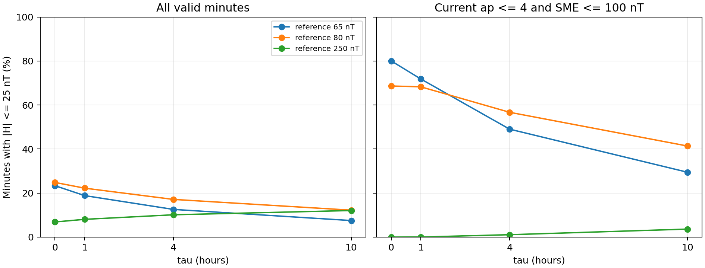
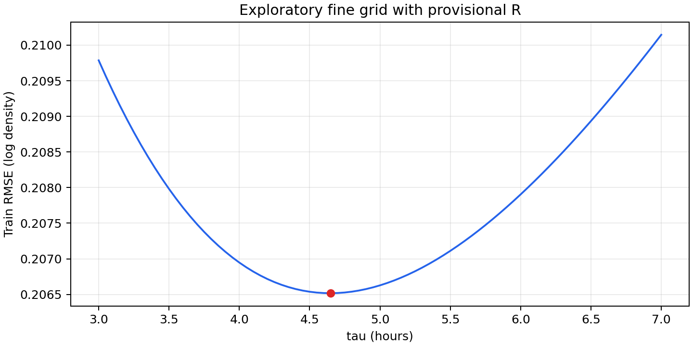
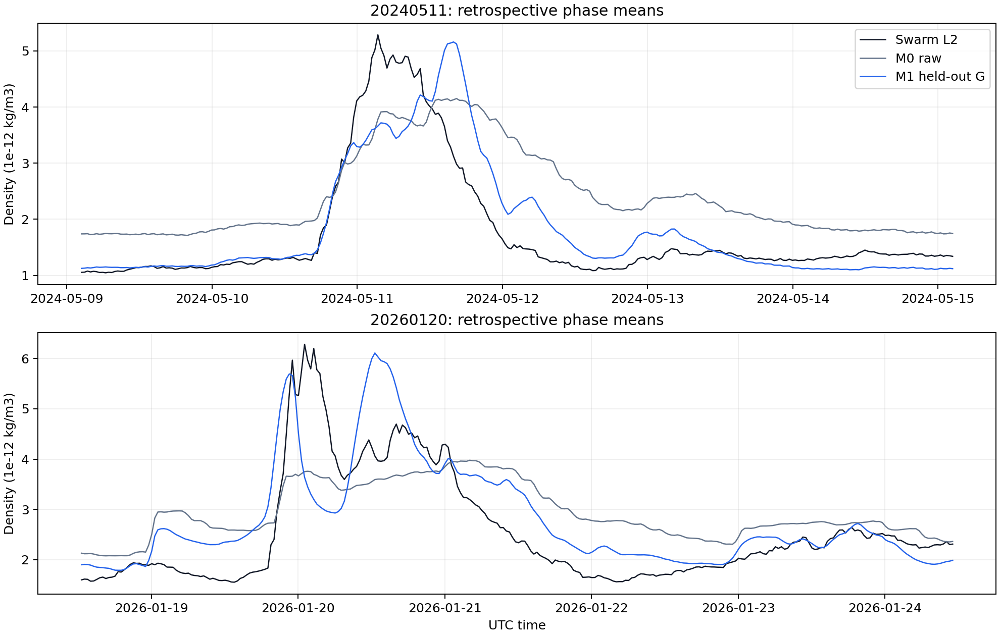
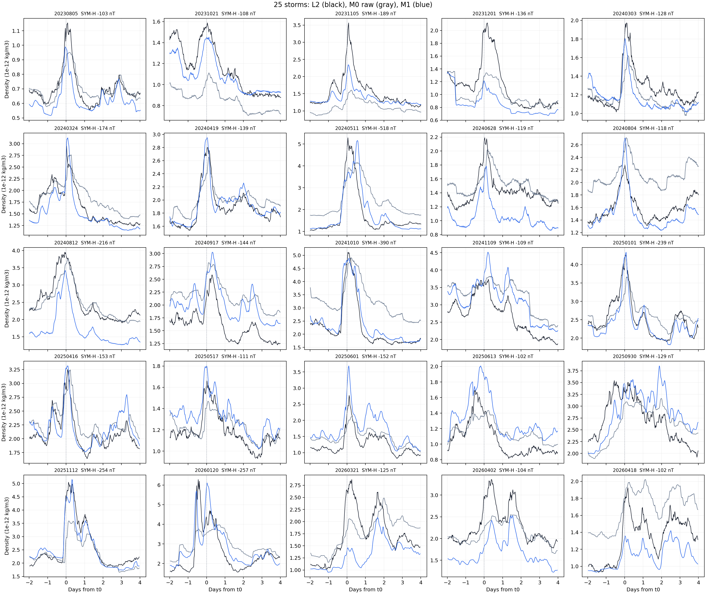

# Swarm-A Phase 3 密度響應流程報告：三年 25 場工作版

## 研究定位與現行狀態

狀態：[探索性回溯試算]，更新日期：2026-10-26。Phase 3 檢查平靜 NRLMSIS 2.0 背景加上 SME 一階響應，能否描述 Swarm-A Level-2（L2）中性氣體密度的磁暴變化。L2 是帶有觀測誤差的對照資料；此階段研究密度，尚未由密度推論軌道衰減，也沒有把大氣阻力接入 propagator。

比較對象是完整 MSIS 的原始預測 M0，以及固定平靜 `ap` 的 MSIS 加上 SME 響應的 M1。現有 M1 使用候選平靜倍率，M0 沒有對等倍率校準；報告保留兩條曲線供診斷，**不作 M1 優於 M0 的正式判定**。目前的中心相位平均與置中 F10.7A 使用錨點之後的資料，故本報告也不是即時 Forecast 成績。

來源期間為 2023-07-01 至 2026-06-30 UTC；25 場事件的 `t0` 由 2023-08-05 延伸至 2026-04-18。`t0` 是 SYM-H 最低點，**不是磁暴開始時刻**。事件時間窗取自唯讀 Phase 2 P2.6 檢查點；Phase 3 不更新 Phase 2／2R 或原始觀測。連續有效的一分鐘 SME 只到 2026-05-07 02:34 UTC，後段缺值沒有補作有效資料。

| 資料層 | 計數單位 | 數量 | 用途 |
| --- | --- | ---: | --- |
| Phase 2 事件 | 磁暴 | 25 | 事件 ID、`t0` 與相位分鐘錨點 |
| Phase 3 響應 | `{storm_id, time_us}` 錨點 | 217,912 | 41 條候選時間常數的相位響應與有效性 |
| Phase 3 平靜密度 | 同一組錨點 | 217,912 | 同樣本 L2／平靜 MSIS／完整 MSIS 相位密度 |
| 有效的預測輸入 | 中心相位錨點 | 214,907 | 25 場合計；另外 3,005 列仍保留無效標記 |
| Phase 3 預測 | 有效錨點 | 214,907 | 固定共同時間常數的 M1 曲線與 M0 對照 |
| 逐場總覽 | 磁暴 | 25 | 候選倍率、來源距離與逐場誤差 |

214,907 是高度重疊的相位窗口數量，**不是獨立觀測次數**。

## 主流程

```text
Phase 2 P2.6 唯讀事件、相位 u、SME、完整 MSIS
  + 原生 DNSAPOD L2／POD + F10.7／ap
  -> P3.1 找每場候選平靜倍率 R_k
  -> P3.2 連續一分鐘 SME 濾波，再作 u±pi 中心相位平均
  -> P3.3 同一批 L2 樣本計算平靜 MSIS 與相位密度
  -> P3.4 以 25 場的對數密度異常搜尋共同 tau、G
  -> P3.5 固定 tau=4.65 h 產生 M1 相位密度曲線
  -> P3.6 將 25 場總覽及逐分鐘預測寫入 SQLite
```

使用連續相位 $u$ 定義每個錨點前後各半個週期；資料沒有重新分成固定「第幾圈」。所有密度單位為 $\mathrm{kg/m^3}$，SME／響應單位為 nT，時間計算用 UTC。

## 1. 找候選平靜倍率 $R_k$

第 $k$ 場磁暴的 $R_k$ 用來表示：沒有額外 SME 響應時，L2 密度約為同位置平靜 MSIS 密度的幾倍。它是一個**由 L2 校準的無單位倍率**，不是 MSIS 內部的物理常數。

目前的選段先對三年連續 SME 計算 41 條響應，再要求候選分鐘同時滿足觀測 `ap ≤ 4`、`SME ≤ 100 nT`，且所有 41 條響應的絕對值都不超過 25 nT。連續至少 90 分鐘才算一段。每場選第一個強 SYM-H 低點之前最近的合格段；只在該段有 L2 的原生分鐘計算 L2／固定七欄 `ap=4` 的 MSIS 密度比，並取中位數作候選 $R_k$。暴後另選一段比較穩定性，**不回填暴前倍率**。

25 場的候選倍率介於 0.646–1.311，但只來自 20 個不同的暴前時段。10 場的選段距第一個強低點超過 14 天，最遠約 74.9 天；暴後／暴前倍率的相對差絕對值中位數為 11.5%，8 場超過 20%。這些數值指出平靜倍率可能隨時間或取樣位置變動，不能只因每場都找到數值就宣布校準成功。現行 $R_k$ 在 P3.4／P3.5 中**僅獲授權作試算輸入**。



圖 1 顯示 65 nT 參考值下，響應接近零的機會會隨時間常數和篩選條件改變；「當下 SME 低」本身不表示先前驅動已被系統忘記。2026-01 個案的[SME／響應／SYM-H 圖](../image/Phase3/onset_case_20260120.png)也顯示，第一個強 SYM-H 低點晚於明顯驅動起漲。選段規則尚未使用可重現的真正 onset。

## 2. 連續 SME 到相位響應 $H_\tau$

先定義每分鐘的相對輸入 $X_j=\mathrm{SME}_j-65\,\mathrm{nT}$。65 nT 是三年試算暫定的共同參考；$X_j<0$ 保留，表示低於參考值，並非負的絕對能量輸入。對時間常數 $\tau>0$，計算

$$
H_{\tau,j}=\alpha H_{\tau,j-1}+(1-\alpha)X_j,
\qquad \alpha=\exp\!\left(-\frac{1\,\mathrm{min}}{\tau}\right).
$$

$\tau=0$ 時直接令 $H_{0,j}=X_j$。這是對 SME 代理量的一階指數記憶濾波；SME 的 nT **不是實際熱通量**。手稿中的熱容量 $C$ 與冷卻係數沒有從本資料單獨量出，所以不能把此濾波當成已驗證的完整熱層能量方程。

程式從連續有效 SME 的起點遞迴，磁暴間不歸零。先算一分鐘序列，之後才把每個錨點在 $u-\pi$ 到 $u+\pi$ 的值平均，避免先用約一個軌道週期的平均抹掉短時間變化。每個原生分鐘的 0／1／2 個 L2 配對樣本作權重；窗口須完整且覆蓋率至少 80%。217,912 個錨點中，2,368 個因窗口不完整、637 個因覆蓋不足而標無效。

一分鐘濾波只用現在與過去的 SME；**中心相位平均還讀到錨點之後的值**。因此 $H_{\tau,\mathrm{phase}}$ 是離線分析量。此步的 SQLite 保存 0–10 小時、每 0.25 小時一條的 41 條響應；後面得到的 4.65 小時不在這張粗格點表內，須從連續 SME 另算。

## 3. 在相同樣本上計算 L2、M0 與平靜 MSIS

以 DNSAPOD 原生約 30 秒的 L2／POD 位置為基礎，在同一位置計算平靜 NRLMSIS 2.0。平靜版的七個 `ap` 欄位全固定為 4；每日 F10.7 使用前一 UTC 日的實際值，F10.7A 使用樣本當日的置中 81 日值。M0 則沿用 Phase 2 已算好的完整 MSIS，其磁活動輸入使用實際 `ap` 歷史。

只有同時存在 L2 的原生樣本才進入密度平均；L2、平靜 MSIS 和 M0 再用相同的 $u\pm\pi$ 窗口與樣本權重分別取相位平均。176 個 DNSAPOD 日檔提供 435,214 個原生配對樣本。報告中的密度比定義為**兩個相位平均密度之比**，並非原生逐點對數密度比的平均。

此步消除了不同缺口取樣造成的直接比較偏差，但沒有消除模型偏差。F10.7A 的置中 81 日值及相位窗口都含未來資料；完整 MSIS 的 `ap` 歷史時間對齊仍需專門稽核。

## 4. 從對數密度異常估共同 $\tau$ 與 $G$

對每個有效相位錨點，先定義

$$
y_{k,i}=\ln\!\left(
\frac{\rho_{\mathrm{L2},k,i}}{\rho_{\mathrm{MSIS,q},k,i}}
\right),\qquad
z_{k,i}=y_{k,i}-\ln R_k.
$$

其中 $i$ 是第 $k$ 場內的一個錨點；$z$ 表示扣除候選平靜倍率後的對數密度差。每個候選 $\tau$ 以 $z\approx G H_\tau$ 作過原點最小平方，只估一個共同 $G$：

$$
G(\tau)=\frac{\sum z_{k,i}H_{\tau,k,i}}{\sum H_{\tau,k,i}^{2}}.
$$

$G$ 的單位為 $\mathrm{nT}^{-1}$。程式先試 41 個 0.25 小時間隔格點，最低點約為 4.75 小時；再用 201 個 0.05 小時間隔格點細分。25 場合計 214,907 個有效錨點，細格點的訓練最小值如下：

| 量 | 試算結果 | 判讀 |
| --- | ---: | --- |
| 共同 $\tau$ | 4.65 h | 目前候選 $R_k$ 與相位定義下的格點最低值 |
| 共同 $G$ | $0.0007032326\,\mathrm{nT}^{-1}$ | 正值；響應增加時預測密度增加 |
| 訓練 RMSE | 0.20652 | 對數密度單位；不是密度的 $\mathrm{kg/m^3}$ 誤差 |
| 最低 RMSE 的 1% 內 | 3.35–6.30 h | 誤差曲線的數值範圍 |
| 最低 RMSE 的 5% 內 | 1.95–9.25 h | 範圍很寬；不是信賴區間 |




細格點只是更精確定位**同一批訓練資料**的最低點。相位窗口高度重疊，且 $R_k$ 未完成校準；4.65 小時不能被解讀成高精度物理常數，也不等於 SME 峰與密度峰的實測時間差。逐場 $\tau_k$ 的探索圖已有輸出，但 7 場頂到 10 小時邊界、8 場的 5% 範圍寬於 4 小時；依既定討論，這項趨勢問題先保留，不從現圖推論「磁暴越強、延遲越長」。

## 5. 固定 4.65 小時，產生 M1 密度曲線

令 $\rho_{\mathrm{MSIS,q,phase}}$ 為平靜 MSIS 的相位平均密度，$H_{4.65,\mathrm{phase}}$ 為相位平均響應。現行 M1 定義為

$$
\widehat\rho_{\mathrm{M1},k}
=\rho_{\mathrm{MSIS,q,phase}}R_k
\exp\!\left(GH_{4.65,\mathrm{phase}}\right).
$$

指數形式使密度為正。2024-05-11 02:14 UTC 的實際資料列可作例子：L2 相位密度為 $4.455\times10^{-12}\,\mathrm{kg/m^3}$，平靜 MSIS 為 $1.702\times10^{-12}\,\mathrm{kg/m^3}$，候選 $R_k=0.646$，$H_{4.65,\mathrm{phase}}=1637.102\,\mathrm{nT}$。公式給出 M1 全樣本曲線 $3.479\times10^{-12}\,\mathrm{kg/m^3}$；完整 MSIS M0 同列為 $3.338\times10^{-12}\,\mathrm{kg/m^3}$。這是單列示例，不代表全場誤差。

預測庫也存一條「排除該場重估 $G$」的曲線。但 $\tau=4.65$ 小時仍由**全部 25 場**選出，$R_k$ 仍沿用第 1 步的事後候選規則；因此它不是完整留一事件驗證。現行相位公式也不等於「在每個原生樣本計算 M1 密度，再對密度取相位平均」，兩種運算順序的差異未驗證。



圖 4 供檢查峰值時間與幅度的偏差。曲線是中心相位平均後的密度，不能當成衛星每 30 秒原生密度或真正可即時發出的預測。

## 6. 25 場總覽、SQLite 交付與稽核

最終交付庫 `data/sqlite/2023/swarm_a_phase3_prediction_tau465_exploratory.sqlite` 內，`phase3_prediction_minute` 以 `{storm_id, time_us}` 為鍵存 214,907 列；`phase3_25storm_overview` 以 `storm_id` 為主鍵存 25 列，並保存唯一的來源 `t0_time_us` 與 `algorithm_version`。每場有效分鐘數介於 8,320–8,677，與逐分鐘表逐場相符。候選 $R_k$ 與參數格點仍保留為中間分析 CSV；**25 場總覽與逐分鐘模型輸出以 SQLite 為準**。

此 SQLite 位於本機 `data/`，依專案 `.gitignore` 不納入 GitHub 提交。GitHub 版本提供重算程式、報告、圖和分析 CSV；要取得完整逐分鐘 SQLite，仍須另行交付資料庫檔案。



下表的 M1 誤差只把該場排除於 $G$ 的估計；M0 是未作同等校準的完整 MSIS。兩欄僅供找出需追查的事件，不能逐列宣布勝負。`R 距離`是候選暴前段結束至第一個強 SYM-H 低點的天數，不是距已確定 onset 的時間。

| `t0` UTC | SYM-H 最低值 (nT) | 候選 $R_k$ | $R$ 距離 (d) | M1 誤差 | M0 誤差 |
| --- | ---: | ---: | ---: | ---: | ---: |
| 2023-08-05 05:46 | -103 | 0.830 | 15.9 | 0.137 | 0.077 |
| 2023-10-21 07:28 | -108 | 1.203 | 3.5 | 0.087 | 0.298 |
| 2023-11-05 16:54 | -189 | 1.311 | 1.4 | 0.159 | 0.347 |
| 2023-12-01 13:30 | -136 | 0.905 | 5.6 | 0.316 | 0.197 |
| 2024-03-03 18:00 | -128 | 0.983 | 13.2 | 0.135 | 0.110 |
| 2024-03-24 16:21 | -174 | 0.822 | 6.4 | 0.127 | 0.152 |
| 2024-04-19 19:21 | -139 | 0.869 | 7.8 | 0.053 | 0.090 |
| 2024-05-11 02:14 | -518 | 0.646 | 10.3 | 0.213 | 0.476 |
| 2024-06-28 12:06 | -119 | 0.649 | 30.3 | 0.299 | 0.112 |
| 2024-08-04 17:04 | -118 | 0.649 | 67.4 | 0.099 | 0.297 |
| 2024-08-12 16:52 | -216 | 0.649 | 74.9 | 0.406 | 0.084 |
| 2024-09-17 04:24 | -144 | 0.878 | 1.4 | 0.240 | 0.329 |
| 2024-10-10 23:14 | -390 | 0.671 | 14.6 | 0.099 | 0.437 |
| 2024-11-09 12:37 | -109 | 0.910 | 7.3 | 0.173 | 0.227 |
| 2025-01-01 16:40 | -239 | 0.893 | 2.4 | 0.090 | 0.137 |
| 2025-04-16 17:43 | -153 | 0.936 | 51.7 | 0.085 | 0.108 |
| 2025-05-17 05:16 | -111 | 1.033 | 18.2 | 0.116 | 0.089 |
| 2025-06-01 10:30 | -152 | 1.033 | 33.4 | 0.309 | 0.207 |
| 2025-06-13 20:15 | -102 | 1.033 | 45.8 | 0.233 | 0.157 |
| 2025-09-30 07:59 | -129 | 1.008 | 43.0 | 0.173 | 0.176 |
| 2025-11-12 03:59 | -254 | 1.024 | 9.5 | 0.089 | 0.166 |
| 2026-01-20 11:52 | -257 | 0.862 | 12.2 | 0.241 | 0.321 |
| 2026-03-21 01:39 | -125 | 0.756 | 1.2 | 0.325 | 0.193 |
| 2026-04-02 08:41 | -104 | 0.756 | 13.5 | 0.318 | 0.116 |
| 2026-04-18 07:54 | -102 | 0.651 | 1.1 | 0.187 | 0.265 |

全樣本 M1 訓練對數密度 RMSE 為 0.20652；僅排除測試場對 $G$ 估計的曲線，按分鐘合併 RMSE 為 0.2105。未校準 M0 為 0.2343。M1 的逐場誤差在 15／25 場較低，但比較條件不同，**這些數字不是模型優劣的正式檢定**。

三個 Phase 3 衍生 SQLite 的 `integrity_check` 均為 `ok`，每庫各有 25 個事件；響應與平靜密度表各 217,912 列，預測表 214,907 列，逐場索引合計有效分鐘也為 214,907。原始記錄與 Phase 2 檢查點未更新。

## 目前不可宣稱的結論與下一步

1. **不能稱 $R_k$ 已正式定稿。** 選段依事後強低點，部分時段距事件太遠，且原生分鐘倍率尚未對中心相位模型驗證。需先定義事前截止時刻、平靜資格與相位校準方法。
2. **不能稱 4.65 小時是精確的物理延遲或預報提前量。** 它是暫定倍率與訓練損失下的一階記憶常數；5% 誤差範圍很寬，中心相位量仍使用未來資料。
3. **不能稱 M1 已擊敗 M0。** M1 有從 L2 取得的逐場倍率，M0 無同等校準；完整 MSIS 的 `ap` 時間對齊尚待稽核。正式比較需用相同校準機會、完全留出測試事件的參數選擇與明確的評分規則。
4. **不能稱已完成即時 Forecast 或軌道衰減驗證。** 需先替換置中 F10.7A 與中心相位窗口，限定所有輸入在預測時刻可得，再單獨驗證密度模型；大氣阻力及軌道預測仍屬後續工作。

本報告是可檢查的工作結果，不替代逐場原始列與決策紀錄。方法變更記入[Phase 3 計畫](../../plans/phase_3/PLAN.md)，實際 key、來源及每步 Input／Output 見[Phase 3 資料血緣](../../data_lineage/phase_3_25_storm_prediction.md)。
