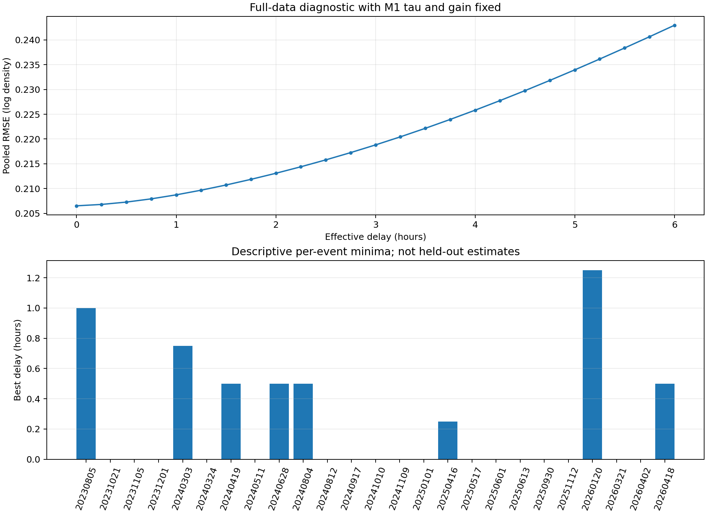

# Phase 3 Trial 2：共用有效時間位移試驗

## 結果與決定

狀態：[done]。三年 25 場事件的第一階段已完成。在平靜 MSIS、既定暴前 $R_k$ 與一階 SME 響應上，加入 **25 場共用的非負有效時間位移 $\delta$**，沒有改善留出磁暴的對數密度誤差。100 次平衡隨機 20／5 切分全部選出 $\delta=0$。依[預先確認的 3% 門檻](../docs/plans/PLAN.md)，本次不執行 $(\delta,\tau)$ 二維搜尋及逐段 $\tau_j$ 重擬合。Phase 3 主線未改動。

| 檢查 | 結果 |
| --- | ---: |
| 事件／有效相位錨點 | 25／214,907 |
| 20／5 分割 | 100 組；每場被測 20 次 |
| 各折訓練得的 M1 $\tau$ | 4.20–5.60 h；中位數 4.65 h |
| 各折訓練得的共用 $\delta$ | 100／100 組為 0 min |
| 25 場等權平均留出 RMSE，M1 | 0.189751873 |
| 25 場等權平均留出 RMSE，加入 $\delta$ | 0.189751873 |
| 相對改善 | 0.000% |
| 固定主線 $\tau,G$ 的全資料最小值 | $\delta=0$ min；合併 RMSE 0.206517515 |

RMSE 是對數密度單位。表中的留出 RMSE 是每場先平均其 20 次測試結果，再讓 25 場等權平均；全資料合併 RMSE 使用另一種權重與參數來源，兩個數字不能直接相減作驗證成績。

## 方法與對齊

逐分鐘輸入 $X(t)=\mathrm{SME}(t)-65\,\mathrm{nT}$；$\delta$ 取 0–6 小時、每 15 分鐘一格。先沿連續 SME 序列計算一階響應，再用既有 $u\pm\pi$ 中心相位窗口和 L2 配對權重平均。背景取主線七欄 `ap=4` 平靜 MSIS；各場 $R_k$ 固定為主線暴前 L2 校準值。

$R_k$ 直接讀取 Phase 3 `phase3_25storm_overview.r_candidate`，本次沒有重估。Phase 3 先找每場暴前最近、至少連續 90 分鐘的低活動段，條件為 `ap ≤ 4`、`SME ≤ 100 nT`，且 41 條候選一階響應的絕對值均不超過 25 nT；再取該段原生分鐘的 $\rho_{L2}/\rho_{MSIS,q}$ 中位數。25 個 $R_k$ 範圍為 0.646–1.311；選段可能距事件多日，因此它是既定校準倍率，並非已知的物理常數。[原始方法](../../phase3/reports/phase_3_final_report.md)。

**$R_k$ 品質問題**：逐列反算主線 M1 所用倍率，214,907 列與 Trial 2 讀取值的最大差僅 $4.44\times10^{-16}$，所以不是讀錯欄位；但 25 場只使用 20 個不同暴前段，10 場的選段距第一個強低點超過 14 天，最遠 74.9 天，且 8 場暴後／暴前倍率相差超過 20%。原本選段要求 $\delta=0$ 的響應接近零；固定這些 $R_k$ 比較 $\delta>0$ 可能偏向零位移。事後以 $\tau=4.65$ 小時檢查所選的整段：$\delta=15$ 分鐘時沒有段落的 $|H|$ 超過 25 nT，$\delta=60$ 分鐘時有 1 段超過，$\delta=360$ 分鐘時有 6 段超過。這些是固定 $R_k$ 試驗的限制，沒有據此重新選段或修改留出門檻。

令 $z_{k,i}=\ln(\rho_{L2,k,i}/\rho_{MSIS,q,k,i})-\ln R_k$。每折先在 20 場訓練事件上，對每個 $\tau$ 用 $G=\sum zH/\sum H^2$ 求一個共用增益，再選訓練誤差最低的 $\tau$；固定該折 $G,\tau$ 後才比較 25 個 $\delta$。各折得到的 $G$ 為 $0.000632$–$0.000810\,\mathrm{nT}^{-1}$。測試事件期間的 L2 只用於評分，不參與這兩個共用參數的估計。

每組分割先僅用 20 場重新搜尋 M1 的共用 $\tau$（0–10 小時、每 0.05 小時）和 $G$；固定這兩個訓練值後，只用相同 20 場搜尋共用 $\delta$。留下的 5 場只用於評分。固定亂數種子為 `20261029`，每 5 組把 25 場各測一次，重複 20 輪。來源 SME 在有效事件前的 6 小時及各事件窗口內連續有效，因此所有候選位移使用相同的 214,907 個有效錨點。

固定主線 $\tau=4.65$ h、$G=0.0007032326071208369\,\mathrm{nT}^{-1}$、$\delta=0$ 時，重算相位響應與主線最大絕對差為 $1.51\times10^{-11}\,\mathrm{nT}$。這項重現檢查與 20／5 留出測試分開。

事後敏感度檢查：即使固定 $\tau=4.65$ h、讓每個 $\delta$ 在全資料上**各自重估 $G$**，最低點仍為 $\delta=0$。$\delta=0,15,60$ 分鐘的合併 RMSE 依序為 0.206517515、0.206793657、0.208723982。這項全資料檢查不納入預先定義的留出門檻。

## 單場診斷

在**固定主線 $\tau,G$、單場資料內選最小值**時，17／25 場的 $\delta=0$；另外 8 場的最小值介於 15–75 分鐘。這些單場結果使用該場事件期間 L2，不能視為留出參數或獨立預報成績。其中改善最多的 2026-01-20 個案為 75 分鐘、資料內 RMSE 相對下降 2.76%；各場診斷都沒有改變共用 $\delta=0$ 的留出結論。

## 輸出與驗證

- [Trial 2 SQLite](../data/sqlite/swarm_a_phase3_trial2_delay_v1.sqlite)：`trial2_split` 2,500 列、`trial2_fold` 100 列、`trial2_test_score` 500 列、`trial2_event_summary` 25 列、`trial2_full_delta_grid` 25 列、`trial2_event_delta_grid` 625 列。`trial2_joint_grid` 為空，符合第一階段未通過門檻的決定。
- [重算入口](../code/prep_trial2_delay.py)與[輸出程式](../code/prep_trial2_outputs.py)只讀 Phase 2／3 來源，產生新的 Trial 2 SQLite；不覆寫來源庫。SQLite `integrity_check=ok`，每場恰好有 20 次測試，所有留出分數的 M1 與位移模型差為 0。
- [資料血緣](../docs/lineage/phase3_trial2_delay.md)記錄來源 checkpoint、配對鍵、分割、估計與輸出表。
- [計算檢查](../tests/test_calc_trial2_delay.py) 3 項通過：平衡分割、已知位移的合成訊號、解析增益。

## 解讀範圍

在本次固定 M1 底座、共用非負 $\delta$、15 分鐘格點與中心相位平均的設定下，資料沒有支持額外的**共用純時間位移**。這不證明熱層沒有傳播或局部時間差；SME 是活動代理量，中心相位平均也會平滑時序。逐段 $\tau_j$ 落在搜尋邊界的問題仍未解決，不能用本次未執行的二維或逐段結果作推論。

測試事件仍使用自己暴前 L2 算出的既定 $R_k$，所以結論限於「暴前校準後的事件響應」；中心相位窗口讀取錨點後資料，此試驗屬離線回溯分析。下一個研究方向需另行決定，不能在看完本次結果後改動既定門檻，並把新規則當作同一次驗證。
