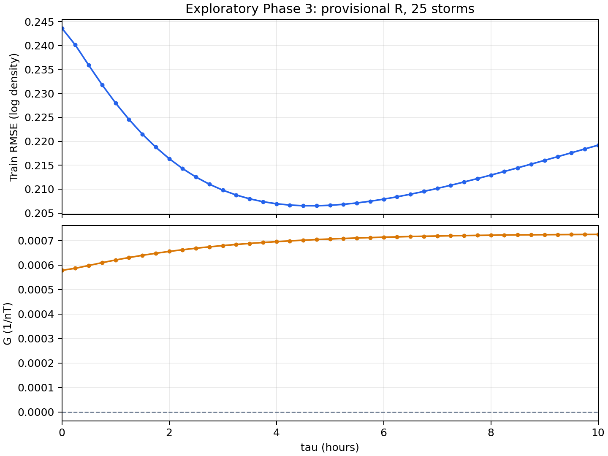

# Swarm-A Phase 3 三年 25 場密度響應結案報告

## 結果與適用範圍

狀態：[done]。三年 25 場的離線密度分析、逐場 $R_k$ 計算與 M1 曲線已交付。本報告的「完成」指這套回溯分析已完成；$R_k$ 是本套模型採用的操作倍率，不能據此宣稱已量得每場事件真正的物理平靜倍率。

研究檢查「固定平靜 `ap` 的 NRLMSIS 2.0 背景 + SME 一階響應」M1，與使用實際 `ap` 歷史的完整 MSIS M0 相比，如何貼近 Swarm-A Level-2（L2）密度。L2 是帶有觀測誤差的對照資料。M1 使用 L2 算逐場倍率，表內 M0 沒有同等倍率校準；兩者誤差可供診斷，不能判定 M1 已勝出。

| 已交付結果 | 數值 | 判讀 |
| --- | ---: | --- |
| 有效中心相位錨點 | 214,907／217,912 | 25 場；窗口高度重疊，不是獨立觀測數 |
| 共同一階時間常數 $\tau$ | 4.65 h | 同一批資料的訓練格點最低值；5% RMSE 範圍為 1.95–9.25 h |
| 共同增益 $G$ | $0.0007032326\,\mathrm{nT}^{-1}$ | 與上述 $\tau$ 配對的訓練結果 |
| 合併對數密度 RMSE | M1 訓練 0.20652；固定 $\tau$、排除測試場重估 $G$ 為 0.2105；原 M0 為 0.2343 | 校準與參數選取不同，不能當公平的模型勝負檢定 |

置中相位平均與置中 F10.7A 會使用錨點之後的資料。這是離線密度研究，沒有驗證即時 Forecast 或軌道衰減。以下按 P3.1–P3.6 記錄方法、結果與交付。

## 資料與主流程

來源期間為 2023-07-01 至 2026-06-30 UTC；25 場事件的 `t0` 由 2023-08-05 延伸至 2026-04-18。`t0` 是 SYM-H 最低點，**不是磁暴開始時刻**。事件時間窗取自唯讀 Phase 2 P2.6 檢查點；Phase 3 不更新 Phase 2／2R 或原始觀測。連續有效的一分鐘 SME 只到 2026-05-07 02:34 UTC，後段缺值沒有補作有效資料。

| 資料層 | 計數單位 | 數量 | 用途 |
| --- | --- | ---: | --- |
| Phase 2 事件 | 磁暴 | 25 | 事件 ID、`t0` 與相位分鐘錨點 |
| Phase 3 響應 | `{storm_id, time_us}` 錨點 | 217,912 | 41 條候選時間常數的相位響應與有效性 |
| Phase 3 平靜密度 | 同一組錨點 | 217,912 | 同樣本 L2／平靜 MSIS／完整 MSIS 相位密度 |
| 有效模型錨點 | 中心相位錨點 | 214,907 | 25 場合計；另外 3,005 列仍保留無效標記 |
| M1 回溯曲線 | 有效錨點 | 214,907 | 固定共同時間常數的 M1 曲線與 M0 對照 |
| 逐場總覽 | 磁暴 | 25 | 採用的 $R_k$、來源距離與逐場誤差 |

```text
Phase 2 P2.6 唯讀事件、相位 u、SME、完整 MSIS
  + 原生 DNSAPOD L2／POD + F10.7／ap
  -> P3.1 依低活動段規則計算每場 R_k
  -> P3.2 連續一分鐘 SME 濾波，再作 u±pi 中心相位平均
  -> P3.3 同一批 L2 樣本計算平靜 MSIS 與相位密度
  -> P3.4 以 25 場的對數密度異常搜尋共同 tau、G
  -> P3.5 固定 tau=4.65 h 產生 M1 相位密度曲線
  -> P3.6 將 25 場總覽及逐分鐘預測寫入 SQLite
```

使用連續相位 $u$ 定義每個錨點前後各半個週期；資料沒有重新分成固定「第幾圈」。所有密度單位為 $\mathrm{kg/m^3}$，SME／響應單位為 nT，時間計算用 UTC。

## 1. 逐場平靜倍率 $R_k$（P3.1）

第 $k$ 場磁暴的 $R_k$ 是 L2 密度與同位置平靜 MSIS 密度的低活動段比值，無單位。它校準本套回溯模型的背景；資料表仍以 `r_candidate`／`r_near_zero_median_candidate` 命名，保留其近零響應選段的來源語意。

選段先對三年連續 SME 計算 41 條響應，再要求分鐘同時滿足觀測 `ap ≤ 4`、`SME ≤ 100 nT`，且所有 41 條響應的絕對值都不超過 25 nT。連續至少 90 分鐘才算一段。每場選第一個強 SYM-H 低點之前最近的合格段；在該段有 L2 的原生分鐘取 L2／固定七欄 `ap=4` 的 MSIS 密度比中位數。暴後另選一段檢查穩定性，不回填暴前倍率。[逐場選段與比值](../data/analysis/phase3_rquiet_near_zero_25.csv)、[重算入口](../code/prep_phase3_rquiet_near_zero.py)。

25 場的倍率介於 0.646–1.311，來自 20 個不同暴前時段。10 場的選段距第一個強低點超過 14 天，最遠約 74.9 天；暴後／暴前倍率相對差的絕對值中位數為 11.5%，8 場超過 20%。因此逐場數值可作本模型的既定輸入，但不能泛化為事件附近穩定的物理平靜倍率。


圖 1 顯示 65 nT 參考值下，響應接近零的機會會隨時間常數和篩選條件改變；「當下 SME 低」本身不表示先前驅動已被系統忘記。2026-01 個案的[SME／響應／SYM-H 圖](../figures/onset_case_20260120.png)也顯示，第一個強 SYM-H 低點晚於明顯驅動起漲。選段規則尚未使用可重現的真正 onset。

## 2. 連續 SME 到相位響應 $H_\tau$

先定義每分鐘的相對輸入 $X_j=\mathrm{SME}_j-65\,\mathrm{nT}$。65 nT 是本次計算採用的參考值，並非量得的物理常數；$X_j<0$ 保留，表示低於參考值。對時間常數 $\tau>0$，計算

$$
H_{\tau,j}=\alpha H_{\tau,j-1}+(1-\alpha)X_j,
\qquad \alpha=\exp\!\left(-\frac{1\,\mathrm{min}}{\tau}\right).
$$

$\tau=0$ 時直接令 $H_{0,j}=X_j$。這是對 SME 代理量的一階指數記憶濾波；SME 的 nT **不是實際熱通量**。手稿中的熱容量 $C$ 與冷卻係數沒有從本資料單獨量出，所以不能把此濾波當成已驗證的完整熱層能量方程。

程式從連續有效 SME 的起點遞迴，磁暴間不歸零。先算一分鐘序列，之後才把每個錨點在 $u-\pi$ 到 $u+\pi$ 的值平均，避免先用約一個軌道週期的平均抹掉短時間變化。每個原生分鐘的 0／1／2 個 L2 配對樣本作權重；窗口須完整且覆蓋率至少 80%。217,912 個錨點中，2,368 個因窗口不完整、637 個因覆蓋不足而標無效。

一分鐘濾波只用現在與過去的 SME；**中心相位平均還讀到錨點之後的值**。因此 $H_{\tau,\mathrm{phase}}$ 是離線分析量。此步的 SQLite 保存 0–10 小時、每 0.25 小時一條的 41 條響應；後面得到的 4.65 小時不在這張粗格點表內，須從連續 SME 另算。

## 3. 在相同樣本上計算 L2、M0 與平靜 MSIS

以 DNSAPOD 原生約 30 秒的 L2／POD 位置為基礎，在同一位置計算平靜 NRLMSIS 2.0。平靜版的七個 `ap` 欄位全固定為 4；每日 F10.7 使用前一 UTC 日的實際值，F10.7A 使用樣本當日的置中 81 日值。M0 則沿用 Phase 2 已算好的完整 MSIS，其磁活動輸入使用實際 `ap` 歷史。

只有同時存在 L2 的原生樣本才進入密度平均；L2、平靜 MSIS 和 M0 再用相同的 $u\pm\pi$ 窗口與樣本權重分別取相位平均。176 個 DNSAPOD 日檔提供 435,214 個原生配對樣本。報告中的密度比定義為**兩個相位平均密度之比**，並非原生逐點對數密度比的平均。

此步使三條曲線使用相同 L2 配對樣本。F10.7A 的置中 81 日值與相位窗口都含錨點之後的資料；主線 M0 沿用 Phase 2 的 `ap` 對齊方式。

## 4. 從對數密度異常估共同 $\tau$ 與 $G$

對每個有效相位錨點，先定義

$$
y_{k,i}=\ln\!\left(
\frac{\rho_{\mathrm{L2},k,i}}{\rho_{\mathrm{MSIS,q},k,i}}
\right),\qquad
z_{k,i}=y_{k,i}-\ln R_k.
$$

其中 $i$ 是第 $k$ 場內的一個錨點；$z$ 表示扣除已校準平靜倍率後的對數密度差。每個候選 $\tau$ 以 $z\approx G H_\tau$ 作過原點最小平方，只估一個共同 $G$：

$$
G(\tau)=\frac{\sum z_{k,i}H_{\tau,k,i}}{\sum H_{\tau,k,i}^{2}}.
$$

$G$ 的單位為 $\mathrm{nT}^{-1}$。程式先試 41 個 0.25 小時間隔格點，最低點約為 4.75 小時；再用 201 個 0.05 小時間隔格點細分。25 場合計 214,907 個有效錨點，細格點的訓練最小值如下：

| 量 | 試算結果 | 判讀 |
| --- | ---: | --- |
| 共同 $\tau$ | 4.65 h | 本次 $R_k$ 與相位定義下的格點最低值 |
| 共同 $G$ | $0.0007032326\,\mathrm{nT}^{-1}$ | 正值；響應增加時預測密度增加 |
| 訓練 RMSE | 0.20652 | 對數密度單位；不是密度的 $\mathrm{kg/m^3}$ 誤差 |
| 最低 RMSE 的 1% 內 | 3.35–6.30 h | 誤差曲線的數值範圍 |
| 最低 RMSE 的 5% 內 | 1.95–9.25 h | 範圍很寬；不是信賴區間 |




細格點只定位**同一批訓練資料**的最低點。相位窗口高度重疊；4.65 小時是此模型的共同記憶參數，並非高精度物理常數或 SME 峰至密度峰的實測時間差。

## 5. 固定 4.65 小時，產生 M1 密度曲線

令 $\rho_{\mathrm{MSIS,q,phase}}$ 為平靜 MSIS 的相位平均密度，$H_{4.65,\mathrm{phase}}$ 為相位平均響應。現行 M1 定義為

$$
\widehat\rho_{\mathrm{M1},k}
=\rho_{\mathrm{MSIS,q,phase}}R_k
\exp\!\left(GH_{4.65,\mathrm{phase}}\right).
$$

指數形式使密度為正。2024-05-11 02:14 UTC 的實際資料列：L2 相位密度為 $4.455\times10^{-12}\,\mathrm{kg/m^3}$，平靜 MSIS 為 $1.702\times10^{-12}\,\mathrm{kg/m^3}$，採用 $R_k=0.646$，$H_{4.65,\mathrm{phase}}=1637.102\,\mathrm{nT}$。公式給出 M1 全樣本曲線 $3.479\times10^{-12}\,\mathrm{kg/m^3}$；原 M0 同列為 $3.338\times10^{-12}\,\mathrm{kg/m^3}$。單列不代表全場誤差。

預測庫另存「排除該場重估 $G$」的曲線。$\tau=4.65$ 小時仍由**全部 25 場**選出，因此它不是完整留一事件驗證。先平均 $H$ 再套指數，也不等於在原生樣本逐點算 M1 後取相位平均；報告數字採用前一種運算順序。


圖 4 供檢查峰值時間與幅度的偏差。曲線是中心相位平均後的密度，不能當成衛星每 30 秒原生密度或真正可即時發出的預測。

## 6. 逐場結果與交付（P3.6）

本機交付庫 `phases/phase3/data/sqlite/swarm_a_phase3_prediction_tau465_exploratory.sqlite` 內，`phase3_prediction_minute` 以 `{storm_id, time_us}` 為鍵存 214,907 列；`phase3_25storm_overview` 以 `storm_id` 為主鍵存 25 列，保留來源 `t0_time_us` 與 `algorithm_version`。每場有效分鐘數介於 8,320–8,677，與逐分鐘表相符。[逐場誤差 CSV](../data/analysis/phase3_prediction_tau465_exploratory.csv)、[選段 CSV](../data/analysis/phase3_rquiet_near_zero_25.csv)和[格點 CSV](../data/analysis/phase3_tau_grid_005h_exploratory.csv)供查核；完整逐分鐘輸出以 SQLite 為準。

此 SQLite 位於本機 `phases/phase3/data/sqlite/`，依專案 `.gitignore` 不納入 GitHub 提交。GitHub 版本提供重算程式、報告、圖和分析 CSV；要取得完整逐分鐘 SQLite，仍須另行交付資料庫檔案。


下表的 M1 誤差只排除該場對 $G$ 的估計，$\tau$ 仍由全部事件選出；M0 是沿用 Phase 2 `ap` 對齊方式的未校準完整 MSIS。`R 距離`是暴前段結束至第一個強 SYM-H 低點的天數，並非距實際 onset 的時間。

| `t0` UTC | SYM-H 最低值 (nT) | 採用 $R_k$ | $R$ 距離 (d) | M1 誤差 | 原 M0 誤差 |
| --- | ---: | ---: | ---: | ---: | ---: |
| 2023-08-05 05:46 | -103 | 0.830 | 15.9 | 0.137 | 0.077 |
| 2023-10-21 07:28 | -108 | 1.203 | 3.5 | 0.087 | 0.298 |
| 2023-11-05 16:54 | -189 | 1.311 | 1.4 | 0.159 | 0.347 |
| 2023-12-01 13:30 | -136 | 0.905 | 5.6 | 0.316 | 0.197 |
| 2024-03-03 18:00 | -128 | 0.983 | 13.2 | 0.135 | 0.110 |
| 2024-03-24 16:21 | -174 | 0.822 | 6.4 | 0.127 | 0.152 |
| 2024-04-19 19:21 | -139 | 0.869 | 7.8 | 0.053 | 0.090 |
| 2024-05-11 02:14 | -518 | 0.646 | 10.3 | 0.213 | 0.476 |
| 2024-06-28 12:06 | -119 | 0.649 | 30.3 | 0.299 | 0.112 |
| 2024-08-04 17:04 | -118 | 0.649 | 67.4 | 0.099 | 0.297 |
| 2024-08-12 16:52 | -216 | 0.649 | 74.9 | 0.406 | 0.084 |
| 2024-09-17 04:24 | -144 | 0.878 | 1.4 | 0.240 | 0.329 |
| 2024-10-10 23:14 | -390 | 0.671 | 14.6 | 0.099 | 0.437 |
| 2024-11-09 12:37 | -109 | 0.910 | 7.3 | 0.173 | 0.227 |
| 2025-01-01 16:40 | -239 | 0.893 | 2.4 | 0.090 | 0.137 |
| 2025-04-16 17:43 | -153 | 0.936 | 51.7 | 0.085 | 0.108 |
| 2025-05-17 05:16 | -111 | 1.033 | 18.2 | 0.116 | 0.089 |
| 2025-06-01 10:30 | -152 | 1.033 | 33.4 | 0.309 | 0.207 |
| 2025-06-13 20:15 | -102 | 1.033 | 45.8 | 0.233 | 0.157 |
| 2025-09-30 07:59 | -129 | 1.008 | 43.0 | 0.173 | 0.176 |
| 2025-11-12 03:59 | -254 | 1.024 | 9.5 | 0.089 | 0.166 |
| 2026-01-20 11:52 | -257 | 0.862 | 12.2 | 0.241 | 0.321 |
| 2026-03-21 01:39 | -125 | 0.756 | 1.2 | 0.325 | 0.193 |
| 2026-04-02 08:41 | -104 | 0.756 | 13.5 | 0.318 | 0.116 |
| 2026-04-18 07:54 | -102 | 0.651 | 1.1 | 0.187 | 0.265 |

全樣本 M1 訓練對數密度 RMSE 為 0.20652；只排除測試場重估 $G$ 的曲線按分鐘合併 RMSE 為 0.2105。原 M0 為 0.2343。M1 在 15／25 場的逐場誤差較低；兩條曲線的校準條件不同，不能由此判定模型勝負。

主線的三個 Phase 3 衍生 SQLite 的 `integrity_check` 均為 `ok`，每庫各有 25 個事件；響應與平靜密度表各 217,912 列，預測表 214,907 列，逐場索引合計有效分鐘也是 214,907。原始記錄與 Phase 2 檢查點未更新。

## 結案判讀

本 phase 交付的是一套可追溯的三年離線密度響應計算。$R_k$ 在每場都有數值，並被固定用於 M1；選段距離、暴前後倍率差和原生樣本至相位模型的轉用限制，決定了這些數值的解讀範圍。共同 $\tau=4.65$ h 是此訓練設定的最低點，不能轉述為精確的物理 lag 或預報提前量。

主線表內的 M0 沿用 Phase 2 的 `ap` 輸入，M1 使用低活動段 L2 校準；兩者誤差數字不能作公平勝負檢定。密度尚未接入大氣阻力或軌道傳播。P3.1–P3.6 的來源、輸出 key 與重算入口見[Phase 3 資料血緣](../docs/lineage/phase_3_25_storm_prediction.md)。
