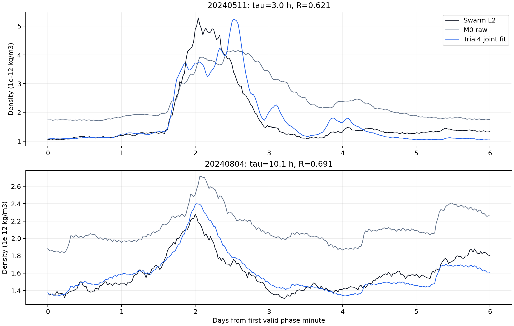
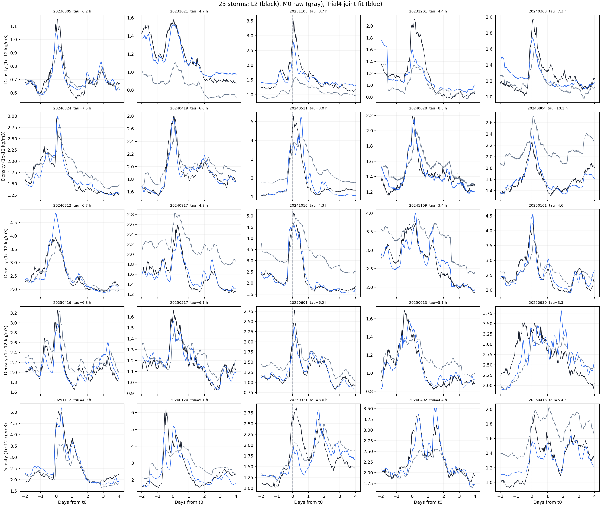

# Swarm-A Trial4 三年 25 場自由 $R_k$／$\tau_k$ 描述性擬合報告

## 結果與適用範圍

狀態：[done]。本報告完成 Trial4 的前兩步與其完整交付：在凍結的 Phase 3 同一批三年 25 場資料上，讓每場背景倍率 $R_k$ 與記憶時間 $\tau_k$ 自由調整，並共用一個正的增益 $G$。這是同一批資料上的離線描述性擬合，不是獨立驗證，也不能把個別 $\tau_k$ 當作量得的物理冷卻時間、lag 或可即時預報的提前量。

正式搜尋範圍是 $0\le\tau_k\le15.0\ \mathrm{h}$，每 $0.1\ \mathrm{h}$ 一格。先前 $10\ \mathrm{h}$ 是錯誤的搜尋上限，相關衍生檔已移除；本報告及其 CSV 只保留 15 小時版本。25 場都沒有選到 $15\ \mathrm{h}$，因此沒有上界卡住的例外。

| 模型 | 可調參數 | 共同 $G\ (\mathrm{nT}^{-1})$ | 等權逐場 MSE | 等權逐場 RMSE | 迭代 |
| --- | --- | ---: | ---: | ---: | ---: |
| A：Phase 3 基線 | 固定 $R_k=R_{k,\mathrm{RQ}}$、$\tau=4.65\ \mathrm{h}$ | 0.000703233 | 0.042768 | 0.206804 | 0 |
| B：自由 $R_k$ | $R_k$；$\tau=4.65\ \mathrm{h}$ | 0.000687248 | 0.012786 | 0.113074 | 1 |
| C：自由 $\tau_k$ | $\tau_k$；固定 $R_{k,\mathrm{RQ}}$ | 0.000706825 | 0.042035 | 0.205024 | 3 |
| D：自由 $R_k,\tau_k$ | 25 個 $R_k$、25 個 $\tau_k$、1 個 $G$ | 0.000705054 | 0.012090 | 0.109953 | 5 |

最直接的結果是：讓 $R_k$ 自由後，RMSE 從 0.206804 降到 0.113074；只讓 $\tau_k$ 自由，只降到 0.205024。再同時調整兩者，RMSE 為 0.109953。這表示在這套資料與損失函數下，主要可修正的是每場的背景位移；自由 $\tau_k$ 有額外改善，但幅度小得多。

## 資料與主流程

資料期間、事件、中心相位錨點和密度處理均直接讀取凍結的 Phase 3 輸出。Trial4 沒有更新 Phase 2、Phase 3、原始 SQLite 或任一主線結論。25 場合計使用 214,907 個有效中心相位密度錨點；每一場先各自算平均平方誤差，再對 25 場取平均，避免資料點較多的事件主導目標函數。

```text
凍結的 Phase 3 L2／平靜 MSIS／SME 相位資料
  + Phase 3 的 R_RQ、G、tau=4.65 h 作起始值
  -> 固定各 tau，交替更新 25 個 R_k 與共同 G
  -> 固定 R_k、G，25 場各自掃 tau=0.0..15.0 h
  -> 重複至所有 tau_k 不再改變
  -> 寫出 A--D 模型、逐場參數與迭代記錄 CSV
```

密度模型仍是

$$
\widehat\rho_{k,i}
=\rho_{\mathrm{MSIS,q},k,i}\,R_k
\exp\!\left(GH_{\tau_k,k,i}\right),
$$

其中 $i$ 是第 $k$ 場的相位錨點，$H_{\tau_k}$ 是由連續 SME 先做一階記憶濾波、再作中心相位平均得到的離線響應。令

$$
y_{k,i}=\ln\!\left(
\frac{\rho_{\mathrm{L2},k,i}}
{\rho_{\mathrm{MSIS,q},k,i}}
\right),
$$

本 trial 最小化

$$
L=\frac{1}{25}\sum_{k=1}^{25}
\frac{1}{n_k}\sum_{i=1}^{n_k}
\left[y_{k,i}-\ln R_k-GH_{\tau_k,k,i}\right]^2.
$$

所有對數均為自然對數。這點很重要：SQLite 的 `log()` 是以 10 為底，不能拿來算此處的對數殘差。

## 1. 參數、起始值與限制

Trial4 的自由模型共有 51 個待定數：25 個 $R_k$、25 個 $\tau_k$ 和一個共同 $G$。起始值依約定採用 $R_k=R_{k,\mathrm{RQ}}$、全部 $\tau_k=2.5\ \mathrm{h}$、$G=0.0007032326\ \mathrm{nT}^{-1}$；這些起始值不等於最後答案。

| 量 | 角色 | 範圍或規則 |
| --- | --- | --- |
| $R_k$ | 第 $k$ 場的無單位背景倍率 | 每場自由；嚴格 $0<R_k<2$；沒有懲罰項或 RQ 軟限制 |
| $\tau_k$ | 第 $k$ 場 SME 一階記憶的格點參數 | 0.0–15.0 h，每 0.1 h；平手保留上一輪值 |
| $G$ | 25 場共用的密度對 SME 響應增益 | 強制 $G>0$；非正值立即視為失敗 |
| $R_{k,\mathrm{RQ}}$ | Phase 3 的暴前近零響應倍率 | 只作起始值與比較基準，不作硬界或代價 |

固定 $\tau_k$ 後，$\ln R_k$ 是該場殘差目標的平均值（再套用 $R_k<2$），共同 $G$ 用 25 場等權的過原點最小平方更新。固定 $R_k,G$ 後，所有事件各自在同一輪掃完整個 151 格時間常數。若同一場的新最低 loss 與原格點相同到數值容忍度，保留原 $\tau_k$。最多跑 20 輪；完整模型 D 在第 5 輪所有 $\tau_k$ 都不再改變。

這是交替最佳化，不保證找到連續參數空間的唯一全域最小值；它的價值是每一步可檢查、可重跑，也符合這次「先 $R_k$，再 $\tau_k$，最後 $G$，反覆做」的流程。

## 2. 25 場自由參數結果

下表使用完整模型 D。`1% tau 範圍`是固定該場最後 $R_k,G$ 後，該場 loss 不超過最小 loss 1% 的格點範圍；它不是統計信賴區間。所有 $R_k$ 都低於 2，所有 $\tau_k$ 都低於 15 小時。

| 事件 ID | $R_{\mathrm{RQ}}$ | $R_{\mathrm{fit}}$ | $R_{\mathrm{fit}}/R_{\mathrm{RQ}}$ | $\tau_{\mathrm{fit}}$ (h) | 1% tau 範圍 (h) |
| --- | ---: | ---: | ---: | ---: | --- |
| S20230805T0546 | 0.830 | 0.931 | 1.121 | 6.2 | 5.8–6.7 |
| S20231021T0728 | 1.203 | 1.267 | 1.054 | 4.7 | 4.0–5.4 |
| S20231105T1654 | 1.311 | 1.444 | 1.101 | 3.7 | 3.2–4.2 |
| S20231201T1330 | 0.905 | 1.180 | 1.303 | 4.4 | 3.4–5.6 |
| S20240303T1800 | 0.983 | 1.051 | 1.070 | 7.3 | 6.0–9.1 |
| S20240324T1621 | 0.822 | 0.897 | 1.091 | 7.5 | 6.9–8.2 |
| S20240419T1921 | 0.869 | 0.851 | 0.980 | 6.0 | 5.7–6.3 |
| S20240511T0214 | 0.646 | 0.621 | 0.961 | 3.0 | 2.6–3.3 |
| S20240628T1206 | 0.649 | 0.864 | 1.331 | 8.3 | 7.7–9.0 |
| S20240804T1704 | 0.649 | 0.691 | 1.065 | 10.1 | 9.3–10.9 |
| S20240812T1652 | 0.649 | 0.959 | 1.478 | 6.7 | 6.2–7.3 |
| S20240917T0424 | 0.878 | 0.701 | 0.798 | 4.9 | 4.5–5.2 |
| S20241010T2314 | 0.671 | 0.625 | 0.933 | 4.3 | 4.1–4.5 |
| S20241109T1237 | 0.910 | 0.782 | 0.859 | 3.4 | 3.0–3.9 |
| S20250101T1640 | 0.893 | 0.937 | 1.050 | 4.6 | 4.3–4.9 |
| S20250416T1743 | 0.936 | 0.904 | 0.966 | 6.8 | 6.3–7.4 |
| S20250517T0516 | 1.033 | 0.931 | 0.902 | 6.1 | 5.7–6.5 |
| S20250601T1030 | 1.033 | 0.783 | 0.758 | 6.2 | 5.9–6.5 |
| S20250613T2015 | 1.033 | 0.834 | 0.807 | 5.1 | 4.7–5.6 |
| S20250930T0759 | 1.008 | 0.956 | 0.948 | 3.3 | 2.7–4.0 |
| S20251112T0359 | 1.024 | 1.039 | 1.015 | 4.9 | 4.6–5.2 |
| S20260120T1152 | 0.862 | 0.774 | 0.897 | 5.1 | 4.6–5.7 |
| S20260321T0139 | 0.756 | 0.957 | 1.265 | 3.6 | 2.9–4.5 |
| S20260402T0841 | 0.756 | 1.026 | 1.357 | 4.4 | 4.1–4.8 |
| S20260418T0754 | 0.651 | 0.760 | 1.167 | 5.4 | 4.8–6.2 |

完整模型 D 的 $R_{\mathrm{fit}}$ 範圍為 0.621–1.444，對 RQ 起始值的比值為 0.758–1.478。$\tau_{\mathrm{fit}}$ 範圍為 3.0–10.1 h；最大值是 `S20240804T1704` 的 10.1 h，其 1% 格點範圍為 9.3–10.9 h，已在 15 h 搜尋範圍內部。因此它表示這個離線模型在該事件偏好較長的記憶，不表示系統有 10.1 小時的已量測物理時間常數。

## 3. 模型比較與判讀

模型 B 已拿走大部分誤差下降，表示 Phase 3 的 $R_{k,\mathrm{RQ}}$ 作為背景中心是有資訊的，但固定它不足以代表每個事件在這個密度模型裡的最佳背景位置。模型 D 中有 14 場 $R_{\mathrm{fit}}>R_{\mathrm{RQ}}$、11 場較低；這些移動是為了本資料上的整段平均誤差，不能直接解釋為真正背景密度改變。

模型 C 的改善很小，且各事件的 1% 格點範圍有寬度。這代表現階段資料可用來比較「此模型在哪些時間尺度比較貼」，但還不足以把每一個 $\tau_k$ 當作很精準的事件物理量。Phase 3 使用中心相位平均，窗口高度重疊且讀取錨點後資料；它本來就是回溯量，不適合作為 timing 的獨立證據。

這裡沒有加入 RQ 距離、平靜段前後差異或任何物理代價。這是刻意的：目前先看資料本身在完全自由但有基本物理界限的情況下，會選出什麼 $R_k,\tau_k,G$。後續若要進入物理判讀，應另開下一步，不能把本表的訓練結果直接升格為物理解釋。

## 4. 正確性核對、Trial4 SQLite、圖與重算

Trial4 是舊 Phase 3 固定 $R_{k,\mathrm{RQ}}$／共同 $\tau$ 基線的修正描述性模型；後續密度分析讀取 D-model，不再把舊固定 M1 當作基線。2026-10-30 的核對確認：Trial4 保存的 prediction SQLite 與 tau-grid CSV 和 Phase 3 原檔 SHA-256 相同；joint-fit 核心只匯入 Trial4 目錄內的計算／載入程式；9 個 Trial4 測試通過。以保存的 $R_{\mathrm{fit}}$、$\tau_k$、$G$ 和 $H_{\tau_k}$ 逐列重算 214,907 筆預測與殘差，數值完全一致；逐場等權 MSE 也完全重現為 0.012089579087948936。

這些核對只建立實作、來源與輸出的一致性。Trial4 仍是同一批事件的回溯資料內擬合，不能據此聲稱物理因果、未見事件能力或即時預報能力。

Trial4 有自己的 SQLite：`data/sqlite/swarm_a_trial4_joint_fit_tau15.sqlite`。它不修改任何凍結來源，也不把 Phase 3 的 SQLite 複製當成 Trial4 結果。`trial4_joint_fit_minute` 以 `{storm_id, time_us}` 保存 214,907 筆 fitted minute rows；`trial4_25storm_overview` 保存 25 筆逐場摘要；`trial4_joint_fit_metadata` 保存共同 $G$、tau 格點和資料邊界。SQLite `integrity_check` 為 `ok`，每場總覽分鐘數和 minute table 完全一致。

重算分兩步。第一步用[擬合入口](../code/prep_trial4_joint_fit.py)重建 A–D CSV；第二步用[SQLite／圖輸出入口](../code/prep_trial4_joint_prediction.py)讀取 D-model CSV，重建預測 SQLite、總覽 CSV 與兩張圖。兩支程式都拒絕覆寫既有輸出，避免結果被靜默替換。

| 輸出 | 內容 |
| --- | --- |
| [模型比較 CSV](../data/analysis/trial4_joint_fit_tau15_models.csv) | A–D 的 $G$、等權逐場 MSE／RMSE、收斂輪數 |
| [逐場參數 CSV](../data/analysis/trial4_joint_fit_tau15_events.csv) | 每個模型的 $R_{\mathrm{RQ}}$、$R_{\mathrm{fit}}$、$\tau$、1% 範圍、上界旗標 |
| [迭代 CSV](../data/analysis/trial4_joint_fit_tau15_iterations.csv) | B、C、D 每輪 $G$ 與改變的 $\tau_k$ 數量 |
| [25 場總覽 CSV](../data/analysis/trial4_joint_fit_tau15_overview.csv) | D-model 每場的密度誤差、R、tau、1% 範圍與 M0 比較 |
| `data/sqlite/swarm_a_trial4_joint_fit_tau15.sqlite` | 214,907 個 D-model minute rows、25 場總覽與 metadata |
| [計算核心](../code/calc_trial4_joint_fit.py) | 交替更新、格點搜尋、限制與等權計分 |
| [重算入口](../code/prep_trial4_joint_fit.py) | 唯讀載入 Phase 3、建立 $H_\tau$、輸出 CSV |
| [資料血緣](../docs/lineage/trial4_joint_fit_tau15.md) | P4.1–P4.3 的來源、SQLite key、資料契約與範例列 |
| [方法與診斷](../docs/trial4_joint_fit_tau15_diagnostics.md) | 非 Report 的模型規格、殘差與 timing 初篩 |





圖只用於檢查同一批訓練資料的曲線形狀。中心相位平均的窗口高度重疊且使用錨點後資料，不能把圖上的貼合度改述為外測預報能力。

## 結論

Trial4 的前兩步已完成：在 $\tau=0$–15 h 的完整格點範圍內，交替更新確實收斂，且沒有任何事件落在上界。自由 $R_k$ 是目前最大的誤差改善來源；自由 $\tau_k$ 只帶來較小但可測的額外改善。這些是後續物理討論的數值起點，不是物理結論。
