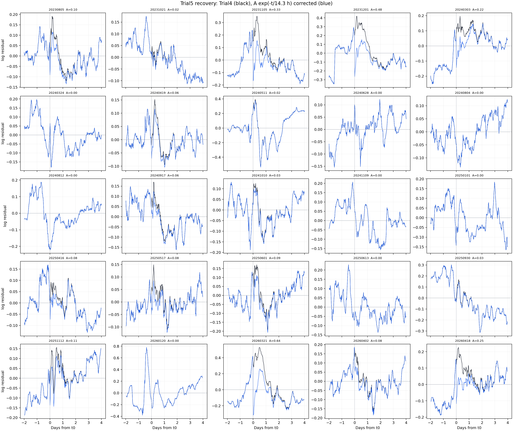
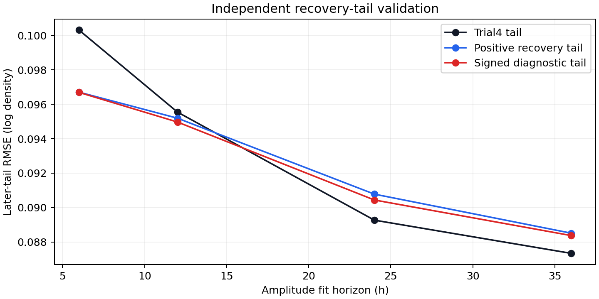

# Swarm-A Trial5 三年 25 場恢復起始項／恢復項第一份擬合報告

## 結果與適用範圍

狀態：[working]。Trial5 在固定 Trial4 D-model 的 $R_k,\tau_k,G$ 上，加入每場非負恢復起始項 $A_k$ 與一個共同恢復時間 $T_{\mathrm{rec}}$。這是同一批三年 25 場訓練資料上的描述性擬合；不能將 $T_{\mathrm{rec}}$ 當作已量得的物理冷卻時間，也不是獨立預報驗證。

| 模型 | 新增量 | 等權逐場 MSE | 等權逐場 RMSE |
| --- | --- | ---: | ---: |
| D：Trial4 基線 | 無 | 0.012090 | 0.109953 |
| E：Trial5 recovery | 25 個 $A_k\ge0$；共同 $T_{\mathrm{rec}}$ | 0.010256 | 0.101272 |

最佳格點為 $T_{\mathrm{rec}}=14.3$ h。RMSE 下降 0.008681，17／25 場 $A_k>0$。這表示在 Trial4 殘差上，加一個只從 $t_0$ 起衰減的正項可以改善訓練貼合；它沒有證明每場都存在同一個物理恢復過程。

## 模型與資料邊界

令 Trial4 對數殘差為

$$
e^{(4)}_{k,i}=\ln\!\left(
\frac{\rho_{\mathrm{L2},k,i}}
{\widehat\rho_{\mathrm{Trial4},k,i}}
\right).
$$

Trial5 保持 Trial4 預測不動，加入

$$
q_{k,i}=A_k\exp\!\left[-\frac{t_i-t_{0,k}}{T_{\mathrm{rec}}}\right]
\mathbf{1}(t_i\ge t_{0,k}),
\qquad A_k\ge0,
$$

並令 $\widehat\rho_{\mathrm{Trial5}}=\widehat\rho_{\mathrm{Trial4}}\exp(q)$。$A_k$ 是在 $t_0$ 的額外對數密度偏移；時間很久後 $q$ 歸零，因此它和每場固定背景 $R_k$ 不同。$t_0$ 仍是 SYM-H 最低點，不是磁暴開始或經驗證的恢復開始時刻。

```text
Trial4 fixed R_k, tau_k, G and minute residuals
  -> scan common T_rec=0.1..96.0 h
  -> solve nonnegative A_k at each grid point
  -> choose equal-event-loss minimum
  -> write Trial5 minute table, overview, CSV, residual figure
```

後續 SME 的重新驅動沒有被切掉；它仍保留在 Trial4 的 $GH_{\tau_k}$ 項內。這避免只剩少數「完全無再驅動」事件才可分析，但也表示恢復項與未建模的後段結構可能混合，物理解讀必須克制。

## 逐場結果

振幅最大的五場如下；完整 25 場數值在[逐場 CSV](../data/analysis/trial5_recovery_events.csv)。

| storm_id | $A_k$ | Trial4 RMSE | Trial5 RMSE |
| --- | ---: | ---: | ---: |
| S20260321T0139 | 0.6431 | 0.2130 | 0.1569 |
| S20231201T1330 | 0.4764 | 0.1703 | 0.1332 |
| S20231105T1654 | 0.3268 | 0.1217 | 0.0975 |
| S20260418T0754 | 0.2456 | 0.0991 | 0.0825 |
| S20240303T1800 | 0.2225 | 0.1135 | 0.1021 |

部分事件的 $A_k=0$，表示在「只允許正的、從 $t_0$ 衰減的項」這個規格下，不需要額外恢復偏移。這不是該事件沒有任何物理恢復，只表示這個最小模型沒有得到正的殘差改善。



## 交付與重算

| 輸出 | 內容 |
| --- | --- |
| [模型 CSV](../data/analysis/trial5_recovery_models.csv) | Trial4／Trial5 的等權 MSE、RMSE 與最佳 $T_{\mathrm{rec}}$ |
| [格點 CSV](../data/analysis/trial5_recovery_grid_01h.csv) | $0.1$–$96.0$ h 的共同恢復時間 loss 曲線 |
| [逐場 CSV](../data/analysis/trial5_recovery_events.csv) | $A_k$、Trial4／Trial5 逐場 RMSE |
| `data/sqlite/swarm_a_trial5_recovery_v1.sqlite` | 214,907 個 Trial5 minute rows、25 場 overview、metadata |
| [計算核心](../code/calc_trial5_recovery.py) | recovery shape、非負 $A_k$、等權格點評分 |
| [重算入口](../code/prep_trial5_recovery.py) | 唯讀 Trial4，寫 Trial5 CSV、SQLite、figure |
| [資料血緣](../docs/lineage/trial5_recovery_terms.md) | 輸入、output key、版本與實際範例列 |

SQLite 的 `integrity_check` 為 `ok`；minute table 為 214,907 列，25 場 overview 分別和 minute table 的列數一致。程式拒絕覆寫既有輸出。

## 留一事件與預測距離驗證

第一份結果的 14.3 h 是用全部 25 場選出的，不能直接採用。為了檢查它，對每一場 $k$：

1. 用其餘 24 場重新選 $T_{\mathrm{rec}}$。
2. 被留出的第 $k$ 場只用 $t_0$ 後前 (h) 小時估 $A_k$。
3. 只在 (t_0+h) 以後比較 Trial4 與 Trial5；這段沒有參與該場的 $A_k$ 估計。

25 次留一事件的共同時間為 11.8–14.7 h，平均 14.248 h。時間尺度本身不亂跳；真正失敗的是起始振幅對較晚殘差的預測力。

| $A_k$ 估計至 | Trial4 後段 RMSE | 正值恢復項 RMSE | 改善場數 | 判讀 |
| ---: | ---: | ---: | ---: | --- |
| 6 h | 0.100312 | 0.096705 | 10／25 | 有小幅短期改善 |
| 12 h | 0.095547 | 0.095192 | 8／25 | 幾乎持平 |
| 24 h | 0.089270 | 0.090781 | 2／25 | 變差 |
| 36 h | 0.087340 | 0.088512 | 1／25 | 變差 |

允許負的 $A_k$ 作為診斷也沒有扭轉結論：24 h 和 36 h 一樣比 Trial4 差。它只在部分事件以負項降低誤差，這違反原本「正的恢復密度偏移」定義，不能當正式模型。



[留一事件 CSV](../data/analysis/trial5_recovery_loo_events.csv)、[留一事件模型總覽](../data/analysis/trial5_recovery_loo_models.csv)記錄每場選出的 $T_{\mathrm{rec}}$；[horizon CSV](../data/analysis/trial5_recovery_horizon_models.csv)記錄上表的每個數值。

## 結論

Trial5 已完成第一個最小恢復模型及其驗證。它有訓練改善，也有很短期的修正能力，但**沒有通過 24 h 以上的獨立後段驗證**。因此不把 $T_{\mathrm{rec}}=14.3$ h 採用為全場恢復常數，也不把這個恢復項併回 Trial4。

目前保留它作為有證據的診斷結果：Trial4 在部分事件的 $t_0$ 附近仍有正的、約數小時尺度的殘差結構；這個結構不足以支持單一 14.3 h 指數恢復律。下一個模型必須有新的、可檢驗的物理或資料依據，不能只是再加第二個自由指數。
