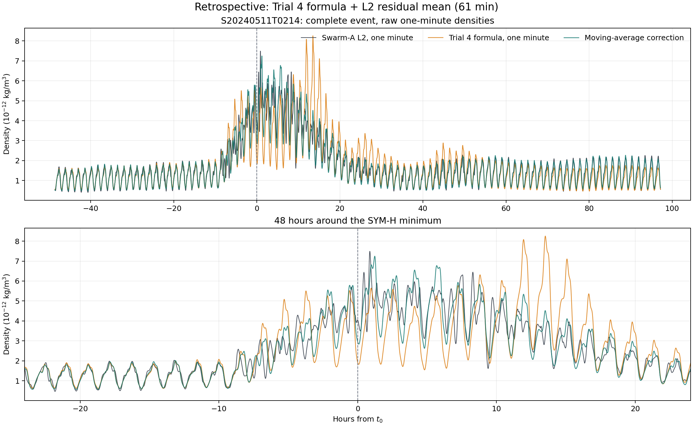

# Phase 4 Trial7：一分鐘移動平均的事後修正展示

狀態：[done: descriptive]。本頁只展示 `S20240511T0214` 一場磁暴的中心移動平均；它讀取被評分的當下 L2，不能當作預測能力。要看不使用當下 L2 的 25 場主結果，請讀[過去 60 分鐘移動平均報告](trial7_25storm_past_mean_report.md)。本頁主圖比較真正的一分鐘 Swarm-A L2、Trial 4 公式的一分鐘延伸，以及用 L2 殘差移動平均得到的事後修正。全部來源唯讀，輸出留在 `phases/phase4-trial7/`。

## 資料定義與方法

Phase 3 Trial 4 的正式 SQLite 雖然每分鐘有一列，但每列的 L2 和模型值仍是約一圈的中心相位平均；它沒有保存原生的一分鐘 Trial 4 曲線。若直接畫正式 SQLite，只是**每分鐘更新的一圈平均**，無法呈現圈內起伏。本 trial 因此把 Trial 4 已擬合的 $R_k,\tau_k,G$ 固定，使用 Phase 3 保存的**一分鐘** L2 與 quiet-MSIS 密度，以及 Phase 2 的一分鐘 SME，計算同一公式在未作相位平均的一分鐘輸入上的值。這條線稱為「Trial 4 公式的一分鐘延伸」，不得冒充正式的一圈平均輸出。

對選定事件，原生配對資料有 8,749 筆連續一分鐘觀測，涵蓋 2024-05-09 01:38 至 2024-05-15 03:26 UTC。中心 SYM-H 低點 $t_0$ 為 2024-05-11 02:14 UTC。程式先用一分鐘輸入重算相位平均的 quiet-MSIS 與 SME 響應，再核對 8,653 筆有效相位點與正式 Trial 4 SQLite 的時間、響應和密度值相符，才畫真正的一分鐘圖。

令 $\rho_{\mathrm{T4,1m}}(t)$ 為 Trial 4 公式的一分鐘延伸，$\rho_{\mathrm{L2,1m}}(t)$ 為同一分鐘的 Swarm-A L2。先計算對數殘差，再以當下前後各 30 分鐘的有效殘差取平均，最後乘回固定的 Trial 4 公式：

$$
e(t)=\ln\frac{\rho_{\mathrm{L2,1m}}(t)}{\rho_{\mathrm{T4,1m}}(t)},\qquad
\overline e_{61}(t)=\operatorname{mean}_{|t_i-t|\leq30\,\mathrm{min}}e(t_i),\qquad
\rho_{\mathrm{MA}}(t)=\rho_{\mathrm{T4,1m}}(t)\exp\overline e_{61}(t).
$$

事件首尾不足完整 61 分鐘時，只平均實際存在的分鐘。這場事件每分鐘連續且原生配對 L2、quiet-MSIS 均有效。61 分鐘是這次看圖用的固定探索窗口，沒有物理最適性主張；沒有為了降低誤差搜尋窗口長度。

## 圖與結果

上半圖是完整約六天事件，下半圖放大 $t_0\pm24$ 小時。黑線是每分鐘 L2，橘線是 Trial 4 公式的一分鐘延伸，綠線是對數殘差中心移動平均後的修正。圈內起伏保留在三條一分鐘曲線中。橘線在磁暴增強後約 12--20 小時有明顯過高的峰；綠線因為讀了當地 L2，能降低這段偏差，但仍不能逐點重建所有短時變化。

這場事件同資料的一分鐘對數 RMSE 由 0.26032 降到 0.14812。**這不是 held-out 成績。** 每個修正點的 61 分鐘窗口包含該分鐘 L2，也包含最多 30 分鐘的後續 L2；當作「預測」會直接使用答案。Trial 4 參數本身也已用同事件 L2 的一圈平均擬合。這個數字只能量化事後平滑的貼合程度。

作為資料定義對照，[每分鐘更新的一圈平均圖](../figures/trial7_s20240511t0214_moving_average.png)使用正式 Trial 4 minute table 的相位平均 L2 和模型值。它比真正一分鐘圖平滑許多，兩圖的誤差數字不能直接比較。若目標是研究圈內震盪，應以本報告的原生一分鐘主圖為準；若目標是評估原本 Trial 4 的正式輸出，則必須使用一圈平均對照圖。

## 決定與證據

本 trial 證明現有資料可在一分鐘尺度比較 L2 與固定 Trial 4 公式，並清楚顯示移動平均對殘差的平滑效果。它沒有回答「沒有同分鐘 L2 時能否修正」，也沒有建立可移轉到其他事件的模型。Phase4 Final 仍為 `[not created]`。

- [一分鐘逐點資料](../data/analysis/trial7_s20240511t0214_raw_minute.csv)
- [正式相位平均逐點對照](../data/analysis/trial7_s20240511t0214_minute.csv)
- [真正一分鐘計算與繪圖](../code/prep_trial7_raw_minute_figure.py)
- [相位平均對照計算與繪圖](../code/prep_trial7_moving_average_figure.py)
