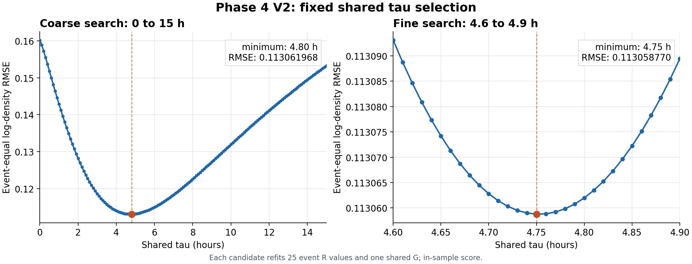

# Phase 4 V2：固定共同 tau 的密度基線報告

狀態：[done: descriptive]。25 場事件共用固定 $\tau=4.75$ h；每場重新擬合一個 $R_k$，全體共用 $G=0.0006898286354\ \mathrm{nT}^{-1}$。事件等權對數密度 RMSE 為 0.113058769603，輸出 214,907 筆分鐘資料。這是同一批資料上的選模與回溯擬合，尚無留出事件的測試結果。

## 決定與版本邊界

V2 直接讀凍結的 Phase 2／3 SQLite，使用本目錄的程式與衍生 SQLite。V1 與 V2 平行保存；V2 不讀 V1 的程式、快照、$R_k$、逐場 $\tau_k$ 或 D-model 輸出。V1 的自由 $\tau_k$ 結果是獨立的歷史版本，不能把它的參數填進 V2。

```text
Phase 2 SME、相位與配對樣本 + Phase 3 L2／quiet 密度
  -> V2 逐候選 tau 計算 SME 響應與相位平均
  -> 每個 tau 重新擬合 25 個 R_k 和共同 G
  -> 粗掃、細掃選定共同 tau
  -> V2 逐分鐘密度、事件統計、固定 tau 的 R 表
```

## 資料與篩選

| 來源 | 讀取內容 | 用途 |
| --- | --- | --- |
| `phases/phase2/data/sqlite/swarm_a_phase2_sme_p2_6_final.sqlite` | `geomag_1min_v2.sme_nt`、`storm_minute_feature_v5.u_rel_rad`、`storm_density_1min_v5.paired_sample_count` | 連續 1 分鐘 SME、中心軌道相位窗口、30 秒原生配對權重 |
| `phases/phase3/data/sqlite/swarm_a_phase3_prediction_tau465_exploratory.sqlite` | `phase3_prediction_minute` 的 L2 與 quiet NRLMSIS 相位平均密度、`phase3_25storm_overview` 的事件順序與候選 $R$ | 25 場的同分鐘密度目標與正值檢查；候選 $R$ 不進 V2 擬合公式 |

Phase 3 SQLite 的檔名帶有 `tau465`，但 V2 只讀其中的 L2 密度與 quiet 密度；不讀其 4.65 h 響應、預測值或擬合參數。V2 用 Phase 2 的連續 SME 對每個候選 $\tau$ 重新濾波。相位平均由 Phase 2 的 `u_rel_rad` 與 `paired_sample_count` 重新計算，並逐筆核對 Phase 3 的 `{storm_id, time_us}`。

每個分鐘錨點的相位窗口是中心 $u\pm\pi$。窗口須完整，且原生配對樣本覆蓋率至少 80%；未達門檻的分鐘不參與擬合。事件分鐘鍵須連續；SME 在最後事件之前不得有內部缺口。L2 與 quiet 密度須為有限正值。V2 不補值、不跨缺口內插。

最後共有 25 場、214,907 筆有效分鐘錨點，UTC 範圍為 2023-08-03T05:50:00Z 至 2026-04-22T07:12:00Z。這是所有事件的最早與最晚有效分鐘，並非宣稱中間每分鐘都有事件資料。`time_us` 是沿用上游的 UTC 分鐘錨點，例如 `1691041800000000` 對應 2023-08-03T05:50:00Z。

## 模型與估計量

對候選共同時間常數 $\tau$，先以 1 分鐘 SME 序列計算濾波值 $F_t(\tau)$。令 $a=\exp[-1/(60\tau)]$，其中 $\tau$ 以小時計；$\tau>0$ 時，$F_t=(1-a)\,\mathrm{SME}_t+aF_{t-1}$，初值為第一筆 SME。$\tau=0$ 時直接使用原 SME。從濾波值扣除 65 nT 參考值，再依每分鐘原生配對樣本數加權，取中心相位窗口平均，得到 $H_{k,t}(\tau)$，單位為 nT。

令 $k$ 為事件、$t$ 為其有效分鐘，$\rho^{L2}_{k,t}$ 為 Phase 3 保存的 L2 相位平均密度，$\rho^{q}_{k,t}$ 為 quiet NRLMSIS 相位平均密度。V2 的密度與擬合目標為：

$$
\widehat\rho_{k,t}=\rho^{q}_{k,t}R_k\exp\!\left(GH_{k,t}(\tau)\right),\qquad
y_{k,t}=\log\frac{\rho^{L2}_{k,t}}{\rho^{q}_{k,t}}.
$$

每個候選 $\tau$ 都重新求 $0<R_k<2$ 與共同 $G>0$，最小化 25 場等權的對數密度均方誤差：

$$
L(\tau)=\frac{1}{25}\sum_{k=1}^{25}\frac{1}{n_k}
\sum_{t=1}^{n_k}\left[y_{k,t}-\log R_k-GH_{k,t}(\tau)\right]^2,
\qquad \mathrm{RMSE}_{\mathrm{event}}=\sqrt{L(\tau)}.
$$

$n_k$ 是事件 $k$ 的有效分鐘數。先固定 $G$ 更新各場 $\log R_k$，再固定 $R_k$ 更新共同 $G$，直到相對變化收斂；初始 $G=0.0007\ \mathrm{nT}^{-1}$，不取自 V1。等事件權重使每場先各算一個 MSE，再平均；它不同於把 214,907 筆分鐘直接混合計算的 RMSE。

## tau 搜尋與選擇

| 步驟 | 候選 | 每個候選的處理 | 最低事件等權 RMSE |
| --- | --- | --- | ---: |
| 粗掃 | 0–15 h，每 0.1 h，共 151 格 | 重算 $H_{k,t}(\tau)$、25 個 $R_k$ 與 $G$ | 4.8 h：0.113061968254 |
| 細掃 | 4.6–4.9 h，每 0.01 h，共 31 格 | 從 SME 重算，不內插粗掃結果 | 4.75 h：0.113058769603 |



圖中每個點都重新擬合 25 個 $R_k$ 與共同 $G$；橘點是各掃描的最低格點。左右圖的縱軸範圍不同，右圖放大後才能看出 4.75 h 附近的微小差距。這是資料內分數，不能解讀為留出事件的表現。

| $\tau$ (h) | $G$ (1/nT) | 事件等權對數 RMSE |
| ---: | ---: | ---: |
| 4.65 | 0.000687247569 | 0.113074188256 |
| 4.70 | 0.000688547322 | 0.113062791986 |
| 4.74 | 0.000689573833 | 0.113058991523 |
| **4.75** | **0.000689828635** | **0.113058769603** |
| 4.76 | 0.000690082712 | 0.113058836521 |
| 4.80 | 0.000691091811 | 0.113061968254 |

4.7 h 與 4.8 h 的分數和粗掃一致。4.75 h 比 4.65 h 的同一 V2 擬合程序低約 0.00001542；比相鄰的 4.76 h 只低約 0.000000067。4.75 h 是此格點、此損失函數與這 25 場資料內的最佳候選；不能把小數第二位解讀為已精確測得的物理記憶時間。

## 固定 tau 後的每場結果

選定 $\tau=4.75$ h 後再次從上游重算 $H_{k,t}$、$R_k$ 與 $G$，並逐分鐘產生 $\widehat\rho_{k,t}$。`R_k` 欄取自 `phase4_v2_tau_fixed_r_v1.r_k_tau_fixed`；事件 RMSE 取自 `phase4_v2_events.rmse_log_density`。表中顯示值經四捨五入，資料庫保留完整精度。

| 事件 `storm_id` | 有效分鐘 | $R_k$ | 事件對數 RMSE |
| --- | ---: | ---: | ---: |
| S20230805T0546 | 8,677 | 0.934250 | 0.070478 |
| S20231021T0728 | 8,671 | 1.269720 | 0.070211 |
| S20231105T1654 | 8,669 | 1.449175 | 0.125772 |
| S20231201T1330 | 8,667 | 1.181759 | 0.171822 |
| S20240303T1800 | 8,659 | 1.053597 | 0.116121 |
| S20240324T1621 | 8,657 | 0.901886 | 0.087681 |
| S20240419T1921 | 8,654 | 0.855970 | 0.048969 |
| S20240511T0214 | 8,653 | 0.626500 | 0.204727 |
| S20240628T1206 | 8,530 | 0.868428 | 0.062670 |
| S20240804T1704 | 8,646 | 0.694002 | 0.072393 |
| S20240812T1652 | 8,644 | 0.962438 | 0.086812 |
| S20240917T0424 | 8,483 | 0.704249 | 0.074453 |
| S20241010T2314 | 8,634 | 0.628432 | 0.069148 |
| S20241109T1237 | 8,628 | 0.784150 | 0.080748 |
| S20250101T1640 | 8,619 | 0.941575 | 0.075137 |
| S20250416T1743 | 8,601 | 0.908366 | 0.076244 |
| S20250517T0516 | 8,597 | 0.936302 | 0.048292 |
| S20250601T1030 | 8,320 | 0.792415 | 0.080011 |
| S20250613T2015 | 8,505 | 0.839031 | 0.071404 |
| S20250930T0759 | 8,583 | 0.964469 | 0.162484 |
| S20251112T0359 | 8,577 | 1.044574 | 0.087959 |
| S20260120T1152 | 8,566 | 0.780237 | 0.212566 |
| S20260321T0139 | 8,557 | 0.963090 | 0.215399 |
| S20260402T0841 | 8,556 | 1.030987 | 0.063379 |
| S20260418T0754 | 8,554 | 0.762441 | 0.101289 |

$R_k$ 範圍為 0.626500–1.449175，事件 RMSE 範圍為 0.048292–0.215399。S20260321T0139、S20260120T1152、S20240511T0214 的事件誤差最高；共同 tau 與單一 $G$ 並未消除所有事件差異。$R_k$ 由同場 L2 密度擬合，不能當作事前已知的物理量或預報參數。

## SQLite 輸出與核對

三個衍生庫都在 `phases/phase4-v2/data/sqlite/`：

| SQLite | Table | 主鍵與內容 |
| --- | --- | --- |
| `shared_tau_grid_v1.sqlite` | `shared_tau_grid` | `tau_hours`；151 個粗掃候選的 $G$ 與事件等權 RMSE |
| `shared_tau_fine_v1.sqlite` | `shared_tau_fine` | `tau_hours`；31 個細掃候選的 $G$ 與事件等權 RMSE |
| `swarm_a_phase4_v2_shared_tau.sqlite` | `phase4_v2_minute` | `{storm_id, time_us}`；214,907 筆 $H$、L2／quiet／V2 密度、對數殘差、參數 |
| 同上 | `phase4_v2_events` | `storm_id`；25 場的 $R_k$、有效分鐘數、事件 RMSE |
| 同上 | `phase4_v2_tau_fixed_r_v1` | `storm_id`；25 個明確命名的 `r_k_tau_fixed` |
| 同上 | `phase4_v2_metadata` | 選模方式、來源、回溯狀態及 `tau_fixed_hours=4.75` |

`phase4_v2_minute` 和 `phase4_v2_events` 的 `tau_hours` 都是同一個 V2 固定值 4.75 h，供既有 V2 讀取端使用；沒有 V1 的逐場 $\tau_k$。獨立的 $R_k$ 表不重複儲存 tau。各衍生表保留 `algorithm_version`；原始與凍結上游表保持唯讀。

核對結果：粗掃 151 筆、細掃 31 筆、事件 25 筆、固定 tau 的 $R_k$ 25 筆、分鐘 214,907 筆；事件與分鐘參數一致，沒有孤立的分鐘事件鍵。逐分鐘殘差回算的事件等權 RMSE 與細掃最佳分數一致。V2 SQLite 的 `PRAGMA integrity_check=ok`；分鐘及事件的 tau 最小值、最大值都是 4.75 h。用直接讀 Phase 2／3 的獨立程式重建後，214,907 個分鐘鍵與相位響應一致，重建前後的對數殘差最大絕對差為 $2.6\times10^{-13}$，屬浮點尾數差異。

## 重算入口與研究界線

依序執行 [粗掃](../code/prep_shared_tau_grid.py)、[細掃](../code/prep_shared_tau_fine.py)、[逐分鐘密度](../code/prep_phase4_v2_density.py)、[固定 tau 的 R 表](../code/prep_tau_fixed_r.py)；[產圖程式](../code/prep_shared_tau_figure.py)讀取粗、細掃 SQLite 重畫上圖。資料流詳見[資料血緣](../docs/lineage/phase4_v2_shared_tau.md)。程式遇到既有衍生輸出會拒絕覆寫；重算須先在隔離的工作目錄準備相同的凍結上游資料。SQLite 依專案規則不提交 Git，報告、圖與程式有版本紀錄。

本報告只支持「在既定 25 場、既定密度產品與事件等權損失下，固定共同 tau 的描述性擬合結果」。25 場全部同時用於 tau 選擇、$R_k$ 與 $G$ 擬合，沒有 20/5 留出驗證。模型沒有處理未見事件、因果辨識、物理時間常數校準或無 L2 的預報。Phase 5 等既有下游結果須按其實際來源版本辨識，不能因本報告改標為 V2。
