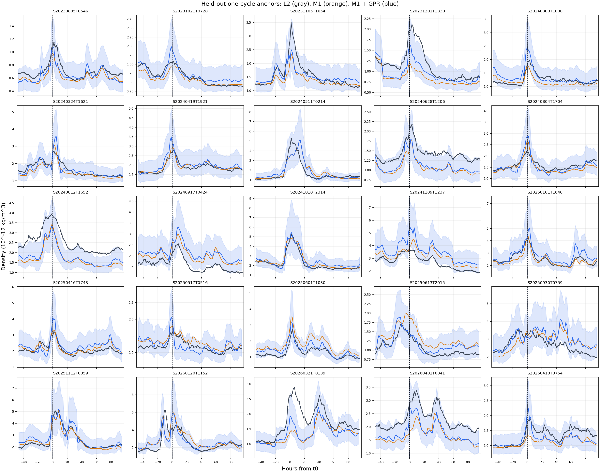

# Swarm-A Phase 4 一圈 GPR 留一場結果

## 結果與適用範圍

狀態：[working]。25 場留一場磁暴驗證與逐場圖已交付；使用者看圖後判斷目前的四特徵 GPR 效果不理想，本版不作為已通過的殘差修正。[資料血緣](../docs/lineage/phase_4_gpr_loso.md)記錄來源與輸出鍵。這是取得每場暴前 L2 平靜倍率後的**條件式離線回放**，不是即時密度預報。

| 留出場指標 | M1 | M1+GPR |
| --- | ---: | ---: |
| 25 場等權平均對數密度 RMSE | 0.18860 | 0.18194 |
| 25 場等權平均對數密度 MAE | 0.16619 | 0.15596 |
| RMSE 較低的場數 | 11／25 | 14／25 |
| 25 場等權平均 95% 區間涵蓋率 | 無 | 90.0% |

RMSE 的等權平均相差 0.00666；25 場中有 11 場修正後反而較差。這是同一批事件的描述性比較，沒有提供獨立事件母體的顯著性結論。涵蓋率的名目值是 95%；8 場低於 90%，最低一場為 35.9%。訓練列平均涵蓋率為 95.2%。留出場的區間沒有充分涵蓋全部事件，不能因訓練涵蓋率接近 95% 就宣稱不確定性已校準。

## 資料與主流程

25 場事件沿用 Phase 2 P2.6 的 $t_0$ 相位與事件範圍；$t_0$ 是 raw SYM-H 最低點，不是 onset。密度使用 Phase 3 的 L2／平靜 MSIS 相位資料；逐場 $R_k$ 讀 Phase 3 最終預測 SQLite 的 `phase3_25storm_overview.r_candidate`。這個欄名保留來源名稱，但 $R_k$ 是 Phase 3 已採用的最終操作倍率。Phase 2/3 來源唯讀。

每場用 $u\pm\pi$ 的一圈中心相位平均，以原生 L2 配對樣本數加權；從完整且覆蓋率至少 80% 的中心，選最接近 $u=2\pi j$ 的有效列，容許距離 $0.01$ 圈。25 場共 2,295 列，每場 90–92 列。這些列是相位窗口的代表中心，非單點瞬時值。[一圈代表錨點圖](phase_4_one_cycle_anchor_qc.md)記錄抽樣形狀；兩圈候選的[對照紀錄](phase_4_two_cycle_window_qc.md)不進正式 GPR。

```text
Phase 2 P2.6：t0、連續 u、SME、SYM-H、配對樣本數
  + Phase 3：一圈 L2／平靜 MSIS、逐場 R_k
  -> 每 2pi 一個有效一圈錨點
  -> 留一場：其餘 24 場重估 tau、G，訓練標準化與 GPR
  -> 留出場：M1、M1+GPR、95% 區間及圖
```

## 模型與驗證

令 $\bar\rho_{\mathrm{L2}}$ 和 $\bar\rho_{\mathrm{q}}$ 是同一個一圈窗口的 L2 與平靜 MSIS 平均密度，$R_k$ 是第 $k$ 場的固定平靜倍率，$H_{\tau}$ 是先對連續 SME 作一階濾波、再作一圈平均的響應。每折只用 24 場訓練列，選 $0$–$10$ h、間距 $0.05$ h 的 $\tau$，並以過原點最小平方估共同 $G$：

$$
z=\ln\!\left(\frac{\bar\rho_{\mathrm{L2}}}{\bar\rho_{\mathrm{q}}R_k}\right),
\quad
G_\tau=\frac{\sum_{\mathrm{train}}H_\tau z}{\sum_{\mathrm{train}}H_\tau^2},
\quad
\rho_{\mathrm{phys}}=\bar\rho_{\mathrm{q}}R_k\exp(G_{\tau^*}H_{\tau^*}).
$$

選使訓練組 $z-G_\tau H_\tau$ 均方誤差最低的 $\tau^*$。25 折的 $\tau^*$ 介於 4.55–5.05 h；$G^*$ 介於 $6.786\times10^{-4}$ 至 $7.436\times10^{-4}\,\mathrm{nT}^{-1}$。各場 $R_k$ 固定來自自己的 Phase 3 低活動窗口，不跨場擬合；這個暴前 L2 校準仍須在測試場取得。該低活動段不保證早於真正 SME onset。

GPR 目標是 $y=\ln(\bar\rho_{\mathrm{L2}}/\rho_{\mathrm{phys}})$，四欄特徵依序為一圈平均的 $H_{\tau^*}$、$H_{24h}$、SME、SYM-H。$H_{24h}$ 從連續 SME 另算；不從 Phase 3 的 0–10 h 粗格點表讀取。`StandardScaler` 每折只在訓練列擬合，再套到留出場。零均值 `GaussianProcessRegressor` 使用 `ConstantKernel × RBF(ARD) + WhiteKernel`、`normalize_y=False`、`n_restarts_optimizer=5`、`random_state=20261028`、`alpha=1e-10` 與 scikit-learn 預設 L-BFGS-B。四個標準化座標的 RBF 長度尺度範圍均為 0.01–1000，訊號變異範圍為 $10^{-3}$–$10^3$，WhiteKernel 雜訊變異範圍為 $10^{-5}$–1。25 折 `ConvergenceWarning` 總數為 0；這不保證找到全域最佳超參數。

密度圖中的 GPR 曲線是 $\rho_{\mathrm{phys}}e^{\mu_{\mathrm{gp}}}$；藍色 95% 帶由 $\mu_{\mathrm{gp}}\pm1.96\sigma_{\mathrm{gp}}$ 指數轉換。`WhiteKernel` 使 `predict(return_std=True)` 的標準差包含觀測雜訊，因此這是留出 L2 觀測值的條件式區間。每場 RMSE、MAE 先在對數密度上計算，再對 25 場等權平均；涵蓋率是每場 L2 落在其 95% 區間的列數比例，再對 25 場等權平均。區間以已擬合的 $\tau,G,R_k$ 與核參數為條件，沒有納入這些估計量的不確定性。中心相位窗口與 Phase 3 置中 F10.7A 會使用錨點後的資料，因此僅適用離線回放。

| ARD／核參數 | 25 折中位數 | 最小–最大 |
| --- | ---: | ---: |
| $H_{\tau^*}$ 長度尺度 | 0.934 | 0.810–1.151 |
| $H_{24h}$ 長度尺度 | 0.594 | 0.386–0.713 |
| SME 長度尺度 | 3.530 | 3.129–4.219 |
| SYM-H 長度尺度 | 0.623 | 0.578–0.691 |
| 訊號變異 | 0.0388 | 0.0321–0.0421 |
| 雜訊變異 | 0.0259 | 0.0233–0.0265 |

長度尺度都未碰 0.01 或 1000 的界限。較短的尺度只代表模型對標準化特徵變化較敏感；四欄彼此相關，不能直接解讀為物理因果排名。[每折核參數原值](../data/analysis/gpr_hyperparams.csv)包含對數邊際概似、重啟次數與警告數。

## 看圖後的失效診斷

本版主要問題是**逐場系統偏差與峰形沒有穩定改善**。把同一留出場的對數誤差定為 $e=\ln(\bar\rho_{\mathrm{L2}}/\widehat\rho)$，在 $t_0-12$ 至 $t_0+24$ h 的 25 場局部窗口中，GPR 的 RMSE 只在 12 場低於 M1。以各曲線在此窗口的最大值比較，GPR 的峰高對數誤差在 10 場較低、15 場較高；峰值時間絕對誤差在 6 場較低、9 場較高、10 場相同。這些補充指標直接從本機 `phase4_gpr_prediction` 與 Phase 3 的 `t0_time_us` 計算；峰值時間是離散一圈錨點上的最大值位置，不是連續曲線極值。

| 留出場 | M1 平均 $e$ | GPR 平均 $e$ | GPR 95% 涵蓋率 | 圖上的問題 |
| --- | ---: | ---: | ---: | --- |
| [S20240812T1652](../figures/gpr_loso/S20240812T1652_m1_gpr_l2.png) | +0.398 | +0.349 | 35.9% | 全段偏低；GPR 的正向修正不足以拉回 L2。 |
| [S20240917T0424](../figures/gpr_loso/S20240917T0424_m1_gpr_l2.png) | -0.226 | -0.288 | 56.0% | M1 已偏高，GPR 平均再往上修。 |
| [S20241109T1237](../figures/gpr_loso/S20241109T1237_m1_gpr_l2.png) | -0.152 | -0.263 | 73.9% | M1 已偏高，GPR 在峰附近推得更高。 |

`S20240812T1652` 的暴前 $R_k$ 選段距第一個強 SYM-H 低點約 74.9 天，可能影響背景倍率；但 `S20240917T0424` 的選段只距約 1.4 天，仍有反方向修正，不能把全部失效歸因於選段距離。四特徵未含明確的加熱進程或局地時間；這是可能的模型限制，尚未用對照實驗證實。下一步應先分開檢查逐場背景偏差與峰值時序，再決定是否改動特徵或物理基線；只調核參數沒有足夠證據會解決這兩種問題。

## 圖與逐場檢查

灰線是 L2，橘線是逐折重估的 M1，藍線是 M1+GPR，淺藍帶是條件式 95% 區間；虛線為 $t_0$。每張逐場圖同時提供全事件窗與 $t_0-12$ 至 $t_0+24$ h 局部圖。繪圖密度標示為 $10^{-12}\,\mathrm{kg/m^3}$。



下表的每個場號連到其全窗及局部圖；指標原值見[逐場 CSV](../data/analysis/phase4_loso_event_metrics.csv)。

| 留出場／逐場圖 | 錨點 | $\tau^*$ (h) | M1 RMSE | GPR RMSE | 95% 涵蓋率 |
| --- | ---: | ---: | ---: | ---: | ---: |
| [S20230805T0546](../figures/gpr_loso/S20230805T0546_m1_gpr_l2.png) | 92 | 4.60 | 0.137 | 0.131 | 98.9% |
| [S20231021T0728](../figures/gpr_loso/S20231021T0728_m1_gpr_l2.png) | 92 | 4.65 | 0.087 | 0.103 | 100.0% |
| [S20231105T1654](../figures/gpr_loso/S20231105T1654_m1_gpr_l2.png) | 92 | 4.65 | 0.159 | 0.140 | 97.8% |
| [S20231201T1330](../figures/gpr_loso/S20231201T1330_m1_gpr_l2.png) | 92 | 4.65 | 0.315 | 0.215 | 87.0% |
| [S20240303T1800](../figures/gpr_loso/S20240303T1800_m1_gpr_l2.png) | 92 | 4.65 | 0.135 | 0.142 | 94.6% |
| [S20240324T1621](../figures/gpr_loso/S20240324T1621_m1_gpr_l2.png) | 92 | 4.60 | 0.126 | 0.113 | 97.8% |
| [S20240419T1921](../figures/gpr_loso/S20240419T1921_m1_gpr_l2.png) | 92 | 4.65 | 0.054 | 0.082 | 100.0% |
| [S20240511T0214](../figures/gpr_loso/S20240511T0214_m1_gpr_l2.png) | 92 | 5.05 | 0.219 | 0.201 | 96.7% |
| [S20240628T1206](../figures/gpr_loso/S20240628T1206_m1_gpr_l2.png) | 91 | 4.55 | 0.300 | 0.263 | 80.2% |
| [S20240804T1704](../figures/gpr_loso/S20240804T1704_m1_gpr_l2.png) | 92 | 4.60 | 0.099 | 0.106 | 100.0% |
| [S20240812T1652](../figures/gpr_loso/S20240812T1652_m1_gpr_l2.png) | 92 | 4.55 | 0.407 | 0.358 | 35.9% |
| [S20240917T0424](../figures/gpr_loso/S20240917T0424_m1_gpr_l2.png) | 91 | 4.75 | 0.238 | 0.300 | 56.0% |
| [S20241010T2314](../figures/gpr_loso/S20241010T2314_m1_gpr_l2.png) | 92 | 4.75 | 0.101 | 0.141 | 97.8% |
| [S20241109T1237](../figures/gpr_loso/S20241109T1237_m1_gpr_l2.png) | 92 | 4.75 | 0.172 | 0.274 | 73.9% |
| [S20250101T1640](../figures/gpr_loso/S20250101T1640_m1_gpr_l2.png) | 92 | 4.65 | 0.090 | 0.130 | 98.9% |
| [S20250416T1743](../figures/gpr_loso/S20250416T1743_m1_gpr_l2.png) | 92 | 4.65 | 0.085 | 0.151 | 98.9% |
| [S20250517T0516](../figures/gpr_loso/S20250517T0516_m1_gpr_l2.png) | 92 | 4.70 | 0.115 | 0.146 | 98.9% |
| [S20250601T1030](../figures/gpr_loso/S20250601T1030_m1_gpr_l2.png) | 90 | 4.85 | 0.308 | 0.172 | 98.9% |
| [S20250613T2015](../figures/gpr_loso/S20250613T2015_m1_gpr_l2.png) | 91 | 4.75 | 0.233 | 0.146 | 100.0% |
| [S20250930T0759](../figures/gpr_loso/S20250930T0759_m1_gpr_l2.png) | 92 | 4.75 | 0.173 | 0.172 | 94.6% |
| [S20251112T0359](../figures/gpr_loso/S20251112T0359_m1_gpr_l2.png) | 92 | 4.65 | 0.090 | 0.125 | 98.9% |
| [S20260120T1152](../figures/gpr_loso/S20260120T1152_m1_gpr_l2.png) | 92 | 4.65 | 0.241 | 0.230 | 88.0% |
| [S20260321T0139](../figures/gpr_loso/S20260321T0139_m1_gpr_l2.png) | 92 | 4.65 | 0.325 | 0.285 | 77.2% |
| [S20260402T0841](../figures/gpr_loso/S20260402T0841_m1_gpr_l2.png) | 92 | 4.60 | 0.319 | 0.269 | 80.4% |
| [S20260418T0754](../figures/gpr_loso/S20260418T0754_m1_gpr_l2.png) | 92 | 4.60 | 0.187 | 0.155 | 98.9% |

## 交付與尚未決定

- 本機[逐錨點留出場預測 SQLite](../data/sqlite/swarm_a_phase4_gpr_loso_v1.sqlite) 的 `phase4_gpr_prediction` 以 `{storm_id,time_us}` 為鍵，含 2,295 列、25 場，`algorithm_version` 全為 `phase4_gpr_loso_v1`；`PRAGMA integrity_check=ok`。此檔依專案 `.gitignore` 不上傳 GitHub。
- [逐場誤差與涵蓋率](../data/analysis/phase4_loso_event_metrics.csv)、[核參數](../data/analysis/gpr_hyperparams.csv)、[逐折標準化參數](../data/analysis/scaler_params.json)與[25 個正式折次 checkpoint](../data/analysis/folds_default_optimizer/)保存並上傳。`folds/` 的單折試跑有最佳化迭代上限，已排除於正式統計與 GitHub 交付。
- [計算入口](../code/prep_gpr_loso.py)以專案根目錄為工作目錄、依 `requirements.txt` 的相依範圍執行；本次 scikit-learn 為 1.7.2。重新計算仍須本機備有唯讀 Phase 2/3 SQLite。若已有正式輸出，入口會拒絕覆寫；重跑前須另行保留或移走現有 Phase 4 輸出。25 折完整訓練耗時 13,204 秒；有相同設定的 checkpoint 時可讀取折次結果，但仍會重新準備上游相位輸入。
- 使用者已看圖，判斷目前四特徵 GPR 效果不理想。平均 RMSE 下降不等於模型全面較好；本版不作為已通過的修正模型。沒有測試真正 onset 前就可取得的輸入，也沒有測試新年份或新任務分布。
