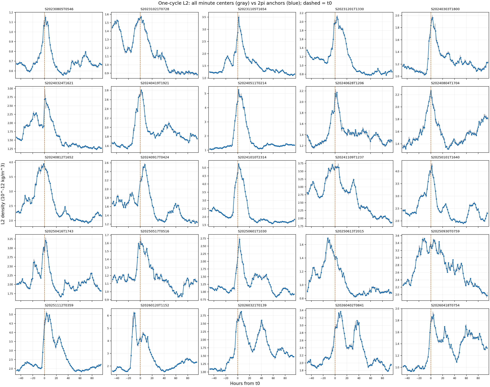

# Swarm-A Phase 4 一圈代表錨點目視檢查

## 狀態與決定

狀態：[done]。2026-10-28 使用者檢視[一圈／兩圈對照](phase_4_two_cycle_window_qc.md)後，選擇 Phase 3 的 $u\pm\pi$ 一圈窗口作 Phase 4 正式資料單位。本報告保留資料單位的目視決定；後續的[25 場 GPR 留一場結果](phase_4_gpr_loso_report.md)已產生，模型判讀仍待看圖。

## 資料與方法

以 Phase 2/3 的 $t_0$ 為 $u=0$，保留既有事件前後範圍。灰線是 Phase 3 一圈 L2 的全部有效分鐘中心錨點，共 214,907 筆。藍點是最接近 $u=2\pi j$ 的有效錨點，距格點最多 $0.01$ 圈，共 2,295 筆。藍點的 L2 值與 Phase 3 一圈相位平均逐點相同；藍線只連接選中的點，線段之間沒有另外計算資料。橘色虛線是 $t_0$。密度圖示單位為 $10^{-12}\,\mathrm{kg/m^3}$。

每張逐場圖有完整事件窗及 $t_0-12$ 至 $t_0+24$ 小時的局部圖。[錨點 QC](../data/analysis/phase4_one_cycle_anchor_qc.csv)記錄逐場數量與相對 $t_0$ 的時間範圍。

## 逐場圖

| 年份 | 磁暴 |
| --- | --- |
| 2023 | [08-05](../figures/one_cycle_anchors/S20230805T0546_one_cycle_anchors.png) · [10-21](../figures/one_cycle_anchors/S20231021T0728_one_cycle_anchors.png) · [11-05](../figures/one_cycle_anchors/S20231105T1654_one_cycle_anchors.png) · [12-01](../figures/one_cycle_anchors/S20231201T1330_one_cycle_anchors.png) |
| 2024 | [03-03](../figures/one_cycle_anchors/S20240303T1800_one_cycle_anchors.png) · [03-24](../figures/one_cycle_anchors/S20240324T1621_one_cycle_anchors.png) · [04-19](../figures/one_cycle_anchors/S20240419T1921_one_cycle_anchors.png) · [05-11](../figures/one_cycle_anchors/S20240511T0214_one_cycle_anchors.png) · [06-28](../figures/one_cycle_anchors/S20240628T1206_one_cycle_anchors.png) · [08-04](../figures/one_cycle_anchors/S20240804T1704_one_cycle_anchors.png) · [08-12](../figures/one_cycle_anchors/S20240812T1652_one_cycle_anchors.png) · [09-17](../figures/one_cycle_anchors/S20240917T0424_one_cycle_anchors.png) · [10-10](../figures/one_cycle_anchors/S20241010T2314_one_cycle_anchors.png) · [11-09](../figures/one_cycle_anchors/S20241109T1237_one_cycle_anchors.png) |
| 2025 | [01-01](../figures/one_cycle_anchors/S20250101T1640_one_cycle_anchors.png) · [04-16](../figures/one_cycle_anchors/S20250416T1743_one_cycle_anchors.png) · [05-17](../figures/one_cycle_anchors/S20250517T0516_one_cycle_anchors.png) · [06-01](../figures/one_cycle_anchors/S20250601T1030_one_cycle_anchors.png) · [06-13](../figures/one_cycle_anchors/S20250613T2015_one_cycle_anchors.png) · [09-30](../figures/one_cycle_anchors/S20250930T0759_one_cycle_anchors.png) · [11-12](../figures/one_cycle_anchors/S20251112T0359_one_cycle_anchors.png) |
| 2026 | [01-20](../figures/one_cycle_anchors/S20260120T1152_one_cycle_anchors.png) · [03-21](../figures/one_cycle_anchors/S20260321T0139_one_cycle_anchors.png) · [04-02](../figures/one_cycle_anchors/S20260402T0841_one_cycle_anchors.png) · [04-18](../figures/one_cycle_anchors/S20260418T0754_one_cycle_anchors.png) |

## 後續結果

2,295 筆代表錨點已用於正式 GPR 留一場驗證。逐場 L2、M1、M1+GPR 與條件式 95% 區間見[結果報告](phase_4_gpr_loso_report.md)；模型好壞仍由使用者看圖判斷。
