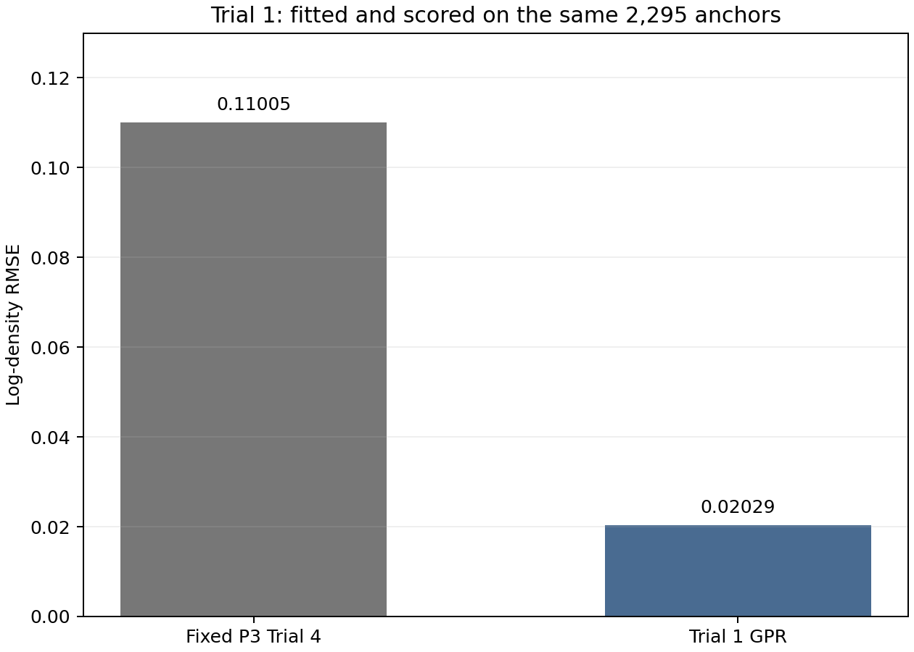
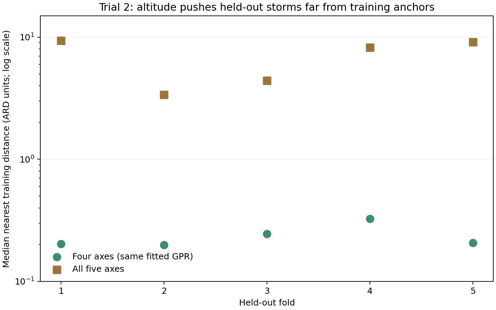
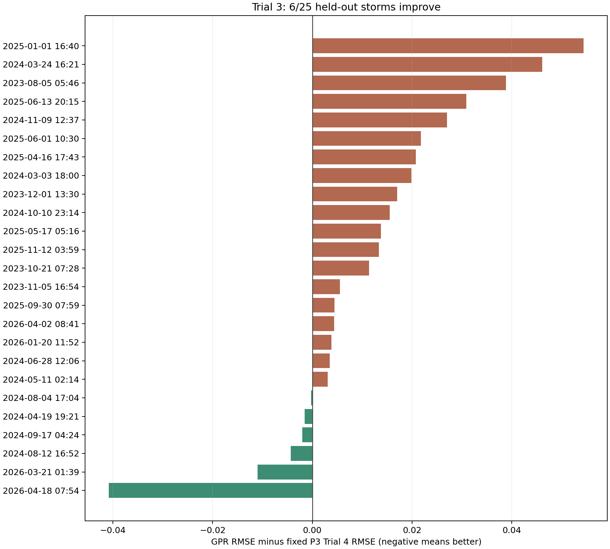
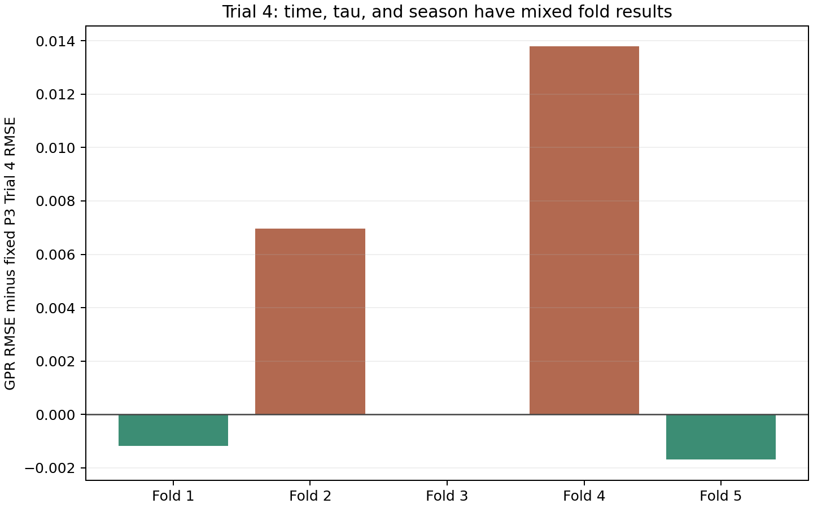
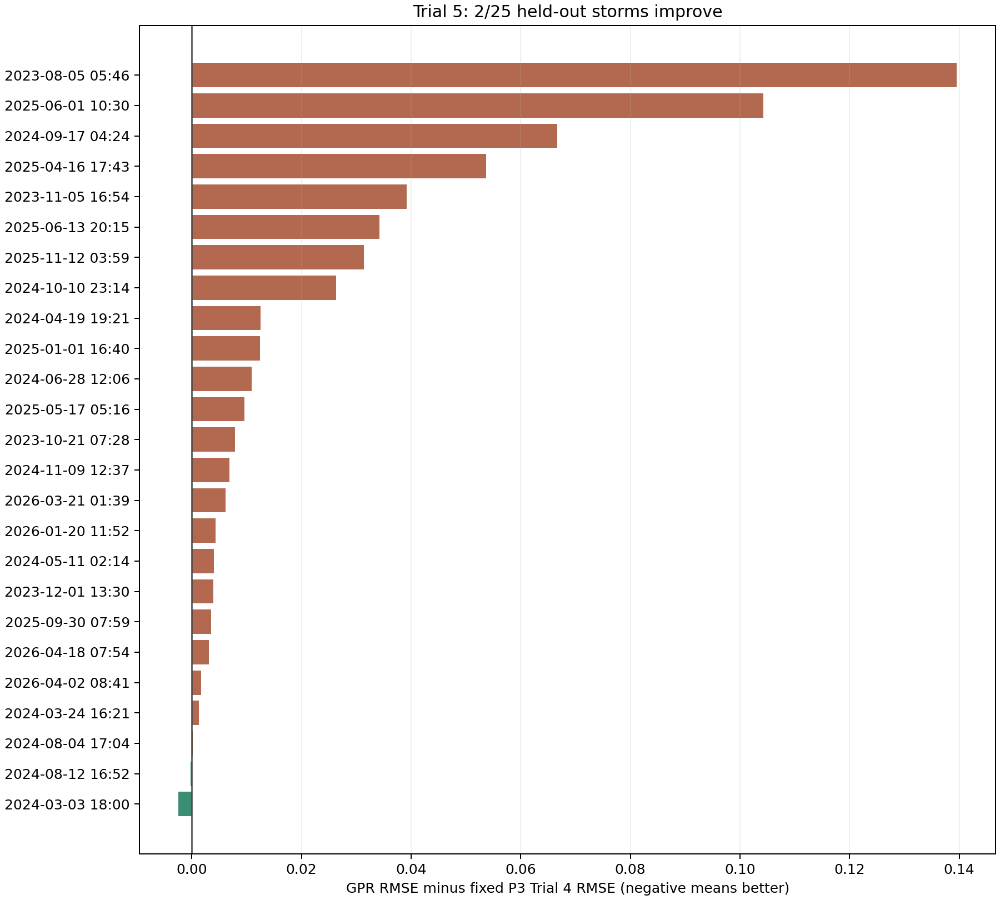
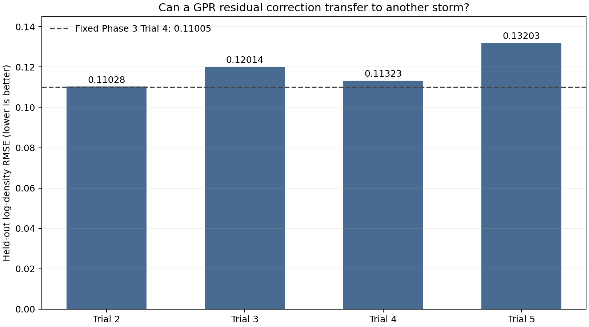
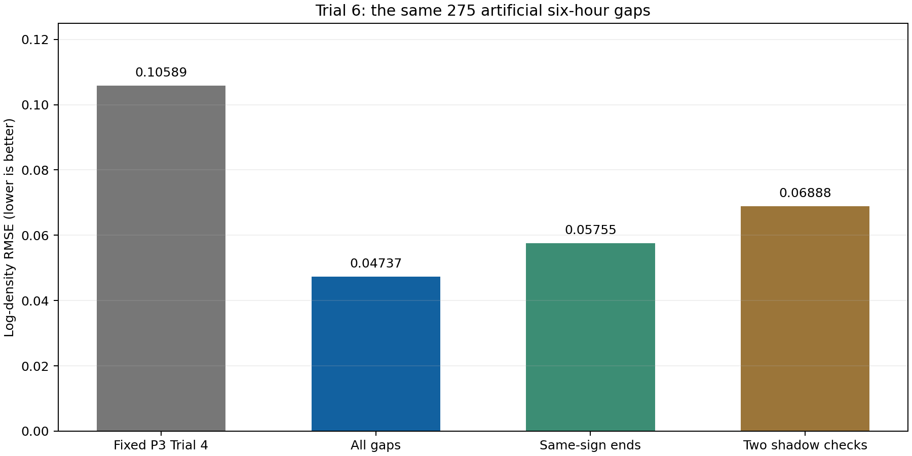
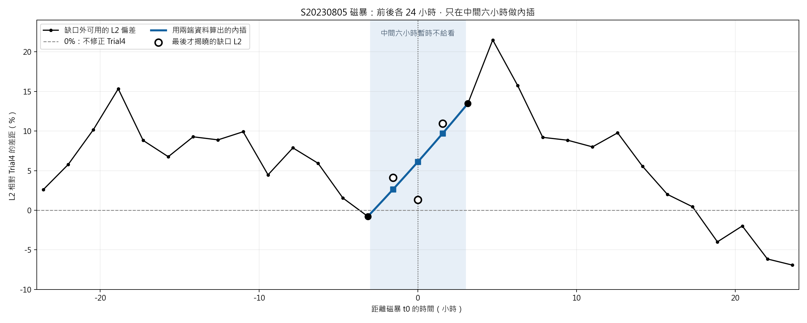
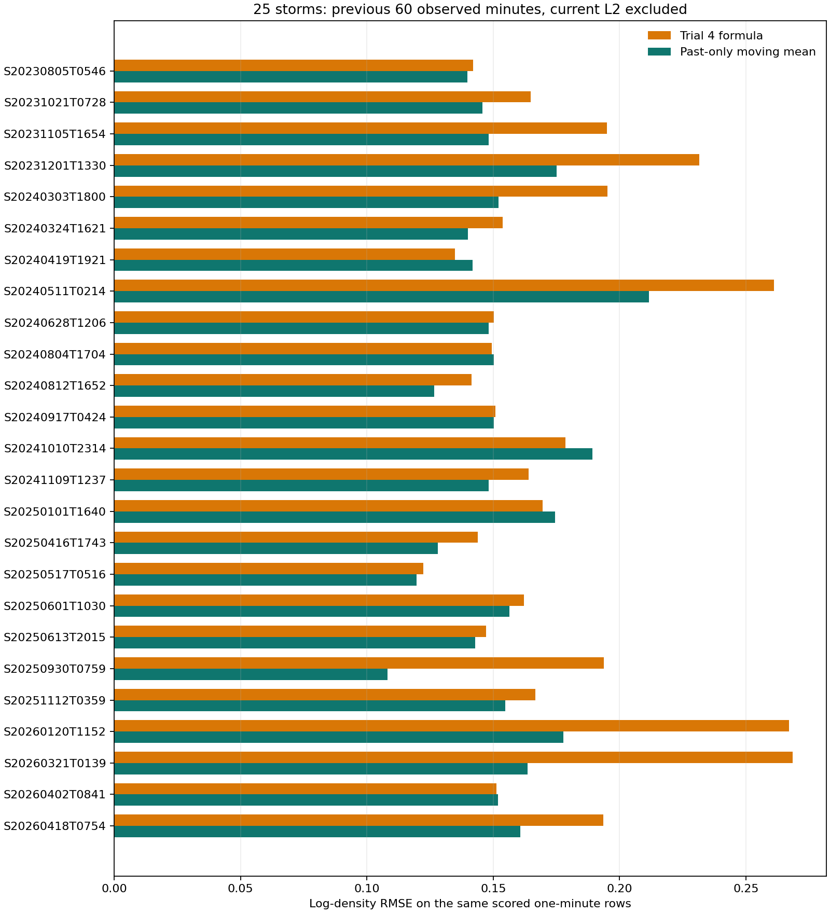

# Phase 4 實驗總報告：Trial1--Trial7

狀態：[done: descriptive]。Phase 4 做完了七個 Trial，目前還沒有找到可以直接用在所有磁暴上的密度修正方法。Trial1--Trial5 測試 GPR 能不能修正 Phase 3 Trial4 剩下的誤差；Trial6 測試有前後觀測時，能不能補中間六小時；Trial7 測試能不能用前一小時的觀測，逐分鐘修正下一個點。每一步都有結果，也都有限制。Phase4 Final 仍為 `[not created]`。

| 試驗 | 最簡單的問題 | 結果 |
| --- | --- | --- |
| Trial1 | GPR 能貼近已經看過的資料嗎？ | 能；但 0.02029 是在訓練資料上得到的分數 |
| Trial2--Trial5 | 學到的修正能不能用在另一場磁暴？ | 目前不行；四種做法都沒有勝過原本的 0.11005 |
| Trial6 | 同場六小時缺口前後有 L2，能補中間嗎？ | 平均可改善，但 275 段中 55 段補壞 |
| Trial7 | 只看過去 L2，能逐分鐘更新嗎？ | 20/25 場改善；仍需近期 L2，也非獨立預測 |

## 先看懂這份報告在比較什麼

先把 Phase 3 Trial4 想成一條**已經算好的密度曲線**。Phase 4 以這條曲線為起點，觀察它和 Swarm-A L2 密度資料還差多少。Trial4 的公式包含每場磁暴自己的背景倍率 $R_k$、反應時間 $\tau_k$，以及各場共用的 SME 增益 $G$。這些數字已經用本次 25 場的 L2 資料調好。Phase 4 不再改它們。

報告裡常見的字，意思如下：

| 用語 | 在這份報告的意思 |
| --- | --- |
| L2 | 本次拿來比較的 Swarm-A 密度資料；它是參考資料，不等於毫無誤差的真值 |
| 錨點 | 約每繞地球一圈取一個代表點；Trial1--Trial5 共用 2,295 個點 |
| 殘差 | 在同一時刻，L2 和 Trial4 曲線之間剩下的差距 |
| RMSE | 把所有點的誤差合成一個分數；同一種資料和計分方式下，越小越好 |
| GPR | 從已看過的例子找修正規律的統計方法；它本身不是新的物理公式 |
| 留出磁暴 | 訓練 GPR 時先不給它看這些磁暴的殘差，之後才用它們評分 |

Phase 3 Trial4 正式保存的是「以每分鐘為中心、取約一圈平均」的密度曲線。它在原報告中的資料內分數是 0.109953；下文 Trial1--Trial5 用每圈挑出的 2,295 個錨點計分，基線是 0.11005。兩個數字很接近，但取點和合併方式不同，不能當成兩次模型進步。

為了比較不同密度大小的時段，我們看的是「L2 相對 Trial4 高或低多少」。公式寫成

$$
e(t)=\ln\!\left(\frac{\rho_{\mathrm{L2}}(t)}{\rho_{\mathrm{T4}}(t)}\right).
$$

$e(t)>0$ 代表 L2 比 Trial4 高；$e(t)<0$ 代表 L2 比 Trial4 低。這只是兩份資料的差距，不能直接說其中一份一定是錯的。Phase 4 要問的是：**不改動 Trial4 公式時，還能不能把這段差距修得更小？**

七個 Trial 用的資料條件不同。Trial1 在看過的資料上評分；Trial2--Trial5 把整場磁暴留給 GPR 測試；Trial6 暫時藏起同一場磁暴中間六小時的資料；Trial7 改用一分鐘一點的資料。因此，**不能只按 RMSE 大小替七個 Trial 排名**，要先看它們各自在回答什麼問題。

## Trial1：GPR 可以貼住已見資料嗎？

第一步先看：**GPR 能不能貼近已經看過的誤差？** 這是最容易通過的一關。它通過了，才值得問能否用在別的磁暴。Trial1 從 25 場磁暴各取約每圈一點，共 2,295 點。GPR 要學的是 L2 與 Trial4 之間的差距，Trial4 原本的公式和參數保持不變。

我們給 GPR 五種資訊：`{H_tau_k, H_24h, SME, SYM-H, altitude}`。前兩項都和 SME 有關：`H_tau_k` 使用 Trial4 已選好的反應時間，`H_24h` 則固定用 24 小時。SME、SYM-H 描述磁活動；`altitude` 是衛星高度。這些資訊都對應同一圈的密度資料，不把不同時間的值硬湊在一起。高度來自 DNSAPOD 的實際軌道樣本；先算每分鐘平均，再配合該圈有效樣本數算出這一圈的代表高度。它不是拿軌道半長軸來代替高度。

GPR 看完這 2,295 點後，我們又用**同一批點**給它評分。原本 Trial4 的對數 RMSE 是 **0.11005**；加上 GPR 後是 **0.02029**。另一個誤差指標 MAE，也從 **0.07955** 降到 **0.01360**。這證明 GPR 很會貼合它剛看過的資料。它還沒有證明可以修好另一場磁暴。[Trial1 原始 25 場圖](../../phase4-trial1/figures/phase4_trial4_altitude_gpr_25storm.png)展示了曲線，但紅線貼近 L2 的原因包含「模型已看過這些資料」。

報告也算了 GPR 的 95% 區間：已見資料中有 98.39% 落在區間內。這個區間假設 Trial4 的參數已經固定，也是在同一批資料上檢查；不能直接解讀成對新磁暴有 95% 的可靠度。

圖中的兩根柱子都是用同一批 2,295 點算的。藍色柱子很低，代表「看過再修」的效果很好。它與後面「整場磁暴先藏起來」的分數不是同一種考試。

還有一個可疑之處：GPR 把高度的「可接受差距」調到設定範圍的最小值 **0.010**，計算也出現收斂警告。換句話說，兩個點的高度只要稍有不同，模型就可能不把它們當成相似資料。它也許是在記住每場磁暴附近的高度，而不是找到能跨磁暴使用的規律。Trial2 因此把整場磁暴藏起來測試。Trial1 也不能用來證明高度的物理效果，或把 Trial4 已用過的 SME 資訊當成新發現的物理公式。

## Trial2：同一套 GPR 能修另一場磁暴嗎？

Trial2 問的是：**GPR 沒看過某場磁暴的誤差，還能修好那一場嗎？** 資料和五個輸入都沿用 Trial1，避免同時更換太多條件。每次挑 20 場讓 GPR 學習，剩下 5 場完整藏起來測試。輪流做五次，25 場都會各當一次測試資料。把不同輸入換成可一起比較的數值尺度時，也只用當次的 20 場來決定，測試場不參與。

這次結果接近原地踏步。固定 Trial4 的對數 RMSE 是 **0.11005**，加上 GPR 後是 **0.11028**，還稍微變差。MAE 從 **0.07955** 變成 **0.07950**，差距太小，不能說模型真的進步。五次測試的 GPR 分數介於 0.08103 和 0.13581，沒有一致變好。Trial1 漂亮的 0.02029，在這裡沒有重現。[Trial2 原始 25 場圖](../../phase4-trial2/figures/phase4_trial4_groupcv20_5_25storm.png)顯示各場真正被留出時的結果。

我們接著查「為什麼 GPR 幾乎沒有修正」。關鍵在高度。模型學到：高度相差大約 **197--226 m**，兩個點就已經不太相像；可是測試場的點，和最接近的訓練點相比，高度通常差 **0.58--1.96 km**。這個差距遠超過模型願意相信的範圍。所以遇到新磁暴時，GPR 多半回到「修正量接近零」。Trial2 的分數緊貼原本的 Trial4，主要反映了它**幾乎沒有動手修**。

圖中每一欄代表一次測試。綠點暫時不把高度算進「相似程度」，棕色方塊把高度算進去；棕色方塊在五次測試中都遠高於綠點。縱軸為了顯示大小差異，用了對數刻度。兩組點來自**同一個已訓練的五特徵模型**；綠點只是重新量距離，不是重訓另一個模型。

Trial2 只測了「已固定 Trial4 之後，GPR 能否修正另一場的剩餘差距」。Trial4 自己的參數早已用全部 25 場 L2 調過，所以不能說整套方法已經通過未知磁暴測試。Trial2 也沒有證明高度對密度不重要。它發現的是：**這個 GPR 太在意高度，到了新磁暴幾乎不敢修。** 下一步自然要試：把高度拿掉會怎樣？

## Trial3：拿掉高度，模型會更能轉移嗎？

Trial2 的 GPR 太在意高度。Trial3 就把高度拿掉，只留下 `{H_tau_k, H_24h, SME, SYM-H}`。問題很直接：**不讓高度擋住修正後，其他四個輸入能不能幫忙？** 這四項與磁活動有關，其中 `H_tau_k` 已經是 Trial4 公式的一部分。這裡依然只問 GPR 能否修好 Trial4 **剩下**的差距。

測試資料仍是那 25 場、2,295 個點，每次完整藏起 5 場。GPR 有 RBF 與 Matérn 3/2 兩種「判斷兩個點有多相似」的方式。選哪一種時，只用剩下的 20 場再分組比較；等選好才去看被藏起的 5 場。這避免直接看測試場的答案選方法。五次測試中，有三次選 RBF、兩次選 Matérn，沒有一種方式每次都勝出。

拿掉高度後，GPR 確實比較願意修正。但它常常修錯：固定 Trial4 的對數 RMSE 是 **0.11005**，四特徵 GPR 升到 **0.12014**；MAE 也從 **0.07955** 升到 **0.08777**。25 場裡只有 **6 場**改善。GPR 的 95% 區間實際蓋到 87.76% 的點，也比 Trial2 的 95.42% 低。這些數字合起來說明：**模型開始動手，不代表它知道該往哪裡修。**

每條橫棒代表一場磁暴。棒子在零左邊、顏色是綠色，代表加上 GPR 後誤差變小；在右邊、顏色是棕色，代表誤差變大。**19/25 場變差**，所以不能把整體變差只歸咎於一場特別難的磁暴。

Trial2 和 Trial3 放在一起，才看得出真正的問題：有高度時，GPR 幾乎不修；沒高度時，它常修錯。這表示目前這四種磁活動資訊，還沒有讓 GPR 學到穩定的跨磁暴修正方法。它**不表示** SME、SYM-H 或高度對物理過程沒有作用。下一步換個角度，看看誤差是否跟磁暴進行的時間、每場的反應時間或季節有關。

## Trial4：改用時間、已擬合的 tau 與季節

這裡有兩個同名的「Trial4」：**Phase 3 Trial4 是固定的密度曲線**；本節的 **Phase 4 Trial4 是第四次 GPR 測試**。前幾次都讓 GPR 看磁活動或高度。這次改問：**誤差會不會跟磁暴進行到哪裡、這場反應得快或慢、以及季節有關？**

GPR 這次只看四個數字。`relative_time_hours` 是離磁暴事件時刻過了幾小時，負數代表事件之前；資料大約從事件前 47 小時到後 96 小時。`tau_hours` 是 Phase 3 Trial4 已為該場算出的反應時間，這裡不重算。另兩個 `season_sin`、`season_cos` 一起代表一年中的位置；用兩個數字，是為了讓 12 月底和 1 月初在計算上仍然靠近。

測試方式沿用 Trial3：每次讓 GPR 學 20 場，藏起完整 5 場；選 RBF 或 Matérn 時，也只能用那 20 場。五次中，RBF 被選兩次，Matérn 被選三次。全部測試點合起來，固定 Trial4 的 RMSE 是 **0.11005**，這次 GPR 是 **0.11323**；MAE 從 **0.07955** 變成 **0.08192**。整體沒有改善。五次正式訓練也各出現一次收斂警告，不能把小幅起伏解讀得太肯定。

每根柱子代表一次「20 場學習、5 場測試」。柱子往下，代表 GPR 比原曲線好；往上，代表更差。第二、四次變差，第三次幾乎沒變。只看整體 0.11323，會看不到這種不一致。

這裡要特別注意 `tau_hours`：它是 Phase 3 Trial4 **看過該場完整 L2 後**才算出的。雖然 GPR 沒用測試場的誤差來學習，這個輸入仍不是磁暴發生前就知道的。因此，這一步只能問「整場結束並算好 Trial4 之後，時間和季節能否再幫忙修正」。答案是目前沒有穩定幫助。它不表示季節或反應時間對大氣沒有物理影響。

## Trial5：新的磁活動與太陽活動指標

Trial5 再換一個問題：**如果 Trial4 已經用過 SME，其他磁活動或太陽活動資料能不能補上剩下的誤差？** 這次 GPR 只看三項新資訊：`dSYM-H/dt`、`ap_step`、`F10.7`。第一項看 SYM-H 最近變化得多快；第二項是資料裡的 ap 值；第三項是前一天的太陽活動值。我們從 Phase 2.6 找到每個錨點同一時刻的資料，仍用原本的 2,295 點評分。這些新輸入沒有拿 L2 誤差倒推製造。

測試方式仍相同：每次學 20 場、藏起 5 場；選模型方式時只用那 20 場。結果比之前幾次還差。固定 Trial4 的 RMSE 是 **0.11005**，加上這三項資訊的 GPR 後變成 **0.13203**；MAE 從 **0.07955** 升到 **0.09750**。25 場裡只有 **2 場**變好。五次測試的 RMSE 落在 0.09309 到 0.16188，每次正式訓練也都有收斂警告。

圖的讀法和 Trial3 一樣：綠色、往左是改善；棕色、往右是變差。這次 **23/25 場變差**。因此不是少數幾場特別糟，拉高了原本普遍進步的平均分數。

資料本身也提供了一個線索：2,295 個點裡，`dSYM-H/dt` 只有 **23** 種不同值，`ap_step` 只有 **28** 種；`F10.7` 有 **167** 種。前兩項在這份資料裡變化得比較粗，可能讓 GPR 難以學到細節。不過三項是一起測的，現有結果無法指出到底哪一項造成多少分數變差。

Trial5 的意思是：**用目前這三種輸入和這套 GPR，無法穩定修正另一場磁暴。** 它沒有證明 SYM-H、ap 或 F10.7 對大氣密度沒影響。我們問的只是「Trial4 已經算完之後，還能不能再減少剩餘誤差」。也不適合一直拿同一批 25 場換特徵試到分數變好；那樣會逐漸變成利用已看過的測試答案選模型。

## Trial1--Trial5 合起來學到了什麼

把五次試驗接起來看，路線很清楚。Trial1 先確認 GPR 能貼近它看過的誤差。Trial2 把整場磁暴藏起來，發現它幾乎不敢修。Trial3 拿掉高度後，它敢修了，卻常常修錯。Trial4 改看事件時間、tau 和季節，仍沒有穩定改善。Trial5 改看新的磁活動與太陽活動資料，結果更差。**目前測過的四種跨場 GPR 做法，都沒勝過原本的 Trial4。** 這只回答本次試過的方法，不能推論所有 GPR 都沒用，或原本的物理公式已經完美。

我們另外做了[五項輸入的逐項檢查](../../phase4-trial2/reports/phase_4_feature_ablation_report.md)：每次只給 GPR 其中一項，或從五項中拿掉其中一項。結果沒有任何單獨一項勝過原本 Trial4。高度自己使用時幾乎不修；從五項組合中拿掉高度，RMSE 卻從 0.11028 升到 0.11813。這符合前面的觀察：高度可能是在**阻止其他輸入亂修**，而不是自己能算出正確的修正量。`H_tau_k` 和 `H_24h` 在五項一起用時有一些小幫助，但五項整體仍輸給 Trial4。這些都是 GPR 裡的相互作用，不能說某一項已被證實是物理原因。

目前沒有一組 GPR 可以當成 Phase4 Final。如果之後想再確認某項輸入是否有用，應先決定要測什麼，再找**這一輪完全沒碰過的新磁暴**來試。不能把這 25 場重新分一次組，就當成全新的獨立證據。

這張圖把 Trial2--Trial5 放在同一種考試中比較：每一根柱子都是「整場磁暴先藏起來」的分數，灰線是原本 Trial4 的分數。四根柱子都沒有低於灰線。Trial1 的 0.02029 是看過資料後的分數，所以不放進這張圖。

## Trial6：前後都有觀測的六小時缺口，能補中間嗎？

前五次想把學到的規則用在**另一場磁暴**。Trial6 改成比較小的問題：**同一場磁暴中間如果缺六小時觀測，但缺口前後都有 L2，能不能補出中間的修正？** 我們先固定 Trial4 曲線，算出缺口前、後各有多少差距，再用直線連接兩端的差距。最後把這條「差距線」用來修正 Trial4。拉成直線的是**差距**，不是衛星密度本身。

為了公平測試，我們在每場磁暴裡**暫時藏起**一些原本有 L2 的六小時區段，再用藏起的答案評分。一般區段的選法是：從第一個有效點開始，先留六小時觀測，再藏六小時，接著再留六小時，如此往後。這是讓測試區段不要緊貼在一起的抽樣方式；**每隔 12 小時沒有物理意義**，也不是說磁暴每 12 小時會重複。每個缺口前後都要有同一場的觀測；做每圈平均時，也不能偷用藏起的六小時裡的原始資料。

這樣得到 **275 段六小時缺口、1,051 個不重複的每圈錨點**。在這些點上，固定 Trial4 的 RMSE 是 **0.10589**；全部用直線補差距後是 **0.04737**。平均分數明顯下降，但 **275 段中有 55 段反而變差**。所以「平均上有效」還不能變成「看到缺口就一定補」。

我們也挑了兩種比較難的地方另測：每場磁暴的事件時刻 $t_0$ 前後三小時，以及離開 $t_0$、但 SYM-H 變化很強的六小時。前者的 RMSE 從 **0.14052 降到 0.06612**；後者從 **0.12914 降到 0.09889**。這兩組各有自己的選區方式，**不是前面 275 段的同一批資料**，不能把三個分數直接混在一起。

接著看能不能在補之前，先知道哪段比較可能成功。若缺口兩端的 L2 都比 Trial4 高，88 段裡有 76 段補得更好；兩端都比較低，103 段裡有 87 段改善；一端高、一端低，84 段裡只有 57 段改善。於是我們試了「只補兩端同方向的缺口」。它補 191 段，補壞的段數從 55 降到 28；可是整體 RMSE 從全部補的 0.04737 升到 0.05755，因為也跳過一些本來補得好的段。

另一個做法是在真正補中間前，先在缺口左右各找一段已知資料，**假裝那裡也有缺口**，看同樣方法在附近能不能成功。它最後選了 148 段，其中 24 段仍補壞，整體 RMSE 是 0.06888。兩種挑選方式都能少補錯一些，也都會錯過有用的修正。目前還不能給出一條已驗證、可自動決定「這段一定要補」的規則。

Trial6 也試過 Ridge 這種較簡單的統計方法：先用事件內時間算修正，再試著加入「這一圈有多少比例在白天」。兩種做法的 RMSE 分別是 **0.07002**、**0.07094**，都沒有勝過直線補差距的 **0.04737**。在這 25 場裡，每場的白天比例平均大約都在 0.49438--0.50565，變化很小；加入它沒有穩定幫助。這只比較本次試過的方法，不代表白天和黑夜對真實密度沒有影響。

最後必須說清楚限制。$t_0$ 和 SYM-H 只用來挑比較難的測試區，**沒有交給直線補值方法當輸入**。直線補值一定要有缺口前後的可信 L2；整場都沒有 L2 時用不了。而且 Trial4 原本的參數，已經用包含這些「後來才藏起來」位置的完整 L2 調過。因此，Trial6 只測了**固定曲線上補一小段差距**的能力，沒有獨立驗證整套密度模型。

## Trial7：中間其實有觀測，逐分鐘修正會怎樣？

Trial6 假裝中間沒有觀測。Trial7 改問：**如果每分鐘都有觀測，能不能用剛過去的誤差，修正下一分鐘？** 這次不再每圈只取一個點，而是用一分鐘一點。每分鐘的 L2 與 quiet-MSIS 都由有效的 30 秒配對樣本平均而來。Trial4 的參數和公式保持固定，但改套用到一分鐘資料，讓每圈裡較快的起伏也看得見。

要注意這條一分鐘 Trial4 曲線：它是把**同一套公式延伸到更細的時間尺度**，不是 Phase 3 Trial4 正式保存的「約一圈平均」曲線。所以這一節的 RMSE，不能和 Trial1--Trial6 的每圈 RMSE 直接比大小。

一開始，我們畫過一張「當分鐘前後各 30 分鐘取平均」的單場圖。它讓該場 RMSE 從 0.26032 降到 0.14812，看起來很好；但算當分鐘的修正時，已經偷看了當分鐘和未來的 L2。那張圖只能當作[事後把曲線變平滑的示意](../../phase4-trial7/reports/trial7_minute_moving_average_report.md)，不能說它證明了修正方法有效。

正式的 25 場測試改成：修正第 $t$ 分鐘時，**只看前面第 $t-60$ 到 $t-1$ 分鐘**。先算這 60 分鐘的平均差距，再拿來修正當分鐘的 Trial4；當分鐘的 L2 留到最後評分才看。如果過去 60 分鐘中間斷了資料，就重新累積，不能跨過缺口沿用舊誤差。我們只平均「L2 與 Trial4 的差距」，沒有把 L2、Trial4、修正曲線各自取一次平均。這樣才是在檢查修正，而不是把三條曲線都磨平。

25 場合計有 217,912 個一分鐘位置，其中 215,753 個有足夠的前 60 分鐘資料，可以公平評分。在這些**同樣的分鐘**，原本一分鐘 Trial4 的 RMSE 是 **0.18056**；用過去一小時的平均差距修正後是 **0.15374**。25 場裡有 **20 場變好、5 場變差**。只看事件時刻 $t_0$ 前後一天，RMSE 也從 **0.22390 降到 0.18984**。這表示「剛過去的誤差」常對下一分鐘有幫助；但不是每分鐘、每一場都會變好。[其中一場變差的圖](../../phase4-trial7/figures/past_mean_25storm/s20241010t2314_past_mean.png)顯示過去的修正有時會把圈內高峰放大。

這個做法沒有在修正當分鐘時直接看當分鐘的答案，但仍有兩個限制。第一，Trial4 的每場參數早已用該場完整 L2 調過。第二，當下之前必須連續有 60 分鐘可信 L2。因此整場沒有 L2 的衛星不能用，連續缺六小時的中間也不能用。60 分鐘只是這次固定選的測試長度，尚未證明它是物理上最好的長度。

## 對一份資料，現在可以怎麼處理

對這 25 場資料，先保留已經算好的 Phase 3 Trial4 曲線。有可用 L2 時，才估計它和 Trial4 的差距，產生一條「修正後的候選曲線」；Trial4 原本的 $R_k,\tau_k,G$ 不再調整。計算方式是 $\rho_{\mathrm{候選}}(t)=\rho_{\mathrm{T4}}(t)\exp[\hat e(t)]$，其中 $\hat e(t)$ 是估計出的差距。下表整理**資料要具備什麼條件，才能做哪一種嘗試**。候選曲線目前都不能自動取代原曲線。

| 資料狀況 | 本次可做的動作 | 目前的判斷 |
| --- | --- | --- |
| 整場沒有可信 L2 | 不能使用這批 Phase 4 修正 | Trial6、Trial7 都需要同場 L2；若 Trial4 的該場參數也要靠 L2 擬合，連原曲線都不能直接移用 |
| 中間連續缺六小時，前後各有可信 L2 | 可試 Trial6：連接兩端的差距，得到中間的候選補值 | 平均有改善，但 275 段中有 55 段補壞；還不能自動決定每段都要補 |
| 待修正分鐘之前，連續 60 分鐘都有可信 L2 | 可試 Trial7：以前 60 分鐘的平均差距修正當分鐘 | 25 場中有 20 場改善；修正時不能讀當分鐘的 L2 |
| 過去一小時的 L2 中斷或不足 | 先不做 Trial7，等重新累積滿 60 分鐘 | 不能跳過缺口，拿更早的誤差來補 |

這張表整理的是**本次資料已測過的情況**，還不是 Phase4 Final 的正式操作規則。特別是 Trial6：我們看到了端點方向與成功率的關係，還不能保證「只要長這樣就一定補得好」。若某顆衛星整場都沒有可用 L2，本次實驗也還沒給出可以直接套用的修正量。

## 目前應怎麼寫研究結論

Phase 4 目前最大的收穫，是知道**不同資料條件下，哪些修正值得試、哪些還不能用**：

1. GPR 能貼近它看過的資料；但本次四種跨場測試，都沒有穩定修好另一場磁暴。這是方法測試的負結果，不能拿來說磁活動或太陽活動沒有物理作用。
2. 同一場磁暴的短缺口，若前後都有 L2，用直線補「誤差」平均有效；但有些區段會補壞。我們知道端點方向可能有幫助，還沒有可靠的自動選擇規則。
3. 如果剛過去一小時持續有 L2，拿那一小時的平均誤差修正下一分鐘，常有幫助；25 場裡仍有 5 場變差。整場沒有 L2 時不能用。

這 25 場的後續分析，仍以 Phase 3 Trial4 作原本的比較曲線。Trial6 與 Trial7 只能在各自需要的 L2 條件下，產生**待檢查的修正結果**；它們測的問題也和 GPR 跨場測試不同。這批 25 場已經反覆用於探索，不能因為本報告整理完成，就宣布 Phase4 Final 成立。

## 可追溯的原始結果

- [Trial1 報告](../../phase4-trial1/reports/phase_4_trial4_altitude_gpr_report.md)、[Trial2 報告](../../phase4-trial2/reports/phase_4_trial4_groupcv20_5_report.md)、[Trial3 報告](../../phase4-trial3/reports/phase_4_trial4_nested_groupcv_report.md)、[Trial4 報告](../../phase4-trial4/reports/phase_4_time_tau_season_report.md)、[Trial5 報告](../../phase4-trial5/reports/phase_4_trial5_driver_report.md)
- [Trial1 資料內指標](../../phase4-trial1/data/analysis/phase4_trial4_altitude_event_metrics.csv)、[Trial2 距離診斷](../../phase4-trial2/data/analysis/phase4_trial4_groupcv20_5_fold_geometry.csv)、[Trial3 逐場指標](../../phase4-trial3/data/analysis/phase4_trial4_trial3_event_metrics.csv)、[Trial4 折次指標](../../phase4-trial4/data/analysis/phase4_trial4_time_tau_season_fold_metrics.csv)、[Trial5 逐場指標](../../phase4-trial5/data/analysis/phase4_trial5_event_metrics.csv)
- [Trial6 報告](../../phase4-trial6/reports/trial6_within_storm_ridge_report.md)、[Trial7 的 25 場報告與逐場圖](../../phase4-trial7/reports/trial7_25storm_past_mean_report.md)
- [Trial6 逐段與規則摘要](../../phase4-trial6/data/analysis/trial6_interpolation_rule_summary.csv)、[Trial7 逐場指標](../../phase4-trial7/data/analysis/trial7_25storm_past_mean_summary.csv)
- [報告專用比較圖重算入口](../../phase4-trial2/code/prep_phase4_report_figures.py)：讀取已保存的指標 CSV；不重新擬合任何 Trial。
