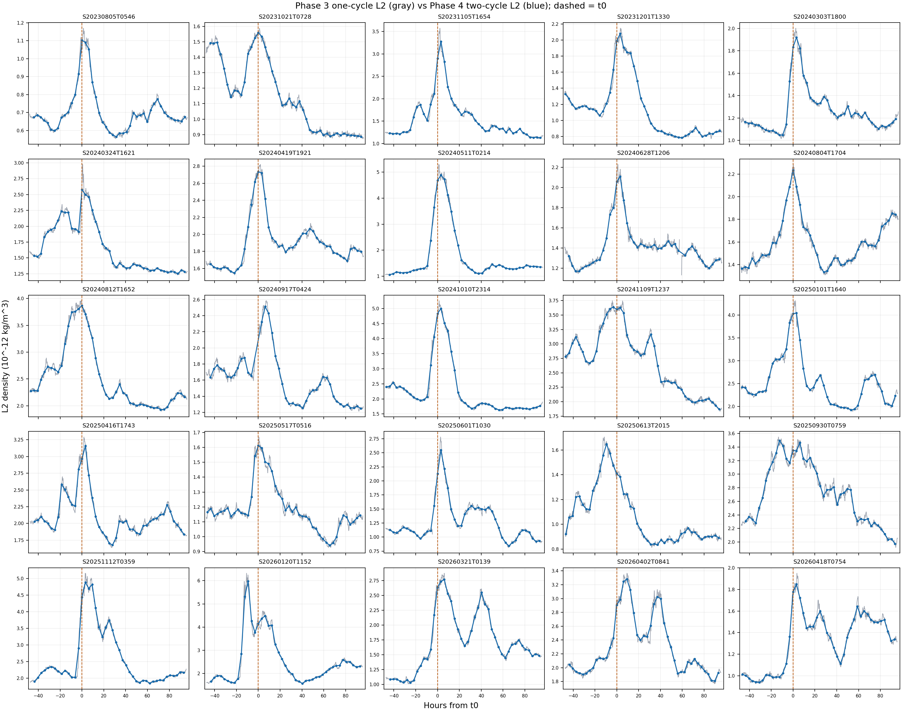

# Swarm-A Phase 4 兩圈窗口目視檢查

## 狀態與決定

狀態：[retained]。2026-10-28 曾以 Phase 2/3 的 $t_0$ 相位 $u$，試算 $u\pm2\pi$ 兩圈窗口與 $u=4\pi j$ 中心。使用者檢視一圈／兩圈對照圖後，決定 Phase 4 正式 GPR 改用 Phase 3 的 $u\pm\pi$ 一圈窗口、$u=2\pi j$ 代表中心。本報告及圖保留作資料單位選擇紀錄；兩圈錨點不進正式 GPR。

## 資料與方法

Phase 3 的一圈 L2 來自 `swarm_a_phase3_quiet_density_v1.sqlite`，共 214,907 個有效分鐘中心錨點。Phase 4 從同庫的原生分鐘配對 L2 與樣本數重算兩圈加權平均；中心相位與樣本數沿用唯讀 Phase 2 P2.6。窗口須完整、原生配對覆蓋率至少 80%，最近中心距 $4\pi j$ 不超過 $0.01$ 圈。25 場共得到 1,131 個兩圈代表錨點；逐場數量與相對 $t_0$ 時間見[錨點 QC](../data/analysis/phase4_two_cycle_anchor_qc.csv)。

灰線是一圈中心相位平均；藍點與藍線是兩圈平均。橘色虛線是 $t_0$。每張逐場圖有完整事件窗及 $t_0-12$ 至 $t_0+24$ 小時的局部圖。藍線只連接實際兩圈代表錨點；線段之間沒有另算模型值。所有密度都繪成 $10^{-12}\,\mathrm{kg/m^3}$ 的顯示尺度。

## 逐場圖

| 年份 | 磁暴 |
| --- | --- |
| 2023 | [08-05](../figures/two_cycle_window/S20230805T0546_one_vs_two_cycle.png) · [10-21](../figures/two_cycle_window/S20231021T0728_one_vs_two_cycle.png) · [11-05](../figures/two_cycle_window/S20231105T1654_one_vs_two_cycle.png) · [12-01](../figures/two_cycle_window/S20231201T1330_one_vs_two_cycle.png) |
| 2024 | [03-03](../figures/two_cycle_window/S20240303T1800_one_vs_two_cycle.png) · [03-24](../figures/two_cycle_window/S20240324T1621_one_vs_two_cycle.png) · [04-19](../figures/two_cycle_window/S20240419T1921_one_vs_two_cycle.png) · [05-11](../figures/two_cycle_window/S20240511T0214_one_vs_two_cycle.png) · [06-28](../figures/two_cycle_window/S20240628T1206_one_vs_two_cycle.png) · [08-04](../figures/two_cycle_window/S20240804T1704_one_vs_two_cycle.png) · [08-12](../figures/two_cycle_window/S20240812T1652_one_vs_two_cycle.png) · [09-17](../figures/two_cycle_window/S20240917T0424_one_vs_two_cycle.png) · [10-10](../figures/two_cycle_window/S20241010T2314_one_vs_two_cycle.png) · [11-09](../figures/two_cycle_window/S20241109T1237_one_vs_two_cycle.png) |
| 2025 | [01-01](../figures/two_cycle_window/S20250101T1640_one_vs_two_cycle.png) · [04-16](../figures/two_cycle_window/S20250416T1743_one_vs_two_cycle.png) · [05-17](../figures/two_cycle_window/S20250517T0516_one_vs_two_cycle.png) · [06-01](../figures/two_cycle_window/S20250601T1030_one_vs_two_cycle.png) · [06-13](../figures/two_cycle_window/S20250613T2015_one_vs_two_cycle.png) · [09-30](../figures/two_cycle_window/S20250930T0759_one_vs_two_cycle.png) · [11-12](../figures/two_cycle_window/S20251112T0359_one_vs_two_cycle.png) |
| 2026 | [01-20](../figures/two_cycle_window/S20260120T1152_one_vs_two_cycle.png) · [03-21](../figures/two_cycle_window/S20260321T0139_one_vs_two_cycle.png) · [04-02](../figures/two_cycle_window/S20260402T0841_one_vs_two_cycle.png) · [04-18](../figures/two_cycle_window/S20260418T0754_one_vs_two_cycle.png) |

## 尚未完成

這批圖只比較 L2 的一圈與兩圈表示。一圈代表錨點的後續計算與逐場圖已記於[Phase 4 GPR 結果報告](phase_4_gpr_loso_report.md)。模型判讀由使用者檢視圖形；數值指標只提供對照。
