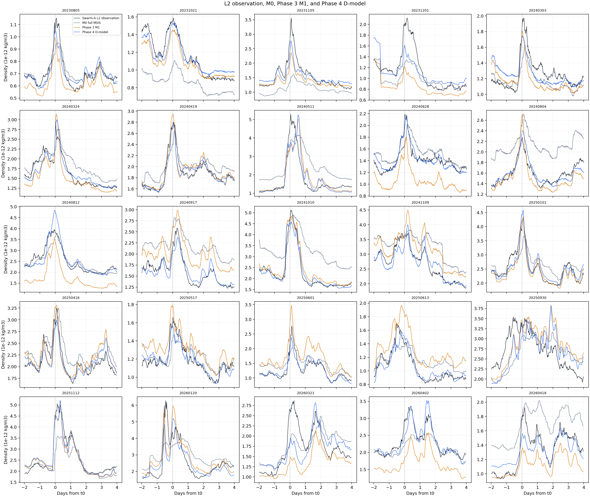

# Swarm-A Phase 4：25 場密度模型修正報告

## 先看最重要的結果

狀態：[done]。Phase 3 是舊模型，叫 M1。Phase 4 是新模型，叫 D-model。兩個模型都拿同一批 25 場資料來比較。

Phase 4 做的事很簡單：Phase 3 原本要求所有事件用同一種設定；Phase 4 讓每一場事件自己選比較適合的背景倍率 $R_k$ 和記憶時間 $\tau_k$。這樣算出的 D-model 比舊的 M1 更接近 Swarm-A L2 觀測值。

L2 是這次拿來對答案的觀測資料。它不是完美的真實密度，但在這份報告裡，所有模型都要和它比較。誤差數字越小，代表模型越接近 L2。

這次搜尋 $\tau_k=0.0$–$15.0\ \mathrm{h}$，每 $0.1\ \mathrm{h}$ 一格。舊的 10 h 上限是錯的，已不用。25 場都沒有選到 15 h，所以沒有卡在搜尋上限。

| 階段／模型 | 相對 Phase 3 的設定 | 共同 $G\ (\mathrm{nT}^{-1})$ | 等權逐場 MSE | 等權逐場 RMSE | 迭代 |
| --- | --- | ---: | ---: | ---: | ---: |
| Phase 3 M1（A 重現） | 固定 $R_k=R_{k,\mathrm{RQ}}$、共同 $\tau=4.65\ \mathrm{h}$ | 0.000703233 | 0.042768 | 0.206804 | 0 |
| Phase 4 B | 只讓每場 $R_k$ 自由；維持 $\tau=4.65\ \mathrm{h}$ | 0.000687248 | 0.012786 | 0.113074 | 1 |
| Phase 4 C | 只讓每場 $\tau_k$ 自由；固定 $R_{k,\mathrm{RQ}}$ | 0.000706825 | 0.042035 | 0.205024 | 3 |
| Phase 4 D-model | 每場 $R_k,\tau_k$ 都自由；共同 $G$ | 0.000705054 | 0.012090 | 0.109953 | 5 |

先只看第一列和最後一列。Phase 3 M1 到 Phase 4 D-model 的 MSE 從 0.042768 降到 0.012090，少了 71.73%。RMSE 從 0.206804 降到 0.109953，少了 46.83%。

中間兩列是在拆開看原因。只讓 $R_k$ 自由時，RMSE 已降到 0.113074。只讓 $\tau_k$ 自由時，RMSE 還是 0.205024，幾乎沒變。所以大部分改善來自「每場事件的背景不一樣」；調整記憶時間只有小幅幫助。

MSE 和 RMSE 都是誤差分數。你不用背公式，只要記得：數字越小越好。

## 四條線各是什麼

Swarm-A L2 是這次比較用的觀測參考，也就是圖裡的「正確答案」。M0、M1 和 D-model 都是回頭算出的模型，不是預報。

| 曲線 | 角色 | 這次比較中代表的改變 |
| --- | --- | --- |
| Swarm-A L2 | 本比較的「正確答案」：觀測參考 | 用來計算各模型的差異 |
| M0 | 使用實際 `ap` 的 full-MSIS 回溯參考 | 完整 MSIS 在這批資料上的表現；不是預測 |
| Phase 3 M1 | 凍結的固定 $R_k$／共同 $\tau=4.65$ h 基線 | Phase 4 之前的密度模型 |
| Phase 4 D-model | 每場自由 $R_k,\tau_k$；25 場共用正 $G$ | 相對 M1 的修正結果 |

先看黑線 L2，它是比較目標。再看橘線 M1 和藍線 D-model，它們的距離就是 Phase 4 有沒有進步。灰線 M0 是另一個完整 MSIS 參考，不是答案，也不是 Forecast。

本 report 的每張圖都會同時放 M1 和 D-model。不然看不出 Phase 4 到底改了什麼。

## Phase 4 怎麼做

資料、事件和密度處理都直接讀 Phase 3 的凍結輸出。Phase 4 不會改 Phase 2、Phase 3 或原始 SQLite。25 場共有 214,907 個有效密度點。

計分時，先算每一場自己的平均誤差，再平均 25 場。這樣資料點多的事件不會把結果壓過其他事件。

```text
Phase 3 的資料和舊設定
  -> 先調每一場的背景倍率 R_k
  -> 再調每一場的記憶時間 tau_k
  -> 兩步重複，直到 tau_k 不再改變
  -> 存下舊模型和新模型的結果
```

下面是模型公式。看不懂可以先跳過；它只是把上面的做法寫成數學。

$$
\widehat\rho_{k,i}
=\rho_{\mathrm{MSIS,q},k,i}\,R_k
\exp\!\left(GH_{\tau_k,k,i}\right),
$$

公式裡，$i$ 是某一場中的一個密度點。$H_{\tau_k}$ 是 SME 先做記憶濾波，再做中心相位平均後的值。令

$$
y_{k,i}=\ln\!\left(
\frac{\rho_{\mathrm{L2},k,i}}
{\rho_{\mathrm{MSIS,q},k,i}}
\right),
$$

模型要讓下面這個誤差越小越好：

$$
L=\frac{1}{25}\sum_{k=1}^{25}
\frac{1}{n_k}\sum_{i=1}^{n_k}
\left[y_{k,i}-\ln R_k-GH_{\tau_k,k,i}\right]^2.
$$

這裡全部用自然對數。SQLite 的 `log()` 是以 10 為底，不能直接拿來算這個殘差。

## 1. Phase 4 到底調了什麼

Phase 4 一共要調 51 個數：每一場各有一個 $R_k$ 和一個 $\tau_k$，所以是 25 + 25；再加上 25 場共用的一個 $G$。

- $R_k$：把這場事件的密度整體往上或往下調多少。
- $\tau_k$：模型要記住 SME 影響多久。
- $G$：SME 變大時，密度要跟著變多少。

一開始用 Phase 3 的值：$R_k=R_{k,\mathrm{RQ}}$、所有 $\tau_k=2.5\ \mathrm{h}$、$G=0.0007032326\ \mathrm{nT}^{-1}$。這只是起點，不是最後答案。

| 量 | 角色 | 範圍或規則 |
| --- | --- | --- |
| $R_k$ | 第 $k$ 場的無單位背景倍率 | 每場自由；嚴格 $0<R_k<2$；沒有懲罰項或 RQ 軟限制 |
| $\tau_k$ | 第 $k$ 場 SME 一階記憶的格點參數 | 0.0–15.0 h，每 0.1 h；平手保留上一輪值 |
| $G$ | 25 場共用的密度對 SME 響應增益 | 強制 $G>0$；非正值立即視為失敗 |
| $R_{k,\mathrm{RQ}}$ | Phase 3 的暴前近零響應倍率 | 只作起始值與比較基準，不作硬界或代價 |

程式反覆做兩件事。第一，先固定 $\tau_k$，找比較好的 $R_k$ 和 $G$。第二，固定 $R_k,G$，讓每場試 151 個 $\tau_k$。新舊結果一樣好時，保留舊的 $\tau_k$。最多做 20 輪；D-model 做到第 5 輪就不再改變。

這種方法叫交替調整。它不保證是全世界唯一最好的答案，但每一步都能檢查和重跑。

## 2. 每一場最後選到什麼

下表是 D-model 的最後結果。每一列是一場事件。

- `$R_{\mathrm{RQ}}$`：Phase 3 原本用的背景倍率。
- `$R_{\mathrm{fit}}$`：Phase 4 最後選到的背景倍率。
- `R_fit/R_RQ`：新舊背景倍率相差幾倍。
- `1% tau 範圍`：幾個幾乎一樣好的 $\tau_k$。它不是信賴區間。

所有 $R_k$ 都低於 2，所有 $\tau_k$ 都低於 15 h。

| 事件 ID | $R_{\mathrm{RQ}}$ | $R_{\mathrm{fit}}$ | $R_{\mathrm{fit}}/R_{\mathrm{RQ}}$ | $\tau_{\mathrm{fit}}$ (h) | 1% tau 範圍 (h) |
| --- | ---: | ---: | ---: | ---: | --- |
| S20230805T0546 | 0.830 | 0.931 | 1.121 | 6.2 | 5.8–6.7 |
| S20231021T0728 | 1.203 | 1.267 | 1.054 | 4.7 | 4.0–5.4 |
| S20231105T1654 | 1.311 | 1.444 | 1.101 | 3.7 | 3.2–4.2 |
| S20231201T1330 | 0.905 | 1.180 | 1.303 | 4.4 | 3.4–5.6 |
| S20240303T1800 | 0.983 | 1.051 | 1.070 | 7.3 | 6.0–9.1 |
| S20240324T1621 | 0.822 | 0.897 | 1.091 | 7.5 | 6.9–8.2 |
| S20240419T1921 | 0.869 | 0.851 | 0.980 | 6.0 | 5.7–6.3 |
| S20240511T0214 | 0.646 | 0.621 | 0.961 | 3.0 | 2.6–3.3 |
| S20240628T1206 | 0.649 | 0.864 | 1.331 | 8.3 | 7.7–9.0 |
| S20240804T1704 | 0.649 | 0.691 | 1.065 | 10.1 | 9.3–10.9 |
| S20240812T1652 | 0.649 | 0.959 | 1.478 | 6.7 | 6.2–7.3 |
| S20240917T0424 | 0.878 | 0.701 | 0.798 | 4.9 | 4.5–5.2 |
| S20241010T2314 | 0.671 | 0.625 | 0.933 | 4.3 | 4.1–4.5 |
| S20241109T1237 | 0.910 | 0.782 | 0.859 | 3.4 | 3.0–3.9 |
| S20250101T1640 | 0.893 | 0.937 | 1.050 | 4.6 | 4.3–4.9 |
| S20250416T1743 | 0.936 | 0.904 | 0.966 | 6.8 | 6.3–7.4 |
| S20250517T0516 | 1.033 | 0.931 | 0.902 | 6.1 | 5.7–6.5 |
| S20250601T1030 | 1.033 | 0.783 | 0.758 | 6.2 | 5.9–6.5 |
| S20250613T2015 | 1.033 | 0.834 | 0.807 | 5.1 | 4.7–5.6 |
| S20250930T0759 | 1.008 | 0.956 | 0.948 | 3.3 | 2.7–4.0 |
| S20251112T0359 | 1.024 | 1.039 | 1.015 | 4.9 | 4.6–5.2 |
| S20260120T1152 | 0.862 | 0.774 | 0.897 | 5.1 | 4.6–5.7 |
| S20260321T0139 | 0.756 | 0.957 | 1.265 | 3.6 | 2.9–4.5 |
| S20260402T0841 | 0.756 | 1.026 | 1.357 | 4.4 | 4.1–4.8 |
| S20260418T0754 | 0.651 | 0.760 | 1.167 | 5.4 | 4.8–6.2 |

最後的 $R_{\mathrm{fit}}$ 是 0.621–1.444。和 Phase 3 相比是 0.758–1.478 倍。最後的 $\tau_{\mathrm{fit}}$ 是 3.0–10.1 h。

最長的是 `S20240804T1704` 的 10.1 h，幾乎一樣好的範圍是 9.3–10.9 h。它沒有碰到 15 h 上限。這只代表模型在這場資料裡偏好較長的記憶；不代表真的量到 10.1 小時的物理時間常數。

## 3. 為什麼 Phase 4 變好

模型 B 已經拿到大部分改善。意思是：Phase 3 的背景倍率不是完全錯，但把它固定住不夠好。D-model 有 14 場把背景倍率調高，11 場調低。

這不表示真實背景密度真的升高或降低。它只表示這樣調，可以讓這批資料的平均誤差變小。

模型 C 的改善很小。意思是：只改記憶時間，幫助不大。而且很多事件有不只一個差不多好的 $\tau_k$，所以不能說某一個 $\tau_k$ 就是精準的物理時間。

Phase 3 的中心相位平均會重疊，也會讀到事件開始後的資料。所以它只適合回頭看，不適合證明真正的時間延遲。

這一步沒有加很多物理規則，例如 RQ 距離或平靜段差異。目的是先看資料本身會選出什麼 $R_k,\tau_k,G$。

所以這張表是在說「怎樣比較貼 L2」，不是在說「太陽風暴為什麼這樣影響大氣」。物理原因要另外研究。

## 4. M1 還有什麼地方沒做好

先看舊的 Phase 3 M1。25 場的 L2/M1 幾何平均是 0.7613–1.4771。這表示有些事件的 M1 偏高，有些偏低，不能只用一個共同常數解決。

全部分鐘的殘差和 $H$ 的 correlation 是 -0.186899。這也表示問題不只有背景倍率，模型對 SME 的反應形狀可能也有差。

`trial4_25storm_residual_screen` 存每場 M1 的問題摘要。平均偏差超過 10% 時標成 `background_offset`。殘差和 $H$ 的關係夠明顯時標成 `response_shape`。

結果是 9 場只有背景問題、3 場只有反應形狀問題、5 場兩種都有、8 場沒有標記。這只用來決定下一步先查哪幾場，不是物理分類，也不能直接用來改參數。

固定 $\tau=4.65$ h 後，我們把資料往前或往後移幾分鐘，再看關係有沒有變好：

| $\Delta$ (min) | 配對列數 | correlation |
| ---: | ---: | ---: |
| -180 | 209,845 | 0.618110 |
| -120 | 211,320 | 0.639796 |
| -60 | 213,047 | 0.655759 |
| 0 | 214,907 | 0.663573 |
| +30 | 213,977 | 0.664279 |
| +60 | 213,047 | 0.662126 |
| +120 | 211,320 | 0.650114 |
| +180 | 209,845 | 0.630578 |

最高值在 +30 min，但只比 0 min 高 0.000706，差得非常小。中心相位平均會用到事件開始後的資料，相鄰窗口也很像。

所以不能說「密度真的晚 30 分鐘才反應」，也不能用它來調整 $\tau$。要研究真正的時間差，要用不會偷看到未來資料的方法，並先決定要看哪段時間。

## 5. 資料在哪裡，怎麼重算

Phase 4 是 Phase 3 M1 的修正版。後面的密度分析要讀 D-model，不再讀固定的 M1。

2026-10-30 的核對結果如下：

- Phase 4 保存的 prediction SQLite 和 tau-grid snapshot table，和 Phase 3 原檔的 SHA-256 相同。
- joint-fit 只用 Phase 4 目錄內的程式。
- 12 個 joint-fit 和四曲線比較測試都通過。
- 用保存的 $R_{\mathrm{fit}}$、$\tau_k$、$G$ 和 $H_{\tau_k}$ 重算 214,907 筆結果，和資料庫完全一樣。
- 每場平均後的 MSE 也是 0.012089579087948936。

這些核對只證明程式、來源和輸出彼此對得上。它不能證明物理因果，也不能證明模型對沒看過的事件或即時預報有用。

Phase 4 用自己的 SQLite：`data/sqlite/swarm_a_trial4_joint_fit_tau15.sqlite`。它不改任何凍結來源，也不把 Phase 3 SQLite 當成自己的結果。

- `trial4_joint_fit_minute`：214,907 筆每分鐘結果，key 是 `{storm_id, time_us}`。
- `trial4_25storm_overview`：25 場摘要。
- `trial4_joint_fit_metadata`：共同 $G$、tau 格點和資料範圍。

SQLite `integrity_check` 是 `ok`，每場分鐘數也都對得上。

重算只要照順序做三步：

1. 用[擬合入口](../code/prep_trial4_joint_fit.py)建立 A–D 的參數 SQLite。
2. 用[SQLite／預測輸出入口](../code/prep_trial4_joint_prediction.py)建立 D-model 的分鐘結果和 25 場總覽。
3. 用[四曲線比較入口](../code/prep_phase4_model_comparison.py)畫 L2、M0、M1、D-model。

三支程式都不會覆寫舊輸出。

| 輸出 | 內容 |
| --- | --- |
| `trial4_joint_fit_models` | A–D 的 $G$、等權逐場 MSE／RMSE、收斂輪數 |
| `trial4_joint_fit_events` | 每個模型的 $R_{\mathrm{RQ}}$、$R_{\mathrm{fit}}$、$\tau$、1% 範圍、上界旗標 |
| `trial4_joint_fit_iterations` | B、C、D 每輪 $G$ 與改變的 $\tau_k$ 數量 |
| `trial4_25storm_overview` | D-model 每場的密度誤差、R、tau、1% 範圍與 M0 比較 |
| `data/sqlite/swarm_a_trial4_joint_fit_tau15.sqlite` | 214,907 個 D-model minute rows、參數、總覽與 metadata |
| [計算核心](../code/calc_trial4_joint_fit.py) | 交替更新、格點搜尋、限制與等權計分 |
| [重算入口](../code/prep_trial4_joint_fit.py) | 唯讀載入 Phase 3、建立 $H_\tau$、輸出 SQLite |
| [資料血緣](../docs/lineage/trial4_joint_fit_tau15.md) | P4.1–P4.5 的來源、SQLite key、資料契約與範例列 |
| [方法與診斷](../docs/trial4_joint_fit_tau15_diagnostics.md) | 非 Report 的模型規格、殘差與 timing 初篩 |



看圖時，先看黑線 L2。接著比較橘線 M1 和藍線 D-model：藍線如果比橘線更靠近黑線，代表 Phase 4 在那段比較好。灰線 M0 是使用實際 `ap` 回頭算的 full-MSIS。

這張圖只用來看同一批資料的曲線，不能當成外測或預報能力。

## 結論

Phase 4 已完成。25 場都在 $\tau=0$–15 h 內收斂，沒有碰到上限。

最重要的結果是：每場自己調整背景倍率 $R_k$，讓 M1 變成 D-model 後，誤差明顯變小。每場自己調整記憶時間 $\tau_k$ 也有幫助，但小很多。

這還不是新的物理結論。它只是在告訴我們：下一步該先研究每場背景為什麼不同，以及 SME 反應形狀為什麼還有誤差。
