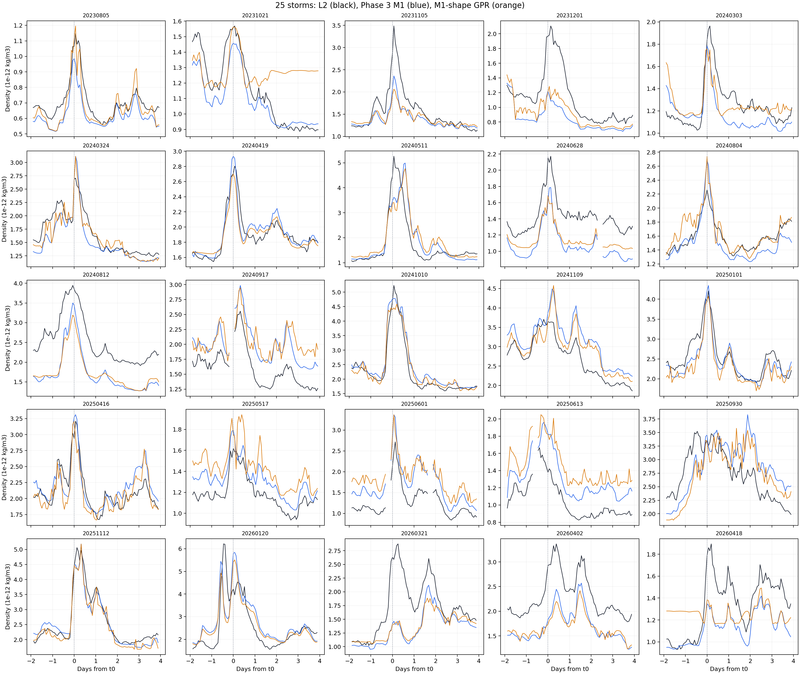
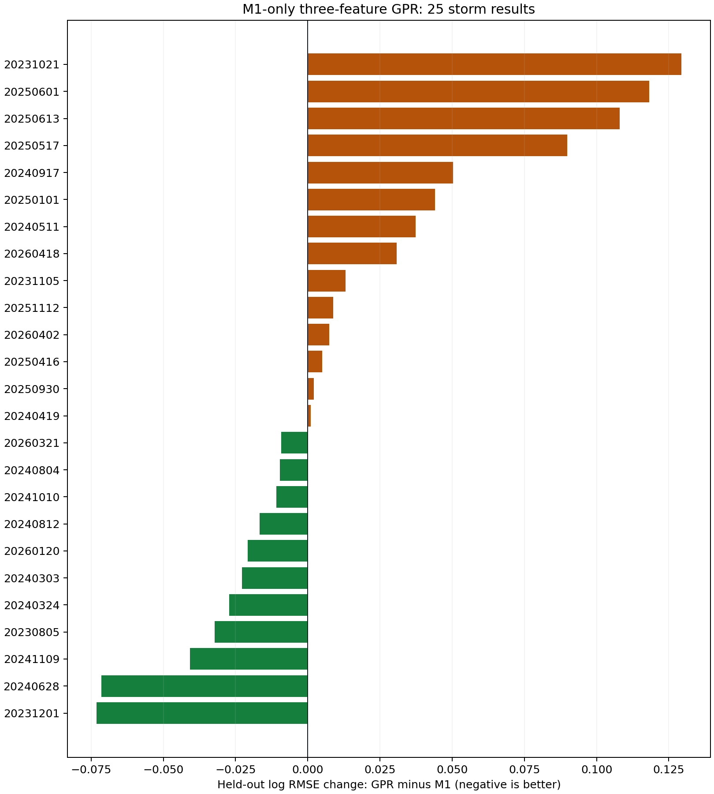

# Phase 5 Trial 10：M1 三個形狀特徵的 GPR

狀態：[done]，2026-10-31。**未改善 Phase 3 M1，不採用。** 25 場留出測試、相同 2,235 圈的對數密度 RMSE：

$$
\begin{cases}
0.11000 & \text{Phase 4 D-model（同場擬合參考）}\\
0.20663 & \text{Phase 3 M1}\\
0.21960 & \text{Trial 10 GPR}
\end{cases}
$$

只有 **11/25 場**的 GPR 比 M1 好。本 Trial 沒有修正 D-model；[同圈比較與限制](../../phase5/reports/phase_5_report.md)見 Phase 5 最終報告。

## GPR 輸入與定義

本次只問一件事：如果 GPR 看見 M1 這一圈的密度、前一圈到這一圈的變化，以及這一圈附近的彎曲程度，能否學到 L2 與 M1 之間可跨磁暴重複的偏差？

先將每圈 M1 密度取自然對數，記為 $m_n=\ln(\rho_{\mathrm{M1},n})$。每個中心圈 $n$ 的三個輸入是：

| 輸入欄位 | 算法 | 白話意思 |
| --- | --- | --- |
| `log_m1` | $m_n$ | M1 目前算出的密度大小 |
| `past_log_change` | $m_n-m_{n-1}$ | 最近一圈是上升還是下降 |
| `centered_log_curvature` | $m_{n+1}-2m_n+m_{n-1}$ | 變化速度是否正在改變 |

第三項用到**下一圈的 M1**，因為本實驗是磁暴結束後的回溯修正；它沒有用下一圈的 L2。GPR 的輸入完全沒有 L2、SYM-H、ap、高度或 Phase 4 D-model。歷史 L2 只用於訓練答案 $e_n=\ln(\rho_{\mathrm{L2},n}/\rho_{\mathrm{M1},n})$ 和測試評分。GPR 預估 $\hat e_n$ 後，輸出 $\rho_{\mathrm{GPR},n}=\rho_{\mathrm{M1},n}\exp(\hat e_n)$。

## 怎麼取資料與防止偷看測試場

輸入是唯讀的 Phase 3 `phase3_h_tau_minute` 和 `phase3_prediction_minute`，用相同的 `storm_id,time_us` 接在一起。每個 $2\pi$ 相位格點選最近且有效的一分鐘資料，距格點不得超過 $0.02\pi$。25 場共有 **2,295 個**逐圈錨點。三個輸入需要前、中、後連續三圈；缺少任一圈就跳過，不跨缺口，最後剩 **2,235 個**中心圈。

沿用 Phase 5 的 `GroupKFold`：固定亂數種子 `20261030`，把 25 場分成五折。每次用 **20 場完整磁暴**訓練，留下 **5 場完整磁暴**測試。每場恰好測試一次。資料列的先後順序不會把同場磁暴拆成訓練和測試兩邊。

每折只用訓練場估計三個輸入的平均與標準差，再將同一套轉換套到測試場。訓練答案除以該折訓練答案的標準差，**不扣除答案平均值**；預測後乘回原尺度。GPR 使用可分別調整三個特徵長度尺度的 RBF kernel、常數幅度及白雜訊項。長度尺度由各折訓練資料學得，不拿測試場調參。五折都沒有 kernel 收斂警告。

## 五次留場測試

下表的 RMSE 都在**相同測試圈**上計算 $\ln(\rho_{\mathrm{估計}}/\rho_{\mathrm{L2}})$ 的均方根；越小越好。M1 欄表示完全不加 GPR 修正。

| 折 | 訓練圈 | 測試圈 | 留出的五場磁暴（日期） | M1 RMSE | GPR RMSE | 判定 |
| --- | ---: | ---: | --- | ---: | ---: | --- |
| 1 | 1,788 | 447 | 2023-12-01、2024-03-24、2024-09-17、2025-01-01、2025-11-12 | 0.19323 | 0.18778 | 改善 |
| 2 | 1,785 | 450 | 2024-03-03、2024-08-04、2024-10-10、2025-04-16、2025-05-17 | 0.10705 | 0.12419 | 變差 |
| 3 | 1,785 | 450 | 2023-10-21、2024-04-19、2024-08-12、2026-01-20、2026-04-18 | 0.22895 | 0.24123 | 變差 |
| 4 | 1,794 | 441 | 2023-08-05、2024-05-11、2024-11-09、2025-06-01、2025-06-13 | 0.20977 | 0.26597 | 變差 |
| 5 | 1,788 | 447 | 2023-11-05、2024-06-28、2025-09-30、2026-03-21、2026-04-02 | 0.26156 | 0.24889 | 改善 |
| 合計 | 每折 20 場 | 2,235 | 25 場各測試一次 | **0.20663** | **0.21960** | **變差** |

合計 RMSE 是把 2,235 個留場預測放在一起重新計算，並非五個 RMSE 的算術平均。GPR 的合計 RMSE 比 M1 高 0.01297，約高 **6.3%**。因此不能只挑改善的磁暴宣稱方法有效。

## 圖上的實際變化

下圖每格一場磁暴，黑線是 L2、藍線是 Phase 3 M1、橘線是 GPR 留場預測。橫軸是相對磁暴 $t_0$ 的日數，縱軸是密度。三條線在同一批圈上對比；遇到缺圈就斷線，沒有補值。

下圖每根橫條是一場磁暴的 `GPR RMSE - M1 RMSE`。綠色向左表示改善；棕色向右表示變差。可以看到這不是所有場都略微變差，而是少數場改善、另一些場明顯惡化。2023-10-21、2025-06-01、2025-06-13 的惡化尤其大。

| 例子 | M1 RMSE | GPR RMSE | 說明 |
| --- | ---: | ---: | --- |
| 2023-12-01 | 0.31709 | 0.24396 | 明顯改善 |
| 2024-06-28 | 0.29608 | 0.22456 | 明顯改善 |
| 2023-10-21 | 0.08643 | 0.21580 | 明顯惡化 |
| 2025-06-01 | 0.28162 | 0.39976 | 明顯惡化 |
| 2025-06-13 | 0.22723 | 0.33516 | 明顯惡化 |

這些數字表示：三個 M1 形狀特徵確實在部分場次含有有用訊號，但不足以穩定判斷另一場磁暴的 L2 偏差。GPR 能輸出一個修正值，不等於它知道該修正值何時可信。

## 進一步發現：修正方向決定成敗

對每場磁暴，先分別算「實際對數偏差」與「GPR 預測對數偏差」的整場平均，再比較兩個平均值的正負號。正號表示 L2 平均高於 M1，GPR 應往上修；負號表示應往下修。這是**事後檢查**，不是 GPR 訓練或推論的輸入。

| 整場平均修正方向 | 場數 | RMSE 改善 | 平均 `GPR RMSE - M1 RMSE` |
| --- | ---: | ---: | ---: |
| GPR 與實際方向相同 | 17 | 11 | -0.00903 |
| GPR 與實際方向相反 | 8 | 0 | +0.05798 |

例如 2025-06-01 的實際平均偏差是負的，M1 原本偏高；GPR 卻給正的平均修正，讓 RMSE 從 0.28162 升到 0.39976。這說明主要風險不只是修正幅度，還包括**判錯要往上還是往下修**。即使方向相同，17 場中仍有 6 場沒有改善，所以方向正確也不保證逐圈修正正確。

這個分組用了測試場的 L2 才知道「實際方向」，因此不能拿來作為新資料的選擇規則，也不能據此重新挑選有利場次重算整體分數。它指出下一個要研究的問題：是否存在**不使用該場 L2**、卻能可靠判斷修正方向的訊號。Trial 10 的結論仍是不採用。

## 這個結果能說什麼

本試驗只測 GPR **殘差層**的跨場轉移。GPR 輸入沒有 L2，但 Phase 3 M1 本身是歷史、資料內建立的曲線；其上游參數與 L2 的關係不能因為輸入向量沒有 L2，就視為完全獨立預測。因此本結果也不能證明「完全沒有 L2 的新衛星」可以直接使用這條曲線。Phase 3 是凍結的歷史基線；Phase 4 D-model 是已保存的描述性下游基線，但也有同場 L2 校準。本 Trial 是依無同場 L2 的研究問題做的 M1 對照實驗，後續判定見[Phase 5 最終報告](../../phase5/reports/phase_5_report.md)。

可重現的逐圈留場預測、逐場分數、五折分數與三個特徵都存在本機 `data/sqlite/swarm_a_phase5_m1_shape_gpr_v1.sqlite`。重算入口是 `code/prep_phase5_m1_shape_gpr.py`；畫圖入口是 `code/prep_phase5_m1_shape_figures.py`。SQLite 產物不納入 Git，程式拒絕覆寫既有資料庫。
