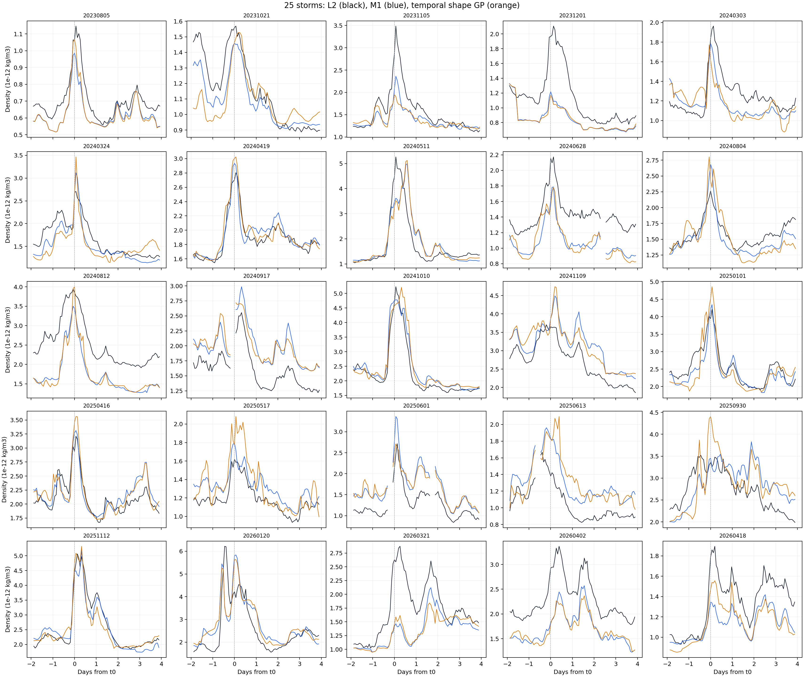

# Phase 5 Trial 11：讓 GPR 專門學誤差的升降

狀態：[done]，2026-10-31。**未改善，不採用。** 相同 25 場、2,235 圈的對數密度 RMSE：

$$
\begin{cases}
0.11000 & \text{Phase 4 D-model（同場擬合參考）}\\
0.20663 & \text{Phase 3 M1}\\
0.21922 & \text{Trial 11 GPR}
\end{cases}
$$

五折全部變差，只有 **7/25 場**改善。本 Trial 沒有修正 D-model；[採用判定與同圈比較](../../phase5/reports/phase_5_report.md)見 Phase 5 最終報告。

## 這次與 Trial 10 差在哪裡

Trial 10 讓 GPR 直接猜每一圈的完整誤差；它會同時移動整條曲線的高低和局部形狀。Trial 11 把這兩件事分開：只學每場磁暴的**曲線形狀誤差**，不讓 GPR 改變整場平均高低。這直接檢查使用者指出的「修正後升降趨勢不對」。

訓練時，用歷史 L2 計算 $e_{k,n}=\ln(\rho_{\mathrm{L2},k,n}/\rho_{\mathrm{M1},k,n})$，再扣掉該場訓練資料的平均 $\bar e_k$。GPR 的訓練答案是 $s_{k,n}=e_{k,n}-\bar e_k$。測試時只用 M1 與已知事件時間產生 $\hat s_{k,n}$，再扣掉該測試場所有 $\hat s$ 的平均，讓修正只改形狀。**測試場 L2 不參與特徵、預測或這個扣平均步驟。**

## GPR 輸入與定義

令 $m_{k,n}=\ln(\rho_{\mathrm{M1},k,n})$，$t_{0,k}$ 是已知磁暴標記。中位數取該場有效的中心圈；所有輸入都能從整場 M1 與事件時間取得。

| 輸入欄位 | 算法 | 它提供的資訊 |
| --- | --- | --- |
| `days_from_t0` | $(t_{k,n}-t_{0,k})/1\,\mathrm{day}$ | 磁暴前後與距離事件中心多久 |
| `log_m1` | $m_{k,n}$ | 這一圈的 M1 密度大小 |
| `relative_log_m1` | $m_{k,n}-\operatorname{median}_j(m_{k,j})$ | 相對整場 M1 一般水準的高低 |
| `centered_log_slope` | $(m_{k,n+1}-m_{k,n-1})/2$ | 附近兩圈之間的升降 |

整場中位數與下一圈 M1 可以在磁暴結束後取得；它們都不是 L2。三圈不連續時不產生中心圈特徵，也不跨資料缺口。25 場原本有 2,295 個錨點，最後 **2,235 個**中心圈可評分，和 Trial 10 使用同一批位置。

## GPR 與測試方法

沿用固定種子 `20261030` 的五折 `GroupKFold`；每折 20 場完整磁暴訓練、5 場完整磁暴測試。每一折只用訓練場估輸入平均與標準差，也只用訓練答案估其標準差。GPR 使用四維 ARD Matérn $\nu=3/2$ kernel、常數幅度和白雜訊項；每個輸入各有一個由訓練場決定的長度尺度。沒有使用測試 L2 調 kernel 或模型參數，五折沒有收斂警告。[Matérn 與 GP kernel 原理](https://gaussianprocess.org/gpml/chapters/RW.pdf)提供方法背景，並不保證本實驗有效。

全報只用**對數密度 RMSE**：每圈計算 `ln(估計密度 / L2)`，平方後取平均再開根號。下表的 M1 與 GPR 都在同折相同圈評分；越小越好。

| 折 | 訓練／測試圈 | M1 RMSE | GPR RMSE |
| --- | ---: | ---: | ---: |
| 1 | 1,788／447 | 0.19323 | 0.21121 |
| 2 | 1,785／450 | 0.10705 | 0.13673 |
| 3 | 1,785／450 | 0.22895 | 0.23573 |
| 4 | 1,794／441 | 0.20977 | 0.21791 |
| 5 | 1,788／447 | 0.26156 | 0.27217 |
| 合計 | 2,235 個留場圈 | **0.20663** | **0.21922** |

合計分數是把 2,235 個留場誤差一起計算，不是五個 RMSE 的算術平均。五折都比 M1 差，因此不採用這版修正。

## 圖與可觀察到的問題

下面每格一場磁暴：黑線是 L2、藍線是 M1、橘線是留場 GPR。橫軸是距離 $t_0$ 的天數，縱軸是密度；缺圈處斷線，不補值。

ARD 長度尺度在五折間相當一致：`days_from_t0` 為 0.24–0.32，`log_m1` 為 0.19–0.27，`relative_log_m1` 為 0.43–0.58，`centered_log_slope` 為 2.26–3.39。因為輸入在每折都標準化，模型對時間與密度大小比對斜率敏感；但敏感不等於預測正確，五折測試已顯示該修正不可用。

## 判定與適用界線

本次否定的是**這組四輸入、每場扣平均、Matérn GPR** 對新磁暴的趨勢修正；不能據此說所有 GPR 都無效。Trial 10 與 Trial 11 合在一起指出：只靠這些 M1 衍生數字，沒有找到可跨場決定誤差方向及形狀的可靠關係。若新磁暴沒有額外觀測，GPR 仍可用來量化對 M1 的不確定度；不能把不確定的平均預測硬當修正後真值。另一條有方法依據的研究方向是把**新的已知驅動**接到物理響應式，再用 GP 表示尚未建模的驅動或擾動；[Latent Force Models](https://proceedings.mlr.press/v5/alvarez09a)提供這種物理式與 GP 結合的原始方法，但它不是 Trial 11 已完成的結果。

本試驗使用凍結 Phase 3 M1 作歷史對照，未來固定 $R_k$、$\tau$ 和 $G$ 的無目標 L2 基線尚未在此重算。現有 SQLite `data/sqlite/swarm_a_phase5_temporal_shape_gpr_v1.sqlite` 保存每圈留場預測、逐場與五折分數及 ARD 長度尺度；它是本機衍生資料，不納入 Git。重算與畫圖入口分別為 `code/prep_temporal_shape_gpr.py`、`code/prep_temporal_shape_figures.py`。
