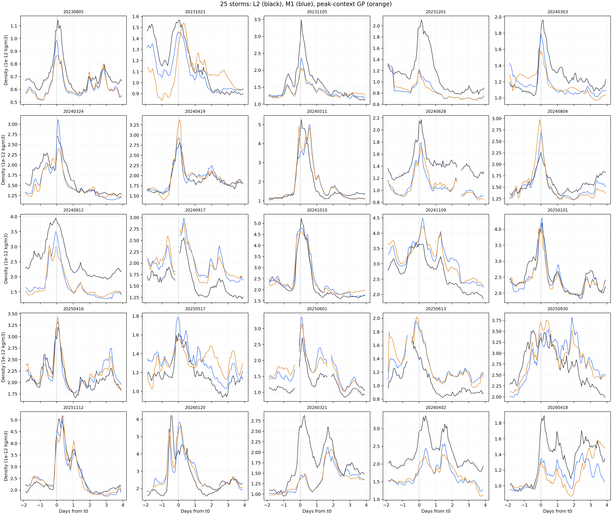

# Phase 5 Trial 12：整場 M1 峰值與累積密度能否幫 GPR 修正趨勢？

狀態：[done]，2026-10-31。**整體未改善，不採用。** 相同 25 場、2,235 圈的對數密度 RMSE：

$$
\begin{cases}
0.11000 & \text{Phase 4 D-model（同場擬合參考）}\\
0.20663 & \text{Phase 3 M1}\\
0.21395 & \text{Trial 12 GPR}
\end{cases}
$$

五折只有第 5 折略好，逐場有 **9/25 場**改善。本 Trial 沒有修正 D-model；[採用判定與同圈比較](../../phase5/reports/phase_5_report.md)見 Phase 5 最終報告。

## 這次改了什麼

Trial 11 把事件時間、密度高低與附近升降交給 GPR，但五折形狀分數全變差。這次沿用相同資料、20/5 整場留出、訓練目標與 Matérn GPR，**只換四個輸入**。目的是檢查整場曲線的峰值位置與累積高密度，是否比短距離斜率更能描述剩餘誤差。整場 M1 曲線是在磁暴結束後取得；推論特徵與每場預測扣平均都不讀取該測試場的 L2。

### GPR 輸入與定義

令 $m_{k,n}=\ln(\rho_{\mathrm{M1},k,n})$，$t_{k,n}$ 為第 $k$ 場第 $n$ 圈時間；$m_k^{\max}$ 是該場有效中心圈的最大對數密度，$t_k^{\max}$ 是首次達到最大值的時間，$\tilde m_k$ 是該場有效中心圈的對數密度中位數。定義 $q_{k,n}=\max(m_{k,n}-\tilde m_k,0)$。GPR 輸入如下：

| 輸入欄位 | 計算方式 | 想提供的資訊 |
| --- | --- | --- |
| `log_m1` | $m_{k,n}$ | 這一圈 M1 的密度大小 |
| `log_below_peak` | $m_{k,n}-m_k^{\max}$ | 離該場最高密度有多遠 |
| `days_from_peak` | $(t_{k,n}-t_k^{\max})/1\,\mathrm{day}$ | 目前在主峰前或主峰後 |
| `cumulative_excess` | 連續兩圈時，累加 $(q_{k,n-1}+q_{k,n})(t_{k,n}-t_{k,n-1})/(2\,\mathrm{day})$ | 高於中位數的對數 M1 差值按時間累積；單位是天 |

最後一項只在相鄰圈都有資料時增加；遇到缺口就保留已有累積值，不補值也不跨缺口積分。這四項全由 M1 算出，沒有把測試場 L2 或真實誤差放進輸入。峰值與中位數使用**整場** M1，所以這是磁暴結束後的回溯修正試驗，不是即時預報。原始錨點 2,295 個；為與 Trial 10、11 在相同位置比較，只評分連續三圈的中心圈，共 2,235 圈。

## 學什麼，怎麼測

歷史訓練場可以用 L2 算出對數誤差 $e_{k,n}=\ln(\rho_{\mathrm{L2},k,n}/\rho_{\mathrm{M1},k,n})$。訓練答案是每場扣掉平均後的 $s_{k,n}=e_{k,n}-\bar e_k$，讓 GPR 專門學曲線形狀。測試場只輸入 M1 特徵，GPR 輸出的形狀修正再扣掉該場**預測修正**的平均，最後乘回 M1。扣平均不使用測試場 L2；它也不會修正該場整體密度的高低偏差。

固定種子 `20261030` 做五折整場留出：每折用 20 場訓練、5 場測試；每場恰好被留出一次。每折特徵標準化參數和訓練答案的標準差只從 20 場訓練資料估計。GPR 使用四維 ARD Matérn $\nu=3/2$ kernel、常數幅度和白雜訊項；本次五折沒有收斂警告。沒有用測試 L2 選 kernel 參數。

全報只用**對數密度 RMSE**：每圈計算 `ln(估計密度 / L2)`，平方後取平均再開根號。同一折的 M1 與 GPR 在相同圈比較；越小越好。

| 折 | 訓練／測試圈 | M1 RMSE | GPR RMSE |
| --- | ---: | ---: | ---: |
| 1 | 1,788／447 | 0.19323 | 0.19867 |
| 2 | 1,785／450 | 0.10705 | 0.13019 |
| 3 | 1,785／450 | 0.22895 | 0.24464 |
| 4 | 1,794／441 | 0.20977 | 0.21234 |
| 5 | 1,788／447 | 0.26156 | 0.26003 |
| 合計 | 2,235 個留場圈 | **0.20663** | **0.21395** |

合計是把 2,235 個留場圈一起計算，不是五個 RMSE 的平均。Trial 12 比 Trial 11 的 **0.21922** 好，但仍輸給不修正的 M1 **0.20663**，不能只因比前一次嘗試好就採用。

## 看圖

每格一場磁暴：黑線是歷史 L2、藍線是 M1、橘線是該場留出時的 GPR 修正。橫軸是距離 $t_0$ 的天數；缺圈處斷線。圖用 L2 **評分與展示**，GPR 在測試時沒有讀它。

ARD 長度尺度是用**每折標準化後**的四個輸入算的；五折範圍依序是 `log_m1` 0.39–0.52、`log_below_peak` 0.63–0.81、`days_from_peak` 0.34–0.40、`cumulative_excess` 0.25–0.34。它們表示模型對輸入變化的敏感度，**不是某個特徵對正確答案的貢獻百分比**。特徵也有相關性，不能單靠長度尺度判定因果或說哪項必然有效；留場分數才是能否轉移的檢查。

## 判定與資料界線

Trial 10、11、12 分別測了局部彎曲、事件時間與整場峰值／累積量，三次都沒有讓**只看 M1 的 GPR**在 25 場留出測試中勝過 M1。這只否定已測的特徵與訓練方式，不能證明所有 GPR 都不可行。繼續從同 25 場反覆挑特徵，會讓這批留出分數逐漸變成選模型的依據；若要主張新的泛化成效，需要新的獨立磁暴，或在事前固定新的分割與決策規則。若有測試時真正可得、且不由 M1 重複推算的事件資訊，才有更明確的新增訊號可以檢驗。

本試驗使用凍結的 Phase 3 M1 作歷史對照，尚未重算未來固定參數的無目標 L2 基線。輸入錨點沿用 Trial 10 的歷史 M1/L2 配對，故分數只代表有 L2 可評分的圈。SQLite `data/sqlite/swarm_a_phase5_peak_context_gpr_v1.sqlite` 保存 2,235 個留場預測、25 場分數、五折分數及 ARD 長度尺度；它是本機衍生資料，不納入 Git。入口是 `code/prep_peak_context_gpr.py` 與 `code/prep_peak_context_figures.py`。
