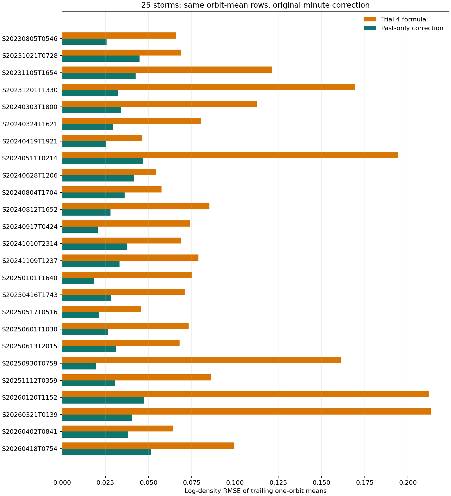
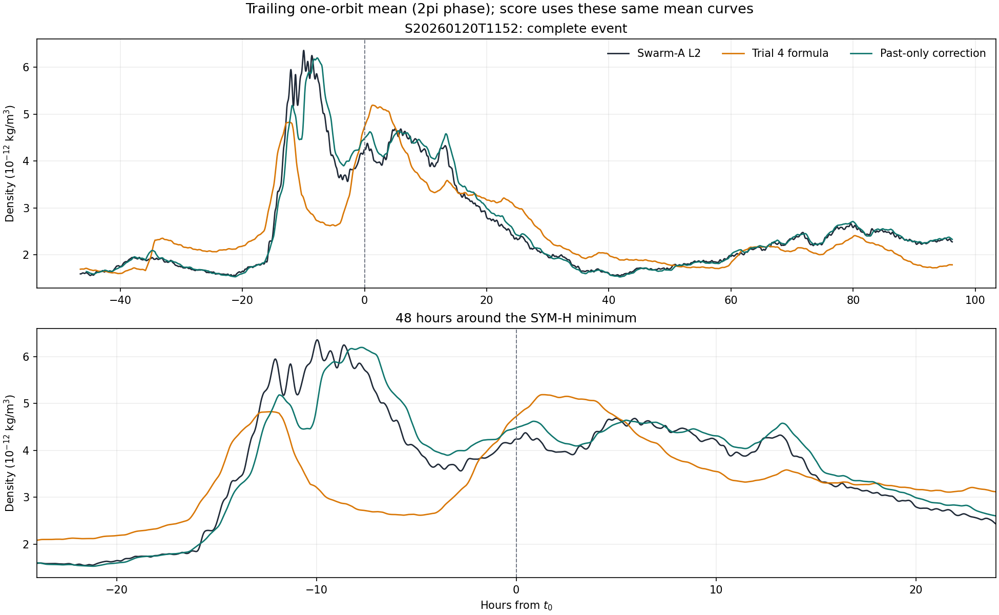
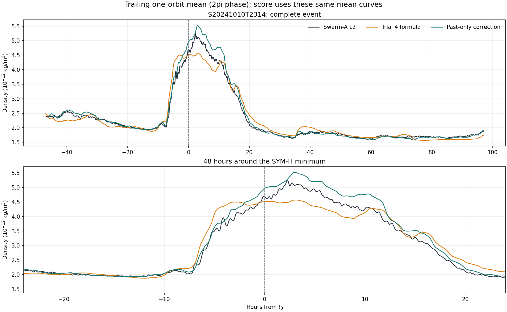

# Phase 5 Trial7：逐分鐘修正、一圈移動平均評分

狀態：[done: descriptive]。在 25 場磁暴中，只用**當下以前連續 60 分鐘**的 Swarm-A L2 對數殘差估計當下修正；當下和未來的 L2 不進入這個估計。主要評分先把 L2、Trial4 與修正後密度各自做往前一圈的移動平均，再在相同時間點比較。合併 212,861 個可評分的一圈平均位置，對數 RMSE 為 **0.11002 → 0.03447**，25 場都下降。原先逐分鐘評分為 **0.18056 → 0.15374**、20/25 場改善，保留作不同尺度的補充。這是同場順序更新的探索性檢查，**不是獨立的跨場或端到端預測**。

## 為什麼重做

先前的[單場中心移動平均展示](trial7_minute_moving_average_report.md)在每個時間點使用前後各 30 分鐘 L2，其中包含要評分的當下 L2。圖可以展示事後平滑，誤差下降不能作為預測證據。本次固定 60 分鐘**過去**窗口，估計第 $t$ 分鐘時只看 $t-60$ 至 $t-1$ 分鐘，然後才以第 $t$ 分鐘 L2 評分。沒有依 25 場成績調整窗口。

產生修正時，我們只對 **L2 與 Trial4 的對數殘差**取過去 60 分鐘平均；不把當分鐘的 L2 加進修正。評分改問「一圈平均密度是否更接近 L2」，因此在**評分階段**才把三條已算好的密度曲線各自做往前一圈的平均。修正和評分是兩個不同步驟；後者沒有回頭修改逐分鐘修正量。

## 資料與方法

資料來自 Phase 3 保存的 Swarm-A L2 和 quiet-MSIS 一分鐘配對密度，共 217,912 個分鐘位置，其中 217,613 分鐘有有效 L2。原生 DNSAPOD 每 30 秒最多兩筆，本報告的一分鐘 L2 是該分鐘有效配對樣本的平均。每場固定 Phase 4 已擬合的 $R_k,\tau_k,G$，以 Phase 2 的連續一分鐘 SME 計算響應，再將 Trial4 公式套到未作相位平均的一分鐘 quiet-MSIS 密度。每場計算前均核對：同一分鐘輸入重新做相位平均後，必須還原 Trial4 正式 SQLite 的 214,907 筆有效一圈平均結果。

Trial4 **正式輸出**是每分鐘更新、以當下為中心的一圈相位平均。本文先以**相同公式及已擬合參數在一分鐘輸入上的延伸**產生橘色逐分鐘曲線，再對這條曲線做往前一圈平均來評分。兩者的相位視窗和可評分位置不同；本文的一圈分數也不可直接當成 Phase 4 正式分數 0.109953 的重測。

對同場的有效分鐘，定義 $e_t=\ln(\rho_{\mathrm{L2},t}/\rho_{\mathrm{T4,1m},t})$。若前 60 個連續分鐘均有有效 L2，就用那些**已過去**的殘差平均，修正固定 Trial4 一分鐘公式：

$$
\widehat e_t=\frac{1}{60}\sum_{j=1}^{60}e_{t-j},\qquad
\rho_{\mathrm{pastMA},t}=\rho_{\mathrm{T4,1m},t}\exp(\widehat e_t).
$$

第一個可用分鐘前的 60 分鐘不評分；遇到無效 L2 分鐘就清空歷史，直到重新累積 60 個連續有效分鐘才恢復估計。共 215,753 個分鐘可在**同一批位置**比較固定 Trial4 與移動平均修正。這是每分鐘順序更新，不適用於中間連續六小時都沒有 L2 的情況。

一圈平均使用每個時間點**往前**的軌道相位 $2\pi$，不是固定 90 或 95 分鐘。令 $u_i$ 為第 $i$ 分鐘的軌道相位，$n_i$ 為該分鐘有效的 30 秒配對筆數；L2、Trial4 與修正後密度各自按同一方式計算：

$$
\bar\rho_X(t)=\frac{\sum_{u_t-2\pi\leq u_i\leq u_t}n_i\rho_X(i)}{\sum_{u_t-2\pi\leq u_i\leq u_t}n_i}.
$$

一圈範圍不完整、缺少觀測或修正尚未開始的時間點不評分。修正曲線中的每個分鐘值仍只用該分鐘以前的 L2 算出，不用一圈視窗後方的資料回頭修它。三條一圈平均密度都有效時，才在該**同一時間點**計算 $\ln(\bar\rho_{\mathrm{L2}}/\bar\rho_{\mathrm{模型}})$。因此一圈分數是「先平均密度、再算誤差」，不是把逐分鐘誤差平均後當分數。尾隨平均會壓低短時尖峰並讓峰形往後延，不能從一圈圖量測物理反應時間 $\tau$。

## 一圈移動平均評分：主要結果

在三條一圈平均曲線都有值的 **212,861 個相同時間點**上，Trial4 的對數 RMSE 是 **0.11002**，修正後是 **0.03447**，整場評分 **25/25 場改善**。只看 $t_0\pm24$ 小時的 71,222 個時間點，RMSE 是 **0.13633 → 0.04448**；其中 **24/25 場改善**，`S20240628T1206` 在這個較短區間從 0.04103 升到 0.05864。

這些時間點是每分鐘更新、彼此高度重疊的一圈視窗，**不能當成 212,861 個獨立磁暴或獨立測試**。分數表示在本次 25 場的同場觀測條件下，修正後的**一圈平均密度**更接近 L2；它沒有證明短時尖峰也被修好。此處是往前一圈平均，Phase 4 正式輸出則是以當下為中心的一圈相位平均，兩者的取點與可評分位置不同，分數不可直接當作同一項重測。

### 兩場曲線

`S20260120T1152` 的一圈平均 RMSE 從 0.21220 降到 0.04739。綠線在多數時段比橘線更接近黑色 L2；尖峰形狀經過平均，不代表原始一分鐘尖峰已重建。

`S20241010T2314` 在逐分鐘評分是 0.17860 → 0.18930，反而變差；改評一圈平均密度則是 0.06853 → 0.03759。這說明兩種分數回答不同問題：綠線在局部高峰仍會偏高，整場較慢的密度變化卻修得更接近 L2。[其餘 23 場的一圈圖](../figures/orbit_mean_25storm/)與[逐場一圈分數](../data/analysis/trial7_25storm_orbit_mean_summary.csv)可逐一核對。

## 逐分鐘評分：保留作對照

| 磁暴 | Trial4 一分鐘對數 RMSE | 過去 60 分鐘修正 | 判定 | 三線圖 |
| --- | ---: | ---: | --- | --- |
| `S20230805T0546` | 0.14199 | 0.13977 | 改善 | [圖](../figures/past_mean_25storm/s20230805t0546_past_mean.png) |
| `S20231021T0728` | 0.16482 | 0.14579 | 改善 | [圖](../figures/past_mean_25storm/s20231021t0728_past_mean.png) |
| `S20231105T1654` | 0.19508 | 0.14813 | 改善 | [圖](../figures/past_mean_25storm/s20231105t1654_past_mean.png) |
| `S20231201T1330` | 0.23144 | 0.17512 | 改善 | [圖](../figures/past_mean_25storm/s20231201t1330_past_mean.png) |
| `S20240303T1800` | 0.19521 | 0.15214 | 改善 | [圖](../figures/past_mean_25storm/s20240303t1800_past_mean.png) |
| `S20240324T1621` | 0.15367 | 0.13991 | 改善 | [圖](../figures/past_mean_25storm/s20240324t1621_past_mean.png) |
| `S20240419T1921` | 0.13492 | 0.14176 | 變差 | [圖](../figures/past_mean_25storm/s20240419t1921_past_mean.png) |
| `S20240511T0214` | 0.26108 | 0.21153 | 改善 | [圖](../figures/past_mean_25storm/s20240511t0214_past_mean.png) |
| `S20240628T1206` | 0.15020 | 0.14813 | 改善 | [圖](../figures/past_mean_25storm/s20240628t1206_past_mean.png) |
| `S20240804T1704` | 0.14950 | 0.15027 | 變差 | [圖](../figures/past_mean_25storm/s20240804t1704_past_mean.png) |
| `S20240812T1652` | 0.14139 | 0.12670 | 改善 | [圖](../figures/past_mean_25storm/s20240812t1652_past_mean.png) |
| `S20240917T0424` | 0.15087 | 0.15024 | 改善 | [圖](../figures/past_mean_25storm/s20240917t0424_past_mean.png) |
| `S20241010T2314` | 0.17860 | 0.18930 | 變差 | [圖](../figures/past_mean_25storm/s20241010t2314_past_mean.png) |
| `S20241109T1237` | 0.16395 | 0.14814 | 改善 | [圖](../figures/past_mean_25storm/s20241109t1237_past_mean.png) |
| `S20250101T1640` | 0.16951 | 0.17450 | 變差 | [圖](../figures/past_mean_25storm/s20250101t1640_past_mean.png) |
| `S20250416T1743` | 0.14379 | 0.12801 | 改善 | [圖](../figures/past_mean_25storm/s20250416t1743_past_mean.png) |
| `S20250517T0516` | 0.12224 | 0.11955 | 改善 | [圖](../figures/past_mean_25storm/s20250517t0516_past_mean.png) |
| `S20250601T1030` | 0.16207 | 0.15647 | 改善 | [圖](../figures/past_mean_25storm/s20250601t1030_past_mean.png) |
| `S20250613T2015` | 0.14714 | 0.14292 | 改善 | [圖](../figures/past_mean_25storm/s20250613t2015_past_mean.png) |
| `S20250930T0759` | 0.19365 | 0.10819 | 改善 | [圖](../figures/past_mean_25storm/s20250930t0759_past_mean.png) |
| `S20251112T0359` | 0.16662 | 0.15468 | 改善 | [圖](../figures/past_mean_25storm/s20251112t0359_past_mean.png) |
| `S20260120T1152` | 0.26708 | 0.17767 | 改善 | [圖](../figures/past_mean_25storm/s20260120t1152_past_mean.png) |
| `S20260321T0139` | 0.26847 | 0.16361 | 改善 | [圖](../figures/past_mean_25storm/s20260321t0139_past_mean.png) |
| `S20260402T0841` | 0.15118 | 0.15194 | 變差 | [圖](../figures/past_mean_25storm/s20260402t0841_past_mean.png) |
| `S20260418T0754` | 0.19361 | 0.16066 | 改善 | [圖](../figures/past_mean_25storm/s20260418t0754_past_mean.png) |

合併 215,753 個分鐘，RMSE 為 **0.18056 → 0.15374**；逐場等權 MSE 後開根號為 **0.18053 → 0.15373**。在 $t_0\pm24$ 小時的 71,594 個可評分分鐘，合併 RMSE 為 **0.22390 → 0.18984**，亦是 20/25 場改善。五場整場變差的是 `S20240419T1921`、`S20240804T1704`、`S20241010T2314`、`S20250101T1640`、`S20260402T0841`。這些事件必須和改善事件一起解讀，不能只挑貼合圖展示。

[S20241010T2314 的失敗圖](../figures/past_mean_25storm/s20241010t2314_past_mean.png)尤其容易看出限制：綠線在部分圈內峰值高於黑色 L2，延續過去偏差反而放大了誤差。這是圖上的現象，不能僅憑圖把原因歸給單一磁暴物理過程。即使 [S20260120T1152 的整場 RMSE 明顯下降](../figures/past_mean_25storm/s20260120t1152_past_mean.png)，短時尖峰仍沒有逐點重建。整場改善不等於每分鐘都修好。

## 能說什麼，不能說什麼

本方法避免了**當分鐘直接讀答案來修正該分鐘**：在第 $t$ 分鐘產生修正時，程式只讀之前 60 個連續有效 L2 殘差；測試也驗證任意更改當分鐘 L2，不影響當分鐘修正。完成修正後，一圈評分才讀該時間點的 L2。這說明同一事件剛觀測到的偏差在後續分鐘有一定可延續性。

但它仍不是獨立預測。Trial4 的每場 $R_k,\tau_k$ 本來就用該事件的完整 L2 一圈平均擬合，當前固定基線含資料內校準；而本方法要求每個待修分鐘之前已有 60 分鐘可信 L2。如果目標衛星整場沒有 L2，或有連續六小時完全無觀測，本方法無從更新。60 分鐘窗口只是固定探索設定，沒有證據說它最符合軌道週期、磁暴響應或局部時間。一圈平均評分也會消去部分圈內差異，不能用 0.03447 代表原始一分鐘密度的誤差。移動平均修正不是新的密度物理項，不能把它的改善解讀成量到了特定大氣機制。

## 證據與輸出

- [25 場摘要 CSV](../data/analysis/trial7_25storm_past_mean_summary.csv)
- [25 場逐分鐘衍生值 CSV.gz](../data/analysis/trial7_25storm_past_mean_minute.csv.gz)
- [25 場一圈平均評分 CSV](../data/analysis/trial7_25storm_orbit_mean_summary.csv)、[一圈平均評分與圖重算程式](../code/prep_trial7_orbit_mean_figures.py)：只讀既有逐分鐘結果與軌道相位，產生一圈尺度分數與 25 張圖；不重算逐分鐘修正。
- [計算與繪圖程式](../code/prep_trial7_past_mean_25storm.py)、[移動平均計算](../code/calc_trial7_past_mean.py)、[資料對齊](../code/prep_trial7_raw_minute_figure.py)
- [不讀當下值與缺口重置檢查](../tests/test_calc_trial7_past_mean.py)

決定：以一圈平均密度的分數回答一圈尺度的問題；逐分鐘分數保留作短時尺度對照。兩者都屬於 Phase5 Trial7 的同場探索，不將 25 場誤差下降升格為 Phase5 Final，也不以中心移動平均的同資料貼合分數當作證據。
