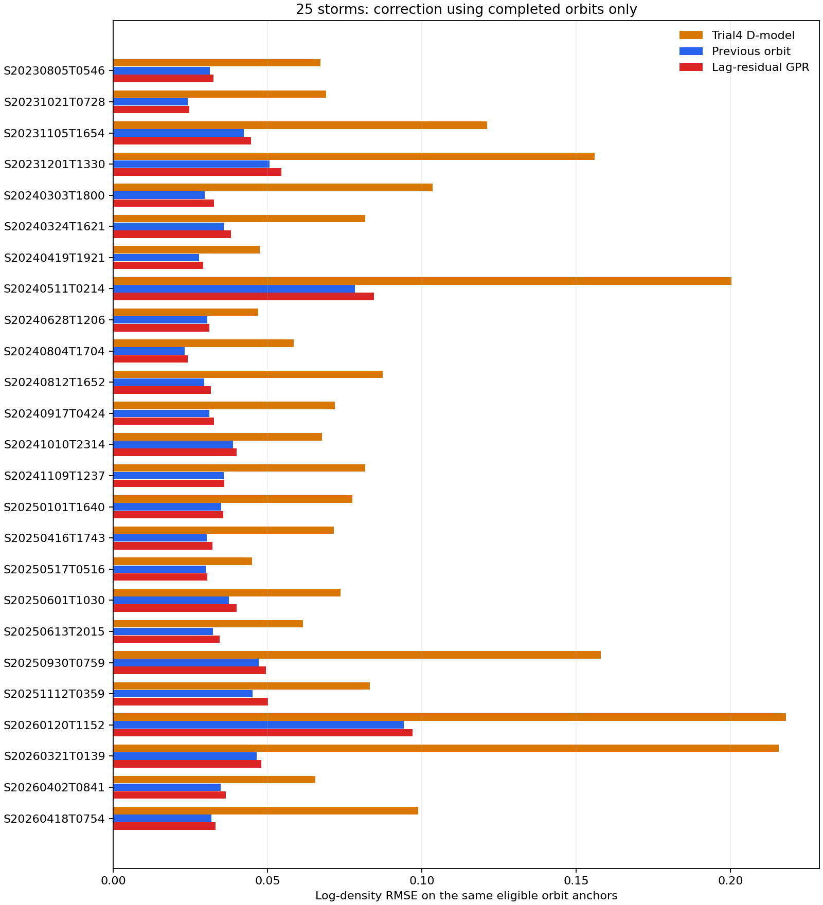
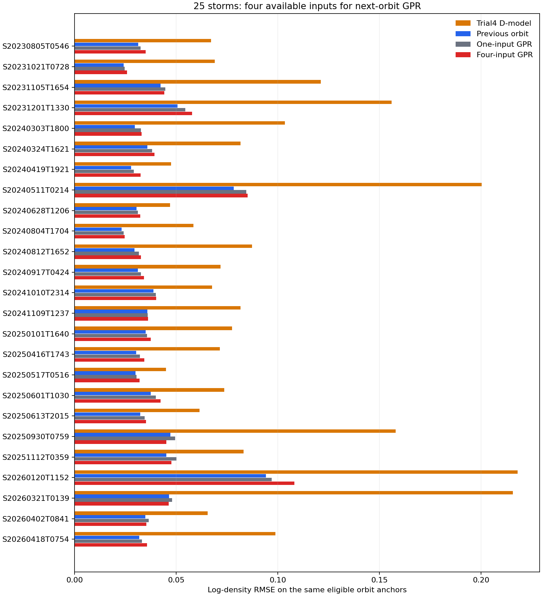

# Trial8：這一圈的誤差能否用 GPR 推下一圈？

狀態：[working]。只用這一場磁暴已完成的圈，依序估計下一圈的 L2 與 Phase 4 D-model 差距。25 場共 2,115 個可評分的圈。單輸入 GPR 的對數 RMSE 是 **0.04429**；指定四輸入 GPR 是 **0.04581**；直接沿用上一圈誤差是 **0.04211**。兩版 GPR 的整體分數都不如這個簡單方法，因此目前不能選為 Trial8 的首選修正。

## 資料與問題

沿用 Trial1 已保存的 2,295 個一圈錨點。每點有同一中心相位窗口的 Swarm-A L2 和 Trial4 密度；Trial4 的公式與參數都不改。每場磁暴各自依時間排序，絕不把另一場的 L2 誤差當作本場的已知歷史。

令第 $k$ 圈的對數差距為

$$
e_k=\ln\!\left(\frac{\rho_{\mathrm{L2},k}}{\rho_{\mathrm{T4},k}}\right).
$$

第 $k$ 圈還沒有拿來更新修正時，只能使用前面已完成的 $e_0,\ldots,e_{k-1}$。最簡單的參考做法是把上一圈的誤差直接沿用：$\hat e_k=e_{k-1}$。

## 第一版：只給上一圈誤差

GPR 讀取過去的「上一圈誤差、下一圈改變量」配對：

$$
(e_i,\ e_{i+1}-e_i),\qquad i=0,\ldots,k-2.
$$

拿最新已知的 $e_{k-1}$ 問 GPR：下一圈的誤差大概還會再改變多少？若 GPR 回答 $\widehat{\Delta e}_k$，修正量就是 $\hat e_k=e_{k-1}+\widehat{\Delta e}_k$，候選密度是 $\rho_{\mathrm{T4},k}\exp(\hat e_k)$。第 $k$ 圈的 L2 只在這個估計完成後用於評分，並成為下一次估計的歷史資料。

每次至少要有五組已完成的相鄰圈變化，才開始評分。錨點的相位圈號若跳過一圈，就重新累積，不把隔了兩圈的變化誤當成下一圈。原資料有 5 處這種缺口。每場第一段和缺口後的前六圈不評分，最後在 2,295 點中有 2,115 點可公平比較三種方法。GPR 使用一個輸入欄位 $e_i$，以 RBF 加雜訊項擬合；標準化和核參數都只用當次已完成的配對估計。這版沒有加入 AP、SME、時間或其他外部特徵。

## 結果

| 方法 | 相同 2,115 圈的對數 RMSE | 對數 MAE | 勝過原始 Trial4 的場數 |
| --- | ---: | ---: | ---: |
| 固定 Trial4 D-model | 0.11014 | 0.07945 | -- |
| 直接沿用上一圈誤差 | **0.04211** | **0.02845** | 25/25 |
| 上一圈誤差 + GPR 估計改變量 | 0.04429 | 0.02994 | 25/25 |

在每一場的同一批圈上，直接沿用上一圈誤差都比單輸入 GPR 小。這表示上一圈本身已是強參考；這個只看單一誤差值的 GPR 沒找到能穩定補上的規律。它仍明顯優於未修正的 D-model，但這個勝利不能代替和簡單方法的比較。

[S20240511T0214 的密度對照圖](../figures/next_orbit_25storm/s20240511t0214_next_orbit.png)顯示四條線在整場磁暴的差別。所有[25 場逐場密度圖](../figures/next_orbit_25storm/)都用相同的繪圖規則；圖上只畫可評分的圈。

## 第二版：加入指定的四個輸入

每個待估計的第 $k$ 圈，依照討論給 GPR 四個值：

1. 這一圈的 Trial4 D-model 密度 $\rho_{\mathrm{T4},k}$。
2. 上一圈的 Trial4 D-model 密度 $\rho_{\mathrm{T4},k-1}$。
3. 上一圈已觀測的 L2 密度 $\rho_{\mathrm{L2},k-1}$。
4. 上一圈的對數誤差 $e_{k-1}$。

前三個密度先取對數，再用當時已完成的圈做標準化；沒有加入這一圈的 L2。GPR 仍以「下一圈誤差比上一圈改變多少」為目標。第 $k$ 圈的 Trial4 與上一圈 Trial4 一起提供基線密度的變化資訊，這是第一版沒有的。但四欄不是四份獨立資訊，因為 $e_{k-1}=\ln(\rho_{\mathrm{L2},k-1}/\rho_{\mathrm{T4},k-1})$，可以由其中兩欄直接算出。保留四欄是為了照指定輸入實測；不能把這當成額外的獨立觀測。

| 方法 | 相同 2,115 圈的對數 RMSE | 對數 MAE | 勝過直接沿用上一圈的場數 |
| --- | ---: | ---: | ---: |
| 固定 Trial4 D-model | 0.11014 | 0.07945 | 0/25 |
| 直接沿用上一圈誤差 | **0.04211** | **0.02845** | -- |
| 單輸入 GPR | 0.04429 | 0.02994 | 0/25 |
| 指定四輸入 GPR | 0.04581 | 0.03076 | 2/25 |

指定四輸入 GPR 在 5/25 場勝過單輸入 GPR，但整體反而更差。這個結果只說明目前四欄設定沒有帶來穩定改善；不能單憑分數判定是欄位重複、訓練資料量或其他因素造成。兩版都使用相同可評分圈，沒有為四輸入版另挑較容易的位置。

[S20240511T0214 的逐圈百分比誤差](../figures/four_feature_25storm/s20240511t0214_four_feature_error.png)可看出兩版 GPR 和簡單沿用在磁暴附近的差異。[25 場逐場誤差圖](../figures/four_feature_25storm/)使用同樣的計分位置。

## 可以主張到哪裡

這是**同場、有持續 L2 的逐圈修正**。GPR 在估計某一圈時沒有讀那一圈或更後面的殘差；程式也有針對這點的測試。但 Trial4 的 $R_k,\tau_k,G$ 早已用這 25 場的完整 L2 擬合，固定基線本身含有全場資訊。因此這不是獨立的即時預報，也不能拿來修一整場沒有 L2 的衛星。

這裡每圈取的是 Trial4 的**中心相位平均錨點**，不是 Trial7 的逐分鐘點或大量重疊的往前一圈平均窗口。Trial8 的 0.04429、0.04211 和 Trial7 的 0.03447 不可直接排名。L2 是比較用的觀測產品，也不是零誤差真值。

## 重算與證據

- [逐圈估計 CSV](../data/analysis/trial8_next_orbit_predictions.csv)：每圈的來源時間、兩種修正量、GPR 標準差與候選密度。
- [逐場與合計指標](../data/analysis/trial8_next_orbit_metrics.csv)：三種方法只在相同可評分圈上計分。
- [計算程式](../code/calc_trial8_next_orbit_gpr.py)、[重算程式](../code/prep_trial8_next_orbit_gpr.py)、[不偷看當圈答案的測試](../tests/test_calc_trial8_next_orbit_gpr.py)。來源 SQLite 唯讀；輸出是新的 CSV 和圖，沒有改 Trial1 或 Phase 3 資料。
- [四輸入版逐圈估計](../data/analysis/trial8_four_feature_predictions.csv)：逐列保存當圈 Trial4、上一圈 Trial4、上一圈 L2、上一圈誤差與上一圈時間。[四方法同位置分數](../data/analysis/trial8_four_feature_metrics.csv)、[計算程式](../code/calc_trial8_four_feature_gpr.py)、[重算程式](../code/prep_trial8_four_feature_gpr.py)、[不偷看當圈 L2 的測試](../tests/test_calc_trial8_four_feature_gpr.py)。
