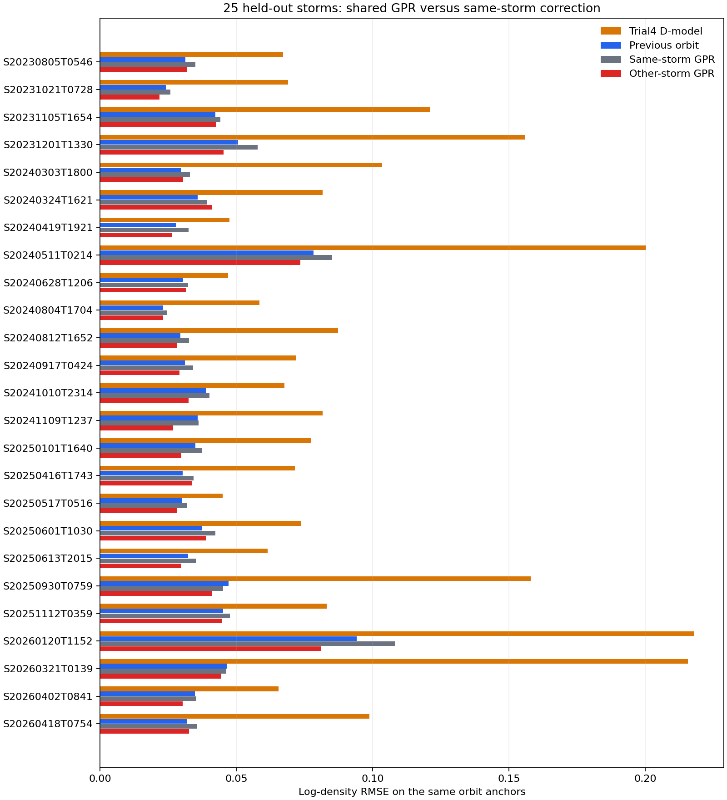
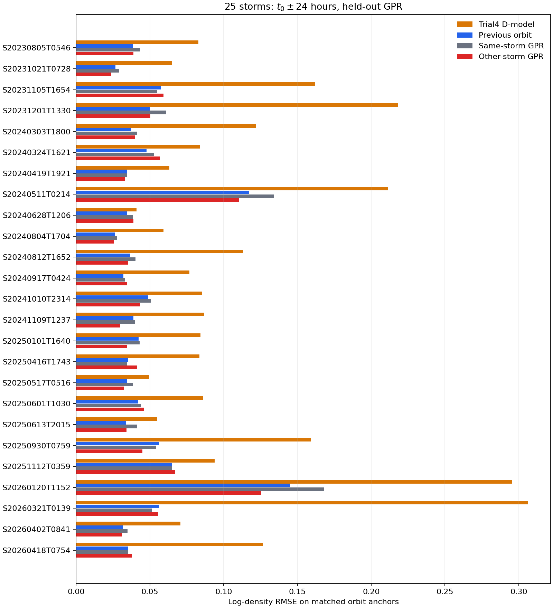

# Trial9：其他磁暴能不能教會 GPR 修正下一圈？

狀態：[working]。使用 Trial2 原有的五折分組，每折以 20 場磁暴的相鄰圈訓練一個共用 GPR，完整留下另外 5 場測試。25 場都被留出測試一次。在與 Trial8 相同的 **2,115 個圈**上，跨場 GPR 對數 RMSE 為 **0.03926**，低於直接沿用上一圈誤差的 **0.04211**。整場 **17/25 場**改善；磁暴中心前後 24 小時只有 **13/25 場**改善。這是有條件的進展，仍不能當作通用密度修正。

## 資料怎麼合併

Trial8 每場各訓練自己的 GPR。Trial9 改把**其他磁暴內部**真正相鄰的圈放在一起，學一個共同的「下一圈誤差怎麼變」規則。原有 25 場共 2,295 個一圈錨點；去掉每場的第一點與 5 處缺圈後，得到 **2,265 組相鄰圈**。不同磁暴的末圈和首圈絕不接在一起。

待測第 $k$ 圈的四個輸入和 Trial8 一致：

1. 這一圈的 Trial4 D-model 密度。
2. 上一圈的 Trial4 D-model 密度。
3. 上一圈已觀測的 L2 密度。
4. 上一圈的對數誤差 $e_{k-1}=\ln(\rho_{\mathrm{L2},k-1}/\rho_{\mathrm{T4},k-1})$。

GPR 要估計的是 $e_k-e_{k-1}$，再用 $\hat e_k=e_{k-1}+\widehat{(e_k-e_{k-1})}$ 修正這一圈的 Trial4 密度。這一圈的 L2 **不是輸入**，只在預測後評分。前三個密度先取對數；標準化、GPR 核參數與訓練標籤，都只從當折的 20 場取得。四個輸入有重複資訊：上一圈誤差能由上一圈 L2 和 D-model 算出。這版照指定四欄測試，不把它們解讀成四份獨立觀測。

## 怎麼留出五場測試

直接讀取[Trial2 保存的五折名單](../../phase5-trial2/data/analysis/phase4_trial4_groupcv20_5_folds.json)，不重新挑較容易的磁暴。每折約有 1,810 組訓練相鄰圈與 450 組測試相鄰圈。五場測試磁暴的誤差變化**完全不參與當折 GPR 訓練或調參**；但估計某一圈時，允許使用這場磁暴**上一圈**已觀測的 L2。這是「在新磁暴有上一圈 L2 時，其他磁暴教的變化規則能否移用」，不是整場都沒有 L2 的情況。

所有 2,265 組測試相鄰圈都有跨場 GPR 估計。為了直接比較 Trial8，同一張主表只評分 Trial8 也能估計的 **2,115 圈**；另外 150 圈的預測仍保留在逐圈 CSV，不混進主比較。

## 整場結果

| 相同 2,115 圈 | 對數 RMSE |
| --- | ---: |
| 固定 Trial4 D-model | 0.11014 |
| 直接沿用上一圈誤差 | 0.04211 |
| Trial8 同場四輸入 GPR | 0.04581 |
| Trial9 其他磁暴訓練的四輸入 GPR | **0.03926** |

跨場 GPR 在 17/25 場勝過直接沿用上一圈，在 24/25 場勝過 Trial8 的同場四輸入 GPR。五折的合併 RMSE 也都比直接沿用小，並非只靠某一折撐起總分；但仍有 8 場比簡單方法差。逐場結果比單一總分更能反映使用風險。

| 測試折 | 圈數 | 沿用上一圈 | 跨場 GPR |
| --- | ---: | ---: | ---: |
| 1 | 423 | 0.04031 | 0.03877 |
| 2 | 430 | 0.03077 | 0.02981 |
| 3 | 430 | 0.04920 | 0.04382 |
| 4 | 409 | 0.04707 | 0.04394 |
| 5 | 423 | 0.04092 | 0.03848 |

## 磁暴最重要的時段

只看每場事件時刻 $t_0$ 前後 24 小時，仍在相同的 **754 圈**評分：Trial4 為 **0.13658**，直接沿用上一圈為 **0.05545**，Trial8 同場 GPR 為 **0.06075**，跨場 GPR 為 **0.05266**。合併分數雖改善，逐場只有 **13/25 場**勝過簡單沿用。不能只引用整場的 17/25，忽略磁暴附近較不穩定的結果。

[S20240511T0214 的逐圈百分比誤差](../figures/pooled_25storm/s20240511t0214_pooled_error.png)顯示跨場 GPR 有時能壓低尖峰，也會在別的位置增大誤差。[25 場逐場圖](../figures/pooled_25storm/)都用相同規則繪製。

## 這個結果能說什麼

Trial9 與 Trial2--Trial5 的跨場 GPR 是**不同問題**。那些 Trial 用磁活動等特徵去估計未見磁暴的殘差；Trial9 額外知道待測磁暴上一圈的 L2，因此能從已觀測誤差往下一圈更新。Trial9 的改善不能推翻 Trial2--Trial5 的負結果，也不能稱為整場無 L2 的密度預測成功。

更深的限制是固定 Trial4 D-model 的每場 $R_k,\tau_k$ 已用完整事件 L2 擬合，$G$ 也在這 25 場上調過。留出的是**殘差 GPR 的訓練標籤**，不是整套 Trial4+GPR 模型的獨立外測。這 25 場已反覆用於研究探索；目前只能說這組留場測試顯示共同的逐圈誤差變化**可能有用**，仍需新的磁暴和真正可事先取得的 D-model 基線驗證。L2 也是比較用的觀測產品，並非零誤差真值。

## 計算硬體與模型保存

本次五折訓練**沒有用 GPU**，只用 CPU。改善的證據是五場完整留出的評分，不是硬體種類。每折約 1,810 組訓練資料，普通 GPR 在這個規模仍可直接運算。

五個已訓練模型連同各自的輸入標準化器，保存在本機 `data/models/trial9_fold_1.joblib` 至 `trial9_fold_5.joblib`。保存後已重新載入，逐圈預測及 GPR 標準差與原 CSV 核對一致。另存一個以 25 場資料訓練的 `trial9_all_25.joblib`，供日後新資料使用；**不能用它回頭替這 25 場宣稱留場測試分數**。

之後若只是看這次結果，直接讀 CSV 和圖，不用訓練。若要用既有模型估計下一圈，可用[模型載入程式](../code/load_trial9_gpr_model.py)載入本機檔案，也不用重訓。若到另一台沒有 `.joblib` 的電腦，則需從保存的來源與折次重新建立模型。模型二進位檔較大，留在本機且不納入 Git；[五折模型清單](../data/models/manifest.json)與[25 場模型清單](../data/models/final_manifest.json)保存版本、訓練筆數與核參數。只載入自己產生且可信的模型檔。

## 重算與證據

- [逐圈測試輸出](../data/analysis/trial9_pooled_predictions.csv)：2,265 組，包含 fold、上一圈時間與四個輸入的來源值、GPR 估計和訓練核參數。
- [逐場分數](../data/analysis/trial9_pooled_event_metrics.csv)、[逐折分數](../data/analysis/trial9_pooled_fold_metrics.csv)：主比較限相同 2,115 圈。
- [磁暴中心前後 24 小時分數](../data/analysis/trial9_t0_48h_event_metrics.csv)：相同 754 圈。
- [五折 GPR 重算程式](../code/prep_trial9_pooled_orbit_gpr.py)、[磁暴窗口重算程式](../code/prep_trial9_storm_window.py)、[資料邊界測試](../tests/test_prep_trial9_pooled_orbit_gpr.py)。來源 SQLite 與 Trial8 CSV 唯讀，結果另存 Trial9。
- [保存五折模型](../code/prep_trial9_save_models.py)、[保存 25 場模型](../code/prep_trial9_save_final_model.py)、[載入模型並推下一圈](../code/load_trial9_gpr_model.py)。
