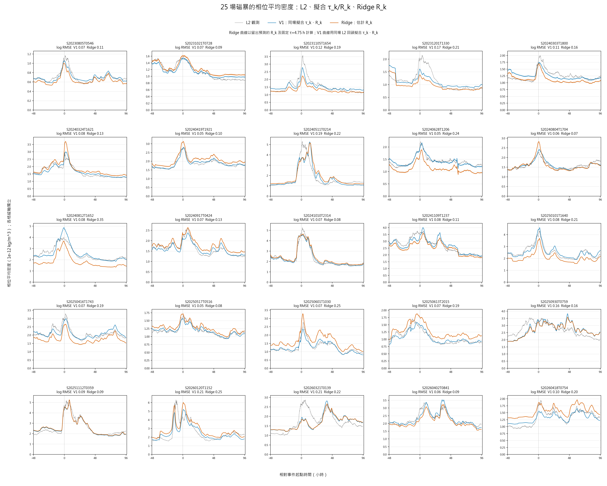

# Phase 5 V2：A* 風格特徵搜尋與 Ridge 估計事件 R

狀態：[done: exploratory]。主線固定為 Ridge，不採用 GPR。從 23 個候選因素中搜尋一組固定特徵，估計 Phase 4 V2 每場 $R_{\mathrm{fit},k}$ 與 Phase 3 原本 $R_k$ 的差。選出的組合是 `{r_phase3, prequiet_sme_mean_nt, quiet_f107a_last81_sfu}`。五次 20 場訓練／5 場算分的 $R_k$ RMSE 算術平均為訓練 0.100904、算分 0.115458；直接使用 Phase 3 $R_k$ 的算分 RMSE 為 0.140640。這批 5 場分數也參與特徵選擇，因此 0.115458 是**搜尋分數，不是獨立外測成績**。代入固定 $\tau=4.75$ h 的密度式後，Ridge 密度在 25 場的等事件權重 log RMSE 為 0.179233；[5×5 密度圖](../figures/ridge_density_25_storms_5x5_v3.png)只顯示 L2、Ridge 與同場擬合 $\tau_k$、$R_k$ 的 V1。

方法名稱：**交叉驗證引導的演化式包裝法特徵選擇 + Ridge 迴歸**（*cross-validation-guided evolutionary wrapper feature selection with Ridge regression*）。「包裝法」用 Ridge 的五組 20/5 RMSE 評價因素組合；「A* 風格」指優先擴展分數較好的組合，再合併、隨機替換。Ridge 是最後預測 $\Delta R_k$ 的機器學習模型。

本階段交付項目已全部完成：Phase 4 V2 $R_k$ 目標快照、23 因素資料、A* 風格搜尋、固定三因素 Ridge、五組逐場分數、全 25 場研究模型、L2／Ridge／擬合 $\tau_k$ 與 $R_k$ 的逐分鐘密度與 25 格圖、SQLite 核對、資料血緣與本報告。本報告結案時尚無新事件外測；後續 Phase 7 V2 已依固定流程完成三場外測，結果不支持作正式下游輸入。

後續狀態：[Phase 7 V2](../../phase7-v2/reports/phase_7_late_2022_early_2023_three_storms_report.md)已用固定模型處理三場未參與訓練的事件。Ridge density 與下降量都是一勝兩負，未支持它優於 M0；這不回寫本報告的 25 場探索分數。

## 問題與目標

Phase 4 V2 `phase4_v2_events.r_fit` 是本研究要估計的 $R_k$，25 場完整精度已存於 `data/sqlite/phase4_v2_r_targets_v2.sqlite`。其共同 $\tau=4.75$ h，$G=0.0006898286353846385\ \mathrm{nT}^{-1}$。Phase 3 `phase3_25storm_overview.r_candidate` 是暴前低活動段算出的原本 $R_k$，用作模型輸入與直接使用的基準。Ridge 學一個事件一個數值：

$$
\Delta R_k=R_{\mathrm{fit},k}-R_{\mathrm{Phase3},k},\qquad
\widehat R_k=R_{\mathrm{Phase3},k}+\widehat{\Delta R}_k.
$$

Phase 4 V2 的 $R_{\mathrm{fit},k}$ 用同場 L2 密度回溯擬合，並非物理真值，也不是事件發生時已知的答案。逐分鐘資料用來做事件特徵；獨立的 $R_k$ 標籤仍只有 25 個。

Phase 4 V2 來源庫在本次整理期間重新產生，`r_fit` 完整精度出現約 $10^{-13}$ 的差異。先前的 `phase4_v2_r_targets_v1.sqlite` 與 `storm_r_ridge_v20.sqlite` 保留為舊來源快照；現行目標快照 v2 與 Ridge 結果 v21 已重算，25 個 `r_fit` 均與目前來源 SQL 逐筆完全相同。報告中的六位小數結果未因此改變。

## Phase 4 V2 與資料串接核對

狀態：[done]。Phase 4 V2 細掃 SQL 的最低點是 $\tau=4.75$ h、$G=0.0006898286353846385\ \mathrm{nT}^{-1}$、事件等權對數密度 RMSE 0.113058769603。逐分鐘 SQL 有 214,907 筆、25 場；`phase4_v2_events.valid_phase_minutes` 合計也為 214,907。每筆分鐘表的 `r_fit` 都等於同場事件表的 `r_fit`，來源庫 `integrity_check=ok`。這些值與 [Phase 4 V2 報告](../../phase4-v2/reports/shared_tau_grid_report.md)一致。

Phase 5 V2 的 Phase 3 事件輸入取自 Phase 4 留下的唯讀 Phase 3 快照；與 `phases/phase3/data/sqlite/swarm_a_phase3_prediction_tau465_exploratory.sqlite` 的 25 筆 `{storm_id, t0_time_us, r_candidate, r_pre_distance_days}` 逐筆相同。特徵讀取的 Phase 2 P2.2 與 Phase 4 V2 讀取的 P2.6 SQL，`geomag_1min_v2` 的 1,578,240 個分鐘鍵及 `{sme_nt, sme_valid, symh_nt, ae_nt}` 全部相同；`storm_minimum_v2` 的 1,758 個鍵也相同。來源版本不同，但本流程使用的資料內容一致。

## 資料與 23 個候選因素

```text
Phase 4 V2 SQL: 25 個 r_fit 標籤
Phase 3 快照: 25 個原本 R_k，來自 20 個不同低活動校準段
Phase 2／1 磁場與太陽活動資料: 校準段及前 24 h 的事件特徵
  -> 25 個事件 × 23 個因素
  -> A* 風格搜尋一組因素 -> Ridge 修正量
```

| 類別 | 候選因素 | 定義 |
| --- | --- | --- |
| 原本估計與時間 | `r_phase3`, `distance_days`, `quiet_day`, `event_day`, `quiet_season_cos` | Phase 3 倍率；校準段到首次強 SYM-H 低點的天數；校準日期、事件日期的線性天數；校準日期的季節餘弦 |
| 校準段活動 | `quiet_duration_h`, `quiet_mean_sme_nt`, `quiet_max_sme_nt`, `quiet_std_sme_nt`, `quiet_sme_trend_nt_h`, `quiet_mean_ap`, `quiet_mean_symh_nt`, `quiet_symh_range_nt`, `quiet_mean_ae_nt`, `quiet_max_ae_nt` | 校準段長度及 SME、ap、SYM-H、AE 的平均、極值、範圍或變動 |
| 校準段殘留響應 | `quiet_mean_h_nt`, `quiet_max_abs_h_nt`, `quiet_std_h_nt`, `quiet_positive_h_fraction`, `quiet_abs_h_p90_nt` | 依 Phase 3 歷史響應設定算出的 $H$ 平均、最大絕對值、標準差、正值比例、絕對值第 90 百分位 |
| 校準前與太陽背景 | `prequiet_sme_mean_nt`, `prequiet_ap_mean`, `quiet_f107a_last81_sfu` | 校準段開始前 24 h 的 SME、ap 平均；校準開始前最近可用的 F10.7A，最長落後 3 h |

原擬試的密度比 IQR 未備妥，23 個因素中的 `quiet_abs_h_p90_nt` 是替代候選，不能稱為密度比。Phase 3 的校準段是依事件首次強 SYM-H 低點往前選取；這套輸入帶有回溯選段條件，尚不是即時預報流程。

## 怎麼挑出三個因素（A* 風格搜尋）

把 23 個因素想成 23 張卡片。我們要找出最多 3 張卡片，讓 Ridge 算出的 $R_k$ 盡量接近答案。A* 找路時會先往較有希望的方向走；我們也先多試**目前分數較好的因素組合**。這只是借用 A* 的想法：我們沒有估計「還沒試的因素」會帶來多少改善，所以不是標準 A*。

1. **先決定怎麼算分。**25 場固定分成 5 組。每次拿 20 場訓練 Ridge（`alpha=1`），預測另外 5 場的 $R_k$。先算這 5 場的 RMSE（預測誤差指標），再取五次 RMSE 的平均；數字越小越好。每次都只用訓練的 20 場把因素換成同一尺度。共用 Phase 3 校準段的事件不拆到訓練和算分兩邊。
2. **23 個因素各試一次。**一開始每組只有 1 個因素；每組都按同樣的五次 20/5 方法算分。
3. **從好成績的組合繼續試。**保留目前分數最低的 8 組，隨機挑其中兩組合在一起，最多留 3 個因素。另有 70% 機率隨機加入 1 個新因素；若已經有 3 個，就先移掉 1 個再加入。每輪嘗試 24 次，重複 7 輪；亂數種子固定為 42。遇到試過的同一組，不重算分數。
4. **選出得分最低的一組。**總共試了 137 種不同組合，選五次 RMSE 平均最低者。沒有把所有可能的組合試完，因此不能保證它是全部組合中最好的。

選定的組合是 `{r_phase3, prequiet_sme_mean_nt, quiet_f107a_last81_sfu}`，五次 RMSE 平均為 0.115458。它們分別是 Phase 3 原本的 $R_k$、校準段前 24 h 的 SME 平均、校準前最近可用的 F10.7A。五次使用**同樣三個因素**，但每次只用當次的 20 場訓練 Ridge。另用全部 25 場訓練一次並保存係數；圖中的 $R_k$ 不是由這個 25 場模型算出。

實際傳給密度計算的 25 個 $\widehat R_k$ 依此順序產生：先用全部 25 場的五組算分選定三個因素；固定因素名稱後，每輪只用 20 場計算標準化參數並訓練 Ridge，預測留出的 5 場。每場只保存自己被留出時的 $\widehat R_k=R_{\mathrm{Phase3},k}+\widehat{\Delta R}_k$，寫入 `heldout_prediction.r_pred`。全 25 場重擬合的模型只保存係數，**不產生圖中的 $R_k$**。

| 搜尋排名 | 因素組合 | 五次 5 場 RMSE 平均 |
| --- | --- | ---: |
| 1 | `r_phase3, prequiet_sme_mean_nt, quiet_f107a_last81_sfu` | 0.115458 |
| 2 | `r_phase3, prequiet_ap_mean` | 0.125682 |
| 3 | `r_phase3, prequiet_ap_mean, quiet_f107a_last81_sfu` | 0.126466 |

排名只針對本輪實際試過的 137 組；多組合反覆比較同一 25 場，名次不能當因素重要性或物理因果證據。

## 結果

| 切分 | Ridge 訓練 RMSE | Ridge 5 場 RMSE | 直接用 Phase 3 $R_k$ 的 5 場 RMSE |
| --- | ---: | ---: | ---: |
| 1 | 0.086501 | 0.162014 | 0.199874 |
| 2 | 0.093136 | 0.158568 | 0.181469 |
| 3 | 0.112368 | 0.061743 | 0.159418 |
| 4 | 0.111648 | 0.068778 | 0.051579 |
| 5 | 0.100868 | 0.126187 | 0.110860 |
| **算術平均** | **0.100904** | **0.115458** | **0.140640** |

五組中有三組 Ridge 的算分 RMSE 較低、兩組較高。訓練與算分 RMSE 平均相差 0.014554。這張表呈現固定資料上的探索結果；因素已依同一張表的五場分數選定，不能用 0.115458 宣稱對新磁暴的預測誤差。

全 25 場重擬合後，標準化模型的截距為 0.036810。若 $x_j$ 是因素原值、$\mu_j$ 是下表的訓練平均、$s_j$ 是訓練尺度，則 $\widehat{\Delta R}=0.036810+\sum_j b_j(x_j-\mu_j)/s_j$。

| 因素 | $\mu_j$ | $s_j$ | $b_j$ |
| --- | ---: | ---: | ---: |
| `r_phase3` | 0.878312 | 0.174405 | -0.059587 |
| `prequiet_sme_mean_nt` | 85.500955 | 15.339324 | -0.058879 |
| `quiet_f107a_last81_sfu` | 166.868000 | 24.707258 | -0.058525 |

係數來自彼此相關的候選因素與 25 場訓練資料，不解讀為物理因果效應。全 25 場訓練 RMSE 為 0.103579，只是貼合度。

## 25 場密度曲線：L2、Ridge、同場擬合 $\tau_k$ 與 $R_k$

狀態：[done: exploratory]。每場使用其 20 場訓練／5 場算分時得到的**留出 Ridge $\widehat R_k$**，代入 Phase 4 V2 的共同 $\tau$、$G$ 與分鐘響應，計算：

$$
\rho_{\mathrm{Ridge},k,t}
=\rho_{\mathrm{MSIS,q},k,t}\,\widehat R_k\,
\exp\!\left(G_{\mathrm{V2}}H_{\mathrm{V2},k,t}\right).
$$

圖上同一 `{storm_id, time_us}` 分鐘鍵只畫三條：**灰色** Swarm-A L2 相位平均觀測、**橘色** Ridge 估計 $R_k$ 的密度、**藍色** Phase 4 V1 D-model 同場擬合 $\tau_k$ 與 $R_k$ 的密度。Ridge 使用 Phase 4 V2 的固定 $\tau$、$G$ 與響應計算密度，但圖中不畫 V2 回頭擬合 $R_k$ 的曲線。三條線共有 214,907 個時間鍵；Ridge 不用同場 L2 重新擬合 $R_k$。



| 密度曲線 | 25 場等事件權重 log-density RMSE |
| --- | ---: |
| 同場擬合 $\tau_k$、$R_k$（Phase 4 V1 D-model） | 0.109953 |
| Ridge $\widehat R_k$ + V2 | 0.179233 |

Ridge 曲線在這 25 場的逐場 log-density RMSE 均高於同場擬合 $\tau_k$、$R_k$ 的曲線。擬合曲線直接使用該場 L2，橘線則使用 Ridge 留出的 $R_k$；這個差距不能當成公平的預報模型勝負。逐分鐘資料與逐場分數在 `data/sqlite/storm_r_ridge_density_v1.sqlite`；圖中每格縱軸依該場密度獨立設定，折線使用原始分鐘點。

## 來源、輸出與決定

重算入口是 `code/prep_phase4_v2_r_targets.py`、`code/prep_storm_r_ridge.py`、`code/prep_storm_r_ridge_density.py` 與 `code/prep_storm_r_ridge_density_figure.py`；既有輸出不覆寫。資料血緣見[Phase 5 V2 Ridge](../docs/lineage/storm_r_ridge.md)。Ridge 結果庫 `data/sqlite/storm_r_ridge_v21.sqlite` 有 25 場目標、575 筆因素、137 組候選、5 筆折分數、25 場留出預測、3 筆最終係數。密度比較庫 `data/sqlite/storm_r_ridge_density_v1.sqlite` 有 214,907 筆分鐘值及 25 筆逐場分數。25 個 $R_{\mathrm{fit},k}$ 與 Phase 4 V2 來源逐筆完全一致；20 個校準段在切分時保持完整，五組各 5 場算分，兩庫 SQLite `integrity_check=ok`。

決定：Phase 5 V2 的 Ridge 保留為**探索性候選**；先前 GPR 試驗保留在[歷史報告](storm_r_gpr_report.md)，不進目前主線。Phase 7 固定三個因素、既有標準化、係數與截距，沒有用新事件答案重新挑因素；三場 Ridge density 與下降量都是一勝兩負，未支持它優於 M0，因此不升級為正式下游輸入。若要主張即時預報，仍須改寫依首次強 SYM-H 低點選校準段的流程，並增加外部事件數。
