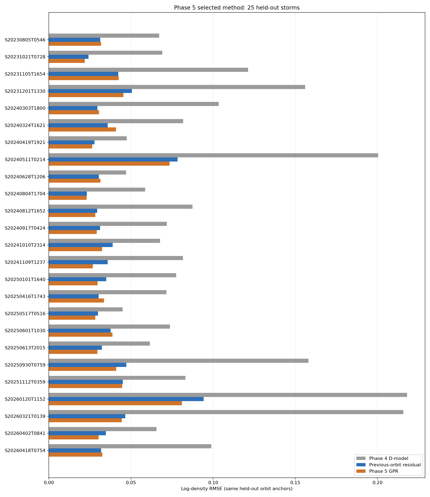
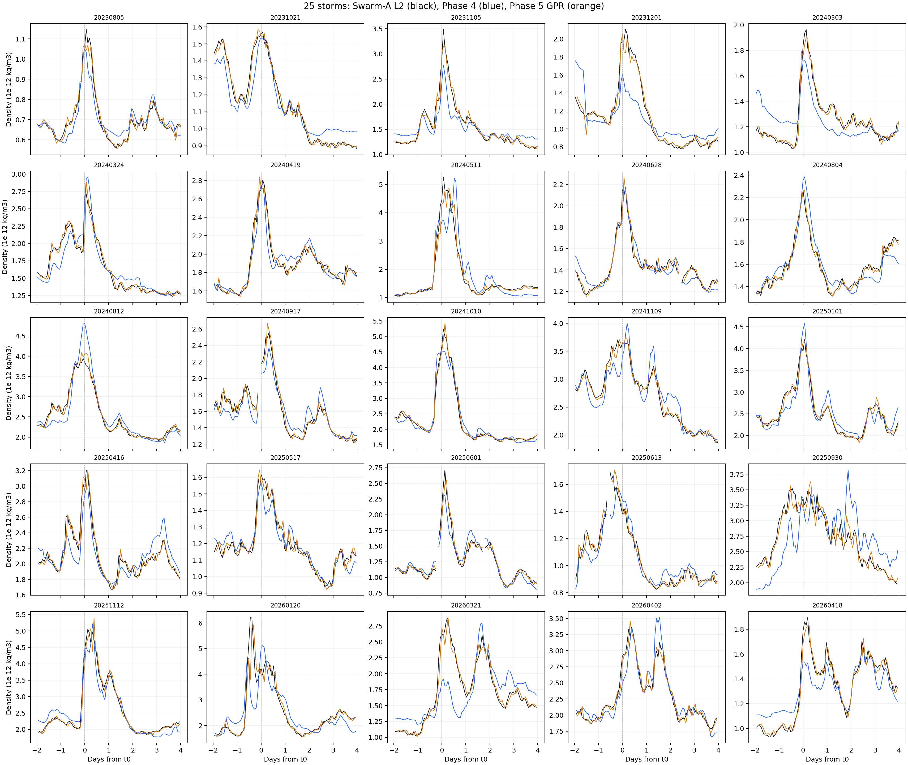

# Phase 5 採用版報告：逐圈 GPR 殘差修正

**決定**：Phase 5 採用「固定 Phase 4 D-model，加上一層跨磁暴共同訓練的逐圈 GPR」作為目前唯一的密度修正流程。版本為 `swarm_a_phase5_pooled_orbit_gpr_v1.sqlite`。方法與輸出已保存；結果屬於**有上一圈 L2 觀測時的回溯修正**，不是端到端密度預報。

這份報告只記錄採用版的輸入、處理、結果與使用界線。Phase 4 的密度曲線是起點；Phase 5 不重新擬合 Phase 4 的事件參數，也不加入新的物理項。最後一層由 GPR 從資料學習誤差如何隨下一圈改變。

## 輸入與處理規則

設 $D_n$ 為 Phase 4 在第 $n$ 圈的密度，$L_n$ 為同圈 Swarm-A L2 密度，$e_n=\ln(L_n/D_n)$ 為兩者的對數差距。計算第 $n$ 圈時，必須已經取得**上一圈**的 $L_{n-1}$，而且兩圈在同一場磁暴中連續。當圈的 $L_n$ 只在訓練與事後評分時使用，不能拿來計算當圈修正值。

```text
Phase 4 有效分鐘與密度
  -> 每圈選一個相位錨點
  -> 配對同場相鄰圈
  -> GPR 估計下一圈的對數誤差變化
  -> 修正當圈 Phase 4 密度
```

每個相位格點只取最接近的一個有效分鐘，與格點相差不得超過 $0.02\pi$。不同磁暴不配成相鄰圈；缺圈時也不跨過缺口繼續修正。25 場資料共有 **2,295 個錨點**，形成 **2,265 組相鄰圈**。

GPR 讀四個數字：$\ln D_n$、$\ln D_{n-1}$、$\ln L_{n-1}$、$e_{n-1}$。第四個數字可由第二、三個算出，並非第四項獨立觀測。模型估計 $\widehat{\Delta e}_n$，即下一圈的對數誤差變化；最後輸出

$$
\widehat L_n=D_n\exp\!\left(e_{n-1}+\widehat{\Delta e}_n\right).
$$

這是對 Phase 4 密度的資料驅動修正。式中的 $\widehat L_n$ 是修正後的估計值，不是已觀測的 L2，也不是新的物理密度公式。

## 如何檢查 GPR 是否只記住訓練資料

我們共有 **25 場**磁暴，把它們分成 **5 組，每組 5 場**。每次用其中 **20 場訓練** GPR，把另外 **5 場完整留出來測試**；輪流做五次，25 場都恰好當過一次測試場。這裡沒有「5 場加 20 場訓練、再拿另外 5 場測試」的第三組資料。

分組使用 `GroupKFold(n_splits=5, shuffle=True, random_state=20261030)`，依 `storm_id` 把整場磁暴放進同一組。`shuffle=True` 讓場次有一次**固定種子的隨機分配**；相同 25 場與相同 seed 重跑會得到同一個分組。它沒有依年份、磁暴強度或密度誤差刻意配平，也沒有看這版 GPR 的測試分數再挑組。採用版沿用先前固定的五折名單，沒有為了本版結果重新抽籤。隨機分的是**已選定的這 25 場**，不能把它說成從所有磁暴隨機抽樣。

切分的單位是**整場磁暴**，不是隨機抽逐圈資料。同一場的前後圈通常很像；若把它們拆到訓練與測試兩邊，分數可能只反映模型認得同一場的形狀。整場留出後，測試場的逐圈誤差變化都不參與該折訓練。

每折先用 20 場的逐圈資料計算特徵的標準化尺度，再用這 20 場擬合 GPR；被留出的 5 場只套用已學好的尺度與模型。GPR 預測測試場時，可以用**該場上一圈已觀測的 L2**，不能用**當圈 L2**。當圈 L2 等預測完成後才拿來評分。五折與筆數保存在 SQLite 的 `phase5_fold`、`phase5_fold_storm`。

| 折次 | 訓練場 | 測試場 | 訓練相鄰圈 | 測試相鄰圈 |
| --- | ---: | ---: | ---: | ---: |
| 1 | 20 | 5 | 1,812 | 453 |
| 2 | 20 | 5 | 1,810 | 455 |
| 3 | 20 | 5 | 1,810 | 455 |
| 4 | 20 | 5 | 1,816 | 449 |
| 5 | 20 | 5 | 1,812 | 453 |

每折實際留下的 5 場如下；其餘 20 場就是該折訓練場：

- 第 1 折：`S20231201T1330`、`S20240324T1621`、`S20240917T0424`、`S20250101T1640`、`S20251112T0359`
- 第 2 折：`S20240303T1800`、`S20240804T1704`、`S20241010T2314`、`S20250416T1743`、`S20250517T0516`
- 第 3 折：`S20231021T0728`、`S20240419T1921`、`S20240812T1652`、`S20260120T1152`、`S20260418T0754`
- 第 4 折：`S20230805T0546`、`S20240511T0214`、`S20241109T1237`、`S20250601T1030`、`S20250613T2015`
- 第 5 折：`S20231105T1654`、`S20240628T1206`、`S20250930T0759`、`S20260321T0139`、`S20260402T0841`

五折合計產生 **2,265 筆**留場預測，每一筆只由沒有看過其磁暴的 GPR 模型產生。主要分數只取其中**前面已連續累積六圈**的 **2,115 圈**，以便在完全相同的位置比較各方法；選點只看相位是否連續，不看當圈 L2 或修正後的分數。最後另用全部 25 場訓練一個供後續使用的模型，但它**不參與下表的留場評分**。

## 五次訓練與測試的 RMSE

以下**全部使用同一種對數密度 RMSE**：先算每圈估計密度與 L2 密度的對數差，再平方、平均、開根號。分數越低越好。每折的「訓練」列只用該折的 20 場，「測試」列只用完整留出的 5 場；兩列都評估該側的**全部相鄰圈**，不混用其他取點範圍。

| 折次 | 資料 | 相鄰圈 | Phase 4 RMSE | 上一圈誤差沿用 RMSE | Phase 5 GPR RMSE |
| --- | --- | ---: | ---: | ---: | ---: |
| 1 | 20 場訓練 | 1,812 | 0.11168 | 0.04198 | **0.03149** |
| 1 | 5 場測試 | 453 | 0.10359 | 0.04002 | **0.03867** |
| 2 | 20 場訓練 | 1,810 | 0.11739 | 0.04392 | **0.03240** |
| 2 | 5 場測試 | 455 | 0.07437 | 0.03061 | **0.02953** |
| 3 | 20 場訓練 | 1,810 | 0.10810 | 0.03971 | **0.03179** |
| 3 | 5 場測試 | 455 | 0.11777 | 0.04836 | **0.04317** |
| 4 | 20 場訓練 | 1,816 | 0.11049 | 0.04025 | **0.03036** |
| 4 | 5 場測試 | 449 | 0.10856 | 0.04665 | **0.04418** |
| 5 | 20 場訓練 | 1,812 | 0.10235 | 0.04198 | **0.03024** |
| 5 | 5 場測試 | 453 | 0.13682 | 0.04002 | **0.03777** |

訓練分數是載入各折已保存的模型，重新預測它當初用來擬合的 20 場算出來的；**不能把訓練分數當成泛化證據**。測試分數由同一模型預測未參與擬合的 5 場，並與 SQLite `phase5_fold` 保存的數值核對一致。第 1、3、4、5 折的測試 GPR RMSE 高於訓練 RMSE，第 2 折較低；留出場的難度也會影響這個差距。五折的**測試 GPR RMSE 都低於同折直接沿用上一圈的 RMSE**，但這不等於每一場都改善。

**過擬合判斷**：以「直接沿用上一圈」為共同參考，GPR 在訓練場降低 RMSE 約 **20%–28%**，在留出場只降低約 **3%–11%**；五折測試合併的全部 2,265 圈降低 **6.2%**。訓練效益明顯縮水，是過擬合或跨磁暴差異的訊號，不能只說「沒有過擬合」。但五折測試仍全部有小幅改善，因此作為**目前選用的條件性回溯修正方法**可以保留；現有證據不足以宣稱它會穩定修好每一場磁暴。

## 共同位置的合併結果

為了和先前共同評分範圍一致，下表只取五折留出預測中前面已連續累積六圈的 **2,115 圈**。這與上表的全部 **2,265 圈**不同，所以數字略有差異；三種方法在本表仍使用完全相同的位置和同一種對數密度 RMSE。

| 方法 | 對數密度 RMSE |
| --- | ---: |
| Phase 4 D-model 原曲線 | 0.11014 |
| 直接沿用上一圈的誤差 | 0.04211 |
| Phase 5 採用版 GPR | **0.03926** |

採用版在 **17/25 場**的整段分數勝過直接沿用上一圈。因此，整體分數變好，不代表每場磁暴都會變好；磁暴中心附近是否穩定改善，也不能由整段分數直接推定。



上圖直接由現行 SQLite 的 `phase5_event_metric` 重畫，逐場比較 Phase 4、上一圈直接沿用與採用版 GPR。表中的 0.03926 是把相同 2,115 圈合起來後計算的分數，不能當成 25 個逐場分數的普通平均。

## 25 場密度折線總覽

這張圖沿用 Phase 3 的 **5×5** 排法：每格是一場磁暴，黑線是 Swarm-A L2、藍線是 Phase 4 D-model、橘線是 Phase 5 GPR。橫軸是距離該場事件時刻 $t_0$ 的天數，縱軸是密度（$10^{-12}\,\mathrm{kg/m^3}$）。黑線和藍線使用 SQLite `phase5_orbit_anchor` 的 **2,295 個有效逐圈點**；橘線只在 `phase5_orbit_prediction` 有留場測試預測的 **2,265 個點**出現。每圈約一點，缺圈處折線斷開，沒有另外平滑。



這張圖方便看各場曲線形狀；精確誤差仍以同位置 RMSE 為準。[製圖程式](../code/prep_phase5_density_overview.py)只讀 Phase 4 的事件時刻與現行 Phase 5 SQLite，不重新訓練 GPR。

第 3 排第 2 格（`S20240917T0424`）的斷線是資料品質門檻造成的。2024-09-17 02:50 UTC 原本應有一個逐圈錨點，但相位窗口只有 **13/186** 個有效配對樣本，涵蓋率 **7.0%**，低於 **80%** 門檻，因此沒有該圈密度。04:24 UTC 有 L2 與 Phase 4 密度，現在照實畫出；但因上一圈錨點缺失，該時刻沒有 GPR 修正值，橘線到 05:58 UTC 才恢復。三條線都沒有跨過缺圈補值。

## 正式輸出與重算

正式結果是本機 `phases/phase5/data/sqlite/swarm_a_phase5_pooled_orbit_gpr_v1.sqlite`。`phase5_orbit_prediction` 保存逐圈結果；`phase5_event_metric` 與 `phase5_summary_metric` 保存逐場及合計分數；`phase5_fold`、`phase5_fold_storm` 保存留場分組。`phase5_metadata` 記錄來源、限制與演算法識別碼。識別碼沿用搬遷前的命名，現行輸出只有上述 v1 資料庫。

五個留場測試模型和一個用全部 25 場訓練的模型保存在本機 `phases/phase5/data/models/`。**表中的分數來自五個留場測試模型**；全部 25 場模型只供後續使用，不能拿它對同一批訓練資料的結果冒充留場分數。從 Phase 4 直接重算的入口與 SQL 查詢例子見 [Phase 5 README](../README.md)，來源 key 與欄位見[資料血緣](../docs/lineage/phase5_pooled_orbit_gpr.md)。本機 SQLite 與大型模型檔依專案規則不提交 Git。

## 可以主張的範圍

這份結果支持：在固定 Phase 4 基線、且測試場上一圈已有 L2 的條件下，共同訓練的 GPR 在本次 25 場資料的整段合計分數，勝過直接沿用上一圈誤差。整場留出減少了 GPR 記住同一場逐圈形狀的風險，但**不能證明整套方法已通過獨立預報驗證**：Phase 4 的每場參數原本就用該場完整 L2 擬合；採用哪種修正方法，也是在反覆檢查這 25 場後決定的。沒有可信上一圈 L2、整場沒有 L2，或相鄰圈中斷時，這份採用版沒有可直接套用的修正值。L2 也是參考資料，不能當成無誤差的真值。
