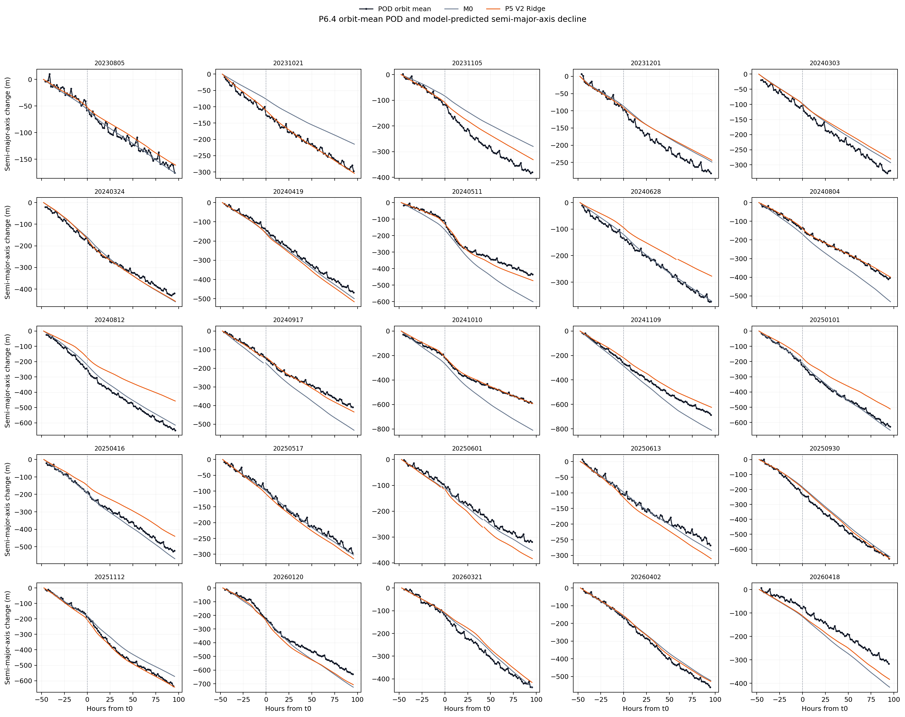
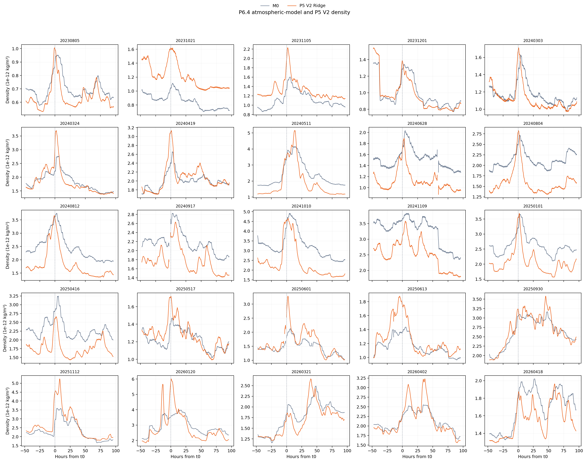

# Phase 6 最終報告：密度轉換為半長軸下降

## 結論

狀態：[done]。Phase 6 已用一個固定 `B_eff`，把兩種 density 轉換成半長軸下降，並與 POD 觀測比較。

在相同事件、相同時間、相同 `B_eff` 與相同積分方法下，Phase 5 V2 Ridge 的整體誤差低於 Phase 3 M0：

| Model | Mean error (m) | MAE (m) | RMSE (m) | 較接近 POD |
| --- | ---: | ---: | ---: | ---: |
| Phase 3 M0 | -24.72 | 72.22 | 89.35 | 9/25 場 |
| Phase 5 V2 Ridge | +18.30 | 53.08 | 74.04 | 16/25 場 |

相對於 M0，Ridge 的 MAE 降低 `26.50%`，RMSE 降低 `17.14%`。這支持「Phase 5 V2 的密度修正，整體上能改善半長軸下降的回推結果」。

這不是每場都改善。Ridge 在 9 場仍比 M0 差，最大失敗是 2024-08-12：Ridge 絕對誤差 `226.14 m`，M0 為 `68.77 m`。

## 研究問題

Phase 6 回答兩個問題：

1. 一條 density 時間序列能否透過固定比例，轉換成與 POD 同量級的半長軸下降？
2. Phase 5 V2 Ridge density 推回的下降，是否比外部經驗大氣模型 M0 更接近 POD？

Phase 6 不直接回答「磁暴額外造成多少下降」。目前使用的是每場 `t0-2 days` 至 `t0+4 days` 的完整窗口下降，裡面同時包含背景下降與磁暴期間下降；沒有建立 quiet counterfactual，也沒有從總下降中扣除平靜期基線。

## 實驗設計

```text
P6.1  三年 L2 density + POD 半長軸
        -> 擬合並固定一個 B_eff

P6.2  Phase 3 M0 density + fixed B_eff
        -> 25 場 M0 預測下降

P6.3  Phase 5 V2 Ridge density + fixed B_eff
        -> 25 場 Ridge 預測下降

P6.4  POD + M0 + Ridge
        -> 每場總下降、逐分鐘曲線與統一誤差比較
```

公平比較的核心是：P6.2 與 P6.3 不重新擬合 `B_eff`，也不各自更換窗口或 POD 資料。兩條路徑只有輸入 density 不同。

## 符號與物理關係

| 符號 | 定義 | 單位 |
| --- | --- | --- |
| `a` | POD mean semi-major axis | m |
| `rho` | 模型大氣密度 | kg/m³ |
| `mu` | Earth gravitational parameter | m³/s² |
| `Delta t` | 相鄰資料時間差，本研究固定為 60 | s |
| `B_eff` | density 積分轉成半長軸變化的有效比例 | m²/kg |
| `Delta a` | 相對 block 起點的半長軸變化 | m |

本研究使用的簡化關係為：

\[
\frac{da}{dt}=-B_{eff}\rho\sqrt{\mu a}.
\]

逐分鐘用梯形法累積 density kernel：

\[
K_n=\sum_{k=1}^{n}
\frac{\rho_{k-1}\sqrt{\mu a_{k-1}}+\rho_k\sqrt{\mu a_k}}{2}\Delta t.
\]

因此預測半長軸變化是：

\[
\Delta a_{model,n}=-B_{eff}K_n.
\]

這是 60 秒梯形積分。它沒有先把資料做成另一條平滑線，也沒有使用額外的 `SQ line`。

## P6.1：只擬合一個 `B_eff`

### 輸入

- 時間範圍：2023-07-01 至 2026-06-30。
- L2 density：每分鐘 2 筆 DNSAPOD instantaneous density 的平均。
- POD 半長軸：每分鐘 6 筆可用 mean semi-major axis 的平均。
- 完整配對分鐘：1,575,708。
- 可積分點：1,575,671。
- 連續 blocks：37。

缺一分鐘或 `chunk_id` 改變時就切開 block。每個 block 的積分與 POD 變化都從零開始，不補資料，也不跨缺口積分。

對每個積分點，POD 觀測變化定義為：

\[
\Delta a_{POD,n}=a_n-a_{block,start}.
\]

全三年只擬合一個通過原點的比例：

\[
B_{eff}=-\frac{\sum_n K_n\Delta a_{POD,n}}{\sum_n K_n^2}.
\]

結果為：

\[
\boxed{B_{eff}=0.0092292068\ \mathrm{m^2/kg}}.
\]

逐圈 sensitivity 得到 `0.0092140060 m²/kg`，與逐分鐘主結果相差 `0.165%`。正式流程只使用逐分鐘結果。

`B_eff` 只負責固定 density-to-decay 尺度。它不是獨立量測的 `C_D A/m`，也不按年份、磁暴、模型或 block 重新調整。

## P6.2 與 P6.3：固定比例後比較兩種 density

### 兩種輸入

| Step | Density | 角色 |
| --- | --- | --- |
| P6.2 | Phase 3 M0：NRLMSIS 2.0 full density | 外部經驗大氣模型基準 |
| P6.3 | Phase 5 V2 held-out Ridge density | 本研究的探索性修正結果 |

兩者都使用：

- 相同 25 場磁暴。
- 每場相同的 `t0-2 days` 至 `t0+4 days` 窗口。
- 相同 214,907 個有效分鐘。
- 相同 31 個 continuous blocks。
- 相同 POD 半長軸 `a_k`。
- 相同 `B_eff=0.0092292068 m²/kg`。

每個模型只把自己的 `rho_k` 代入同一條積分式。最後的事件預測下降是該事件所有已覆蓋 block 下降量的總和。

### POD 總下降的定義

若一場事件沒有缺口，POD 總下降就是窗口終點相對起點的變化。

若事件內有缺口，不能直接把缺口兩側相減。此時分別計算每個連續 block：

\[
\Delta a_{POD,event}=\sum_b\left(a_{b,end}-a_{b,start}\right).
\]

模型預測也用相同 blocks 加總，不對缺口內的未知下降做假設。

### 誤差定義

每場事件的誤差為：

\[
e=\Delta a_{model}-\Delta a_{POD}.
\]

- `e > 0`：模型預測下降較少，屬於少估。
- `e < 0`：模型預測下降較多，屬於多估。

MAE 與 RMSE 都以 25 場事件的總下降誤差計算，不是以 214,907 個逐分鐘殘差灌大樣本數。

## P6.4：三層結果

### 1. 每場 POD 總下降量

25 場的已覆蓋窗口總下降全部為負值，範圍約為 `-231.40 m` 至 `-694.82 m`。這表示這些窗口終點相對已覆蓋起點整體下降；它本身不能證明所有下降都是磁暴造成。

| 磁暴 | POD 下降 (m) | M0 下降 (m) | M0 error (m) | Ridge 下降 (m) | Ridge error (m) |
| --- | ---: | ---: | ---: | ---: | ---: |
| 2023-08-05 | -231.40 | -176.36 | +55.04 | -160.97 | +70.43 |
| 2023-10-21 | -309.23 | -214.73 | +94.50 | -304.10 | +5.13 |
| 2023-11-05 | -378.29 | -279.66 | +98.63 | -331.32 | +46.97 |
| 2023-12-01 | -239.50 | -248.92 | -9.42 | -243.82 | -4.32 |
| 2024-03-03 | -369.14 | -292.71 | +76.42 | -280.55 | +88.59 |
| 2024-03-24 | -389.99 | -458.98 | -68.99 | -456.64 | -66.66 |
| 2024-04-19 | -426.17 | -499.66 | -73.49 | -516.17 | -90.00 |
| 2024-05-11 | -457.64 | -600.82 | -143.18 | -472.97 | -15.32 |
| 2024-06-28 | -412.91 | -371.72 | +41.20 | -277.49 | +135.42 |
| 2024-08-04 | -411.14 | -531.33 | -120.19 | -399.25 | +11.89 |
| 2024-08-12 | -683.56 | -614.79 | +68.77 | -457.42 | +226.14 |
| 2024-09-17 | -368.99 | -532.49 | -163.50 | -434.50 | -65.51 |
| 2024-10-10 | -578.22 | -810.13 | -231.91 | -592.17 | -13.95 |
| 2024-11-09 | -694.82 | -812.24 | -117.43 | -624.85 | +69.96 |
| 2025-01-01 | -636.33 | -650.97 | -14.65 | -511.32 | +125.00 |
| 2025-04-16 | -519.79 | -568.88 | -49.09 | -440.24 | +79.55 |
| 2025-05-17 | -293.00 | -302.42 | -9.42 | -314.24 | -21.24 |
| 2025-06-01 | -405.45 | -352.19 | +53.26 | -383.93 | +21.51 |
| 2025-06-13 | -304.20 | -284.80 | +19.40 | -310.62 | -6.42 |
| 2025-09-30 | -641.43 | -650.39 | -8.95 | -663.46 | -22.02 |
| 2025-11-12 | -642.34 | -572.24 | +70.09 | -641.75 | +0.59 |
| 2026-01-20 | -646.56 | -724.74 | -78.17 | -706.57 | -60.01 |
| 2026-03-21 | -399.10 | -436.30 | -37.20 | -415.43 | -16.33 |
| 2026-04-02 | -539.22 | -522.77 | +16.45 | -528.06 | +11.16 |
| 2026-04-18 | -330.31 | -416.49 | -86.18 | -383.30 | -52.99 |

### 2. POD 隨時間的下降

黑線與圓點是 Phase 1 定義的完整一圈 POD 平均；藍線是 M0 預測；橘線是 Phase 5 V2 Ridge 預測；虛線是每場磁暴的 `t0`。



逐分鐘 POD 有明顯軌道週期振盪，因此圖中不再直接畫原始逐分鐘線。POD 使用 Phase 1 的 mean argument of latitude 切分完整軌道，再以 phase-weighted mean 得到每圈一點。整場都相對於窗口開始前最後一個完整 orbit。

POD 圖直接讀完整 Phase 1 orbit mean，不受 P6.4 density pairing 缺口限制。只有 POD 自己缺少完整軌道或 `chunk_id` 改變時才斷黑線；M0、Ridge 仍在 density 缺口處斷線。

每場總下降與誤差仍由原始 POD covered endpoint 計算。逐圈平均只改善圖的可讀性，不參與 `B_eff` 擬合或誤差重算。

### 3. Density 與預測下降



同一時間的 Ridge density 若高於 M0，Ridge 累積下降曲線就會比 M0 更陡；若低於 M0，則會更平。Phase 6 沒有再修改 density，只有把兩條既有 density 透過相同公式轉成下降量。

## 整體結果

| 指標 | M0 | Phase 5 V2 Ridge | Ridge 相對變化 |
| --- | ---: | ---: | ---: |
| 少估下降 | 10 場 | 13 場 | - |
| 多估下降 | 15 場 | 12 場 | - |
| Mean error | -24.72 m | +18.30 m | 偏差方向反轉 |
| MAE | 72.22 m | 53.08 m | 降低 19.14 m；26.50% |
| RMSE | 89.35 m | 74.04 m | 降低 15.31 m；17.14% |
| 逐場絕對誤差較小 | 9 場 | 16 場 | Ridge 較多 7 場 |

M0 的 mean error 為負，代表整體略偏向多估下降；Ridge 的 mean error 為正，代表修正後整體略偏向少估下降。Ridge 改善了誤差大小，但沒有消除系統偏差，而是讓偏差方向反轉。

### 明顯改善事件

| 磁暴 | M0 absolute error (m) | Ridge absolute error (m) |
| --- | ---: | ---: |
| 2023-10-21 | 94.50 | 5.13 |
| 2024-10-10 | 231.91 | 13.95 |
| 2025-11-12 | 70.09 | 0.59 |

### 明顯退步事件

| 磁暴 | M0 absolute error (m) | Ridge absolute error (m) |
| --- | ---: | ---: |
| 2024-06-28 | 41.20 | 135.42 |
| 2024-08-12 | 68.77 | 226.14 |
| 2025-01-01 | 14.65 | 125.00 |

因此正確結論不是「Ridge 已經取代 M0」，而是「Ridge 在這 25 場回溯事件的整體誤差較小，但事件穩定性仍不足」。

## 可以主張與不能主張

### 可以主張

- 固定 `B_eff` 能把 L2、M0 與 Ridge density 轉成與 POD 六天窗口下降相同量級的半長軸變化。
- 在這 25 場事件上，Phase 5 V2 Ridge 的事件總下降 MAE 與 RMSE 都低於 M0。
- 半長軸下降可以作為 density model 的 downstream closure quantity。
- 個別事件結果顯示，density 修正有時能大幅改善下降量，也可能明顯惡化。

### 不能主張

- 不能把整個六天窗口下降都歸因於磁暴。
- 不能聲稱 Ridge 在每一場磁暴都優於 M0。
- 不能把這次回溯比較稱為獨立 forecast validation。
- 不能把 `B_eff` 當成獨立校準出的衛星物理 ballistic coefficient。
- 不能把目前積分結果稱為不依賴 POD 的自由軌道 propagation。

## 限制

- P6.1 `B_eff` 由同一三年 L2/POD 資料 in-sample 擬合。
- DNSAPOD L2 density 與 semi-major axis 都依賴 POD lineage，不是完全獨立的觀測來源。
- Ridge 使用每場 held-out `R_k`，但三個 Ridge 特徵仍由相同 25 場的算分結果選出，尚無新事件外測。
- P6.1 使用逐分鐘 L2 density；M0 與 Ridge 是逐分鐘保存的 orbit-phase-average density，兩者時間平滑方式不同。
- 積分核中的 `a_k` 取自 POD；目前不是從初始狀態獨立傳播出的預測軌道。
- 未獨立處理 maneuver、姿態變化、`C_D` 變化與其他 non-drag forces。
- 目前沒有 quiet counterfactual，因此不能分離背景下降與磁暴額外下降。

## 資料品質與重現性

- P6.1：1,575,708 個完整分鐘、1,575,671 個積分點、37 個 blocks。
- P6.2/P6.3/P6.4：25 場、214,907 個分鐘、31 個 blocks。
- P6.2 與 P6.3 以 `{storm_id, time_us}` 精確連接，沒有模糊時間配對。
- 缺值不插值，缺口不積分，圖也不跨缺口連線。
- P6.4 SQLite `PRAGMA integrity_check` 結果為 `ok`。
- Phase 0 與 Phase 6 相關測試共 15 項，全部通過。

## 正式輸出

| Output | 內容 |
| --- | --- |
| `swarm_a_phase6_1_l2_minute_pairs_v1.sqlite` | 三年 L2/POD 完整分鐘配對 |
| `swarm_a_phase6_1_beff_v1.sqlite` | 固定 `B_eff` 與逐分鐘積分結果 |
| `swarm_a_phase6_2_m0_error_v1.sqlite` | M0 逐分鐘與逐事件下降誤差 |
| `swarm_a_phase6_3_ridge_decay_v1.sqlite` | Ridge 逐分鐘與逐事件下降誤差 |
| `swarm_a_phase6_4_decay_comparison_v1.sqlite` | POD、M0、Ridge 統整結果 |

資料契約：

- [P6.1 lineage](../docs/lineage/phase6_1_beff.md)
- [P6.2 lineage](../docs/lineage/phase6_2_m0_error.md)
- [P6.3 lineage](../docs/lineage/phase6_3_ridge_decay.md)
- [P6.4 lineage](../docs/lineage/phase6_4_decay_comparison.md)
