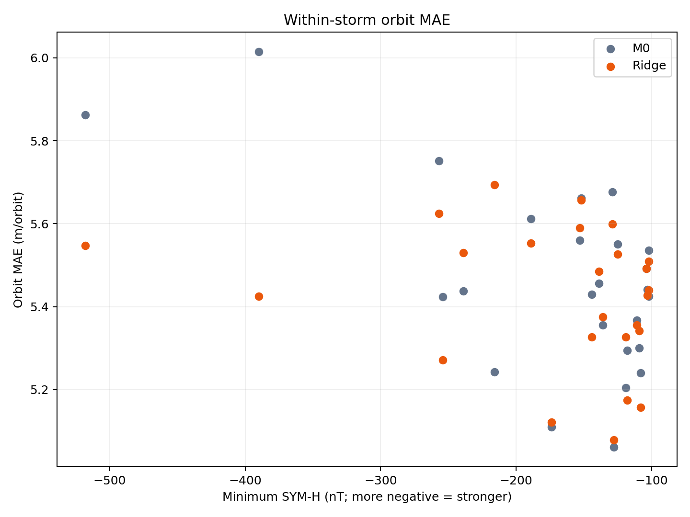

# Phase 6 最終報告：密度轉換為半長軸下降

共用變數與單位：[VARIABLES.md](../../../VARIABLES.md)。

## 結論

狀態：[done]。Phase 6 已用一個固定 `B_eff`，把兩種 density 轉換成半長軸下降，並與 POD 觀測比較。

正式比較以每一場磁暴為一票。先用該場所有有效 orbit 算兩個模型的 orbit MAE，再由 MAE 較低者贏得該場：

| Model | 磁暴勝場 | 25 場等權平均 orbit MAE |
| --- | ---: | ---: |
| Phase 3 M0 | 10 | 5.460 m/orbit |
| Phase 5 V2 Ridge | 15 | 5.425 m/orbit |

沒有完全平手。Ridge 以 `15:10` 領先，但兩個模型的等權平均 MAE 只差 `0.035 m/orbit`。2025-06-01 與 2026-04-02 的差距小於 `0.01 m/orbit`，因此結果只能支持 Ridge 在這 25 場略佔優勢，不能稱為明顯勝出。

2,262 個有效圈間區間作為底層資料；每場以逐圈 MAE 決勝，25 場磁暴等權。

## 研究問題

Phase 6 回答兩個問題：

1. 一條 density 時間序列能否透過固定比例，轉換成與 POD 同量級的半長軸下降？
2. Phase 5 V2 Ridge density 推回的下降，是否比外部經驗大氣模型 M0 更接近 POD？

Phase 6 不直接回答「磁暴額外造成多少下降」。目前使用的是每場 `t0-2 days` 至 `t0+4 days` 的完整窗口下降，裡面同時包含背景下降與磁暴期間下降；沒有建立 quiet counterfactual，也沒有從總下降中扣除平靜期基線。

## 實驗設計

```text
P6.1  三年 L2 density + POD 半長軸
        -> 擬合並固定一個 B_eff

P6.2  Phase 3 M0 density + fixed B_eff
        -> 25 場 M0 預測下降

P6.3  Phase 5 V2 Ridge density + fixed B_eff
        -> 25 場 Ridge 預測下降

P6.4  POD + M0 + Ridge
        -> 每圈局部下降作底層誤差
        -> 每場磁暴用 orbit MAE 決勝；25 場等權
        -> SYM-H 最低值與每場逐圈誤差圖
```

公平比較的核心是：P6.2 與 P6.3 不重新擬合 `B_eff`，也不各自更換窗口或 POD 資料。兩條路徑只有輸入 density 不同。

## 符號與物理關係

同一積分式中的 `rho` 依實驗指定來源：P6.1 是 L2 密度，P6.2 是 M0 密度，P6.3 是使用 Phase 5 V2 留場 $\widehat R_k^{\mathrm{LOO}}$ 的 Ridge 密度。下式的 $n$ 是 block 內分鐘索引、$j$ 是求和索引；$k$ 留作磁暴事件索引。`K_n` 與 `Delta a` 必須沿用同一條密度序列；跨 Phase 記法見[共用變數表](../../../VARIABLES.md)。

| 符號 | 定義 | 單位 |
| --- | --- | --- |
| `a` | POD mean semi-major axis | m |
| `rho` | 模型大氣密度 | kg/m³ |
| $\mu_{\mathrm{P1/P6}}$ | 下降核使用的地球重力參數，$3.986004418\times10^{14}$；與產生 mean $a$ 的 Orekit B-L provider 值 $3.986004415\times10^{14}$ 不同 | m³/s² |
| `Delta t` | 相鄰資料時間差，本研究固定為 60 | s |
| `B_eff` | density 積分轉成半長軸變化的有效比例 | m²/kg |
| `Delta a` | 相對 block 起點的半長軸變化 | m |

本研究使用的簡化關係為：

$$
\frac{da}{dt}=-B_{eff}\rho\sqrt{\mu_{\mathrm{P1/P6}} a}.
$$

逐分鐘用梯形法累積 density kernel：

$$
K_n=\sum_{j=1}^{n}
\frac{\rho_{j-1}\sqrt{\mu_{\mathrm{P1/P6}} a_{j-1}}+\rho_j\sqrt{\mu_{\mathrm{P1/P6}} a_j}}{2}\Delta t.
$$

因此預測半長軸變化是：

$$
\Delta a_{model,n}=-B_{eff}K_n.
$$

這是 60 秒梯形積分。它沒有先把資料做成另一條平滑線，也沒有使用額外的 `SQ line`。

## P6.1：只擬合一個 `B_eff`

### 輸入

- 時間範圍：2023-07-01 至 2026-06-30。
- L2 density：每分鐘 2 筆 DNSAPOD instantaneous density 的平均。
- POD 半長軸：每分鐘 6 筆可用 mean semi-major axis 的平均。
- 完整配對分鐘：1,575,708。
- 可積分點：1,575,671。
- 連續 blocks：37。

缺一分鐘或 `chunk_id` 改變時就切開 block。每個 block 的積分與 POD 變化都從零開始，不補資料，也不跨缺口積分。

對每個積分點，POD 觀測變化定義為：

$$
\Delta a_{POD,n}=a_n-a_{block,start}.
$$

全三年只擬合一個通過原點的比例：

$$
B_{eff}=-\frac{\sum_n K_n\Delta a_{POD,n}}{\sum_n K_n^2}.
$$

結果為：

$$
\boxed{B_{eff}=0.0092292068\ \mathrm{m^2/kg}}.
$$

逐圈 sensitivity 得到 `0.0092140060 m²/kg`，與逐分鐘主結果相差 `0.165%`。正式流程只使用逐分鐘結果。

`B_eff` 只負責固定 density-to-decay 尺度。它不是獨立量測的 `C_D A/m`，也不按年份、磁暴、模型或 block 重新調整。

## P6.2 與 P6.3：固定比例後比較兩種 density

### 兩種輸入

| Step | Density | 角色 |
| --- | --- | --- |
| P6.2 | Phase 3 M0：NRLMSIS 2.0 full density | 外部經驗大氣模型基準 |
| P6.3 | Phase 5 V2 held-out Ridge density | 本研究的探索性修正結果 |

M0 指 Phase 2／3 保存的完整 MSIS 計算，不是重新用 pymsis 標準 `ap` 時序產生的另一版。其 `ap` driver 用上一個已完成 3 h 格和前一日 daily ap；pymsis 七欄定義則是當前格與當日 daily ap。這項來源時序差異見[公式稽核 P0-A](../../../docs/formula_audit.md)，本報告所有 M0 分數只適用於已保存版本。

兩者都使用：

- 相同 25 場磁暴。
- 每場相同的 `t0-2 days` 至 `t0+4 days` 窗口。
- 相同 214,907 個有效分鐘。
- 相同 31 個 continuous blocks。
- 相同 POD 半長軸 `a_k`。
- 相同 `B_eff=0.0092292068 m²/kg`。

每個模型只把自己的 `rho_k` 代入同一條積分式。最後的事件預測下降是該事件所有已覆蓋 block 下降量的總和。

## P6.4：新版逐圈誤差

### 每圈計算、每場磁暴決勝



橫軸是 Phase 2 每場磁暴的 SYM-H 最低值，越負代表磁暴越強。縱軸是該場所有有效圈的平均絕對誤差（MAE）。每個模型各有 25 個事件點，一場磁暴只佔一點。圖是描述性比較，不能直接當作磁暴額外下降量。

對相鄰兩個完整 POD orbit，觀測下降定義為：

$$
\Delta a_{POD,j}=\bar a_j-\bar a_{j-1}.
$$

設 $m(t)=\lfloor(t+30\,\mathrm{s})/(60\,\mathrm{s})\rfloor\,60\,\mathrm{s}$，把兩個 orbit endpoint 對齊最近 UTC minute，恰在半分鐘時選較晚分鐘。模型下降使用同一 block 內 cumulative prediction 的差：

$$
\Delta a_{model,j}
=\Delta a_{model}(m(t_j))-\Delta a_{model}(m(t_{j-1})),
$$

$$
e_j=\Delta a_{model,j}-\Delta a_{POD,j}.
$$

只有 POD orbit 連續、`chunk_id` 相同、兩個 model endpoint 存在且位於同一 density block 時才計分。跨 POD 缺口、chunk 或 density 缺口的 orbit 不計分，也不插值。

保存的 2,262 個有效圈間區間中，模型錨點與 POD 終點最大差 28 秒，兩錨點跨度與 POD 終點跨度最多差 50 秒；上式比較的是近分鐘對齊的變化，並非 UTC 端點完全一致。[時間鍵稽核](../../../docs/formula_audit.md)另列 Phase 7 的同規則結果。

逐圈 POD 下降有 545 圈為正、1,717 圈為負，因此單圈 observed change 可能接近零。每場 orbit MAE 不使用 MAPE，避免分母接近零時產生無意義的極大百分比。

每場磁暴的計分方法是：

$$
\operatorname{MAE}_{model,k}=\frac{1}{N_{\mathrm{orbit},k}}\sum_{j=1}^{N_{\mathrm{orbit},k}}|e_{model,k,j}|.
$$

其中 `k` 是磁暴，$N_{\mathrm{orbit},k}$ 是該場有效圈間區間數；Phase 4 的 $N_k$ 則是有效相位分鐘數，兩者不能互代。M0 與 Ridge 誰的 `MAE` 較低，誰就贏得該場。最後只數 25 場各自的 winner；每場磁暴權重相同，不讓 91 圈的事件比 85 圈的事件多一票。

正式磁暴結果：Ridge 15 勝、M0 10 勝、0 平手。25 場等權平均 orbit MAE 為 Ridge `5.425 m/orbit`、M0 `5.460 m/orbit`。

| 磁暴 | 計分圈數 | M0 MAE (m) | Ridge MAE (m) | Winner | 勝出差距 (m) |
| --- | ---: | ---: | ---: | --- | ---: |
| 2023-08-05 | 91 | 5.441 | 5.428 | Ridge | 0.013 |
| 2023-10-21 | 91 | 5.240 | 5.157 | Ridge | 0.083 |
| 2023-11-05 | 91 | 5.612 | 5.553 | Ridge | 0.059 |
| 2023-12-01 | 91 | 5.355 | 5.375 | M0 | 0.020 |
| 2024-03-03 | 91 | 5.061 | 5.079 | M0 | 0.018 |
| 2024-03-24 | 91 | 5.110 | 5.121 | M0 | 0.012 |
| 2024-04-19 | 91 | 5.456 | 5.485 | M0 | 0.030 |
| 2024-05-11 | 91 | 5.862 | 5.547 | Ridge | 0.315 |
| 2024-06-28 | 89 | 5.204 | 5.327 | M0 | 0.122 |
| 2024-08-04 | 91 | 5.295 | 5.174 | Ridge | 0.121 |
| 2024-08-12 | 91 | 5.243 | 5.694 | M0 | 0.452 |
| 2024-09-17 | 88 | 5.430 | 5.327 | Ridge | 0.102 |
| 2024-10-10 | 91 | 6.014 | 5.425 | Ridge | 0.589 |
| 2024-11-09 | 91 | 5.300 | 5.341 | M0 | 0.041 |
| 2025-01-01 | 91 | 5.438 | 5.530 | M0 | 0.093 |
| 2025-04-16 | 91 | 5.560 | 5.590 | M0 | 0.029 |
| 2025-05-17 | 91 | 5.367 | 5.356 | Ridge | 0.011 |
| 2025-06-01 | 85 | 5.661 | 5.657 | Ridge | 0.005 |
| 2025-06-13 | 89 | 5.425 | 5.440 | M0 | 0.015 |
| 2025-09-30 | 91 | 5.677 | 5.600 | Ridge | 0.077 |
| 2025-11-12 | 91 | 5.424 | 5.272 | Ridge | 0.152 |
| 2026-01-20 | 91 | 5.751 | 5.625 | Ridge | 0.126 |
| 2026-03-21 | 91 | 5.551 | 5.527 | Ridge | 0.024 |
| 2026-04-02 | 91 | 5.492 | 5.491 | Ridge | 0.001 |
| 2026-04-18 | 91 | 5.536 | 5.509 | Ridge | 0.027 |

Ridge 的 event-level orbit MAE 在 15 場較低，M0 在 10 場較低。2025-06-01 與 2026-04-02 的勝出差距小於 `0.01 m`，實質上接近平手。磁暴主分數的主要訊息是 Ridge 勝場較多，但優勢很小。

### 新版逐圈誤差分析

本節全部使用每場逐圈 MAE 衡量模型下降量與 POD 下降量的差距，再以磁暴為單位比較。

- 最大改善是 2024-10-10：M0 MAE `6.014 m/orbit`，Ridge `5.425 m/orbit`，降低 `0.589 m/orbit`。
- 最大退步是 2024-08-12：M0 MAE `5.243 m/orbit`，Ridge `5.694 m/orbit`，增加 `0.452 m/orbit`。
- 2024-05-11 也改善：MAE 由 `5.862` 降至 `5.547 m/orbit`。但個別強磁暴改善，不能推論所有強磁暴都改善。
- 25 場等權平均 MAE 只由 `5.460` 降至 `5.425 m/orbit`。勝場 `15:10` 與平均改善量都應同時呈現，不能只憑勝場宣稱明顯提升。

SYM-H 最低值對 MAE 圖使用上述同一組逐圈誤差，先在每場內計算 MAE，再各畫一點。這張圖目前提供描述性比較，尚未檢定強度與誤差的關聯。

## 可以主張與不能主張

### 可以主張

- 固定 `B_eff` 能把 L2、M0 與 Ridge density 轉成與 POD 六天窗口下降相同量級的半長軸變化。
- 25 場磁暴等權計分時，Ridge 贏 15 場，M0 贏 10 場；Ridge 略佔優勢。
- 以 25 場等權平均逐圈 MAE 比較，Ridge 只略低於 M0，兩者單圈能力接近。
- 半長軸下降可以作為 density model 的 downstream closure quantity。
- 個別事件結果顯示，density 修正有時能大幅改善下降量，也可能明顯惡化。

### 不能主張

- 不能把整個六天窗口下降都歸因於磁暴。
- 不能聲稱 Ridge 在每一場磁暴都優於 M0。
- 不能把這次回溯比較稱為獨立 forecast validation。
- 不能把 `B_eff` 當成獨立校準出的衛星物理 ballistic coefficient。
- 不能把目前積分結果稱為不依賴 POD 的自由軌道 propagation。

## 限制

- P6.1 `B_eff` 由同一三年 L2/POD 資料 in-sample 擬合。
- DNSAPOD L2 density 與 semi-major axis 都依賴 POD lineage，不是完全獨立的觀測來源。
- Ridge 使用每場留出時估得的 $\widehat R_k^{\mathrm{LOO}}$，但三個 Ridge 特徵仍由相同 25 場的算分結果選出。後續 Phase 7 改用全 25 場係數得到新事件的 $\widehat R_k^{\mathrm{full25}}$，五場探索性逐圈比較未顯示 Ridge 對 M0 的穩定優勢；不能把 Phase 6 的 25 場分數當作獨立外測。
- P6.1 使用逐分鐘 L2 density；M0 與 Ridge 是逐分鐘保存的 orbit-phase-average density，兩者時間平滑方式不同。
- 積分核中的 `a_k` 取自 POD；目前不是從初始狀態獨立傳播出的預測軌道。
- 未獨立處理 maneuver、姿態變化、`C_D` 變化與其他 non-drag forces。
- 目前沒有 quiet counterfactual，因此不能分離背景下降與磁暴額外下降。

## 資料品質與重現性

- P6.1：1,575,708 個完整分鐘、1,575,671 個積分點、37 個 blocks。
- P6.2/P6.3/P6.4：25 場、214,907 個分鐘、31 個 blocks。
- 正式磁暴分數：25 場等權，Ridge 15 勝、M0 10 勝；底層共有 2,262 圈，每場 85 至 91 圈。
- P6.2 與 P6.3 以 `{storm_id, time_us}` 精確連接，沒有模糊時間配對。
- 計算與評分不插值，也不跨缺口積分。
- P6.4 SQLite `PRAGMA integrity_check` 結果為 `ok`。
- Phase 6 測試共 53 項，全部通過。

## 正式輸出

| Output | 內容 |
| --- | --- |
| `swarm_a_phase6_1_l2_minute_pairs_v1.sqlite` | 三年 L2/POD 完整分鐘配對 |
| `swarm_a_phase6_1_beff_v1.sqlite` | 固定 `B_eff` 與逐分鐘積分結果 |
| `swarm_a_phase6_2_m0_error_v1.sqlite` | M0 逐分鐘與逐事件下降誤差 |
| `swarm_a_phase6_3_ridge_decay_v1.sqlite` | Ridge 逐分鐘與逐事件下降誤差 |
| `swarm_a_phase6_4_decay_comparison_v1.sqlite` | POD、M0、Ridge 統整結果 |
| `swarm_a_phase6_4_orbit_scores_v1.sqlite` | 25 場磁暴主分數與 2,262 圈底層局部下降誤差 |

資料契約：

- [P6.1 lineage](../docs/lineage/phase6_1_beff.md)
- [P6.2 lineage](../docs/lineage/phase6_2_m0_error.md)
- [P6.3 lineage](../docs/lineage/phase6_3_ridge_decay.md)
- [P6.4 lineage](../docs/lineage/phase6_4_decay_comparison.md)
