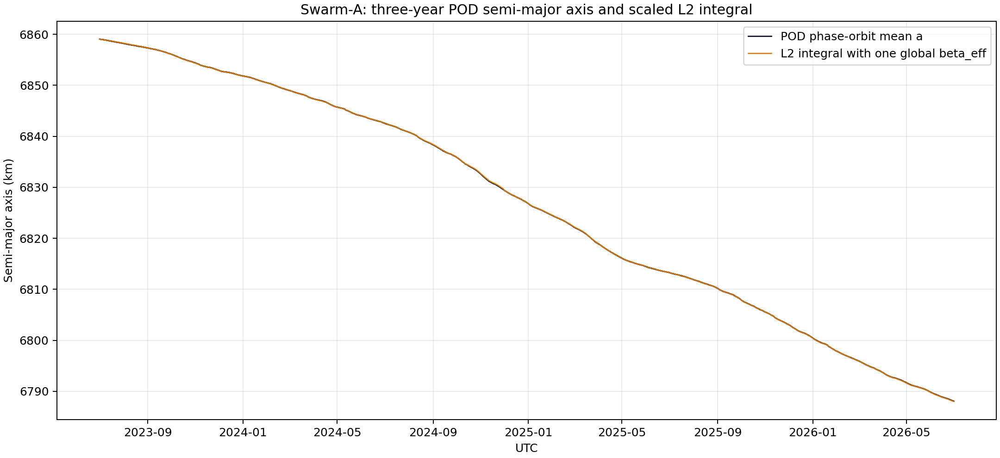

# Phase 6：三年 L2 積分線與 POD 半長軸線

## 決定

狀態：[retained sensitivity]。現行 P6.1 已改用逐分鐘 L2 density 重新擬合；本報告保留逐圈結果作時間解析度 sensitivity。

\[
K(t)=\int\rho_{L2}(t)\sqrt{\mu a(t)}\,dt,
\]

\[
\Delta a_{POD}(t)\simeq-\beta_{eff}K(t).
\]

資料有缺口或 `chunk_id` 改變時，兩條累積線同時歸零重開；不跨缺口積分。這不是 quiet/storm selection，只是避免捏造不存在的 density。

## 三年資料

| 項目 | 數值 |
| --- | ---: |
| UTC 範圍 | 2023-07-01 -- 2026-06-30 |
| DNSAPOD daily ZIP | 1,096 |
| Phase 1 complete phase orbits | 16,844 |
| L2/POD paired orbits | 16,792 |
| 未配對 orbits | 52 |
| cumulative fit points | 16,755 |
| continuous integral blocks | 35 |
| L2 density range | 4.635e-13 -- 6.256e-12 kg/m³ |
| density time offset | -22 -- 8 s |

ESA CDF 的 `density_orbitmean` 缺值是正數 `9.99e32`。本輪已修正共同 DNSAPOD loader，依 CDF `FILLVAL` 排除；否則正值檢查會把缺值誤當成極高密度。

## 單一比例

三年所有 cumulative points 一次擬合：

\[
\boxed{\beta_{eff}=0.0092140060\ \mathrm{m^2/kg}}
\]

沒有每年、每場磁暴或每個 block 各自重調比例。絕對預測線使用每個 block 的 POD 起始半長軸：

\[
a_{L2,pred}(t)=a_{POD}(t_{block,start})-\beta_{eff}K(t).
\]

## 同資料閉合結果

| Metric | Value |
| --- | ---: |
| MAE | 20.78 m |
| RMSE | 31.42 m |
| mean error | 0.49 m |

35 個有積分長度的 blocks，其 POD endpoint change 合計為 `-70,597.02 m`；L2 積分預測合計為 `-70,570.62 m`，差 `26.40 m`。

這個接近程度是 in-sample 擬合的結果，不能當成外部準確率。它回答的問題只有：是否存在一個三年固定比例，能把 L2 累積積分線放到 POD 半長軸變化的量級上。答案是可以，候選比例為 `0.0092140060 m²/kg`。

## 限制

- `beta_eff` 由整個三年答案擬合；不能再用同三年 residual 宣稱跨時間預測成功。
- L2 DNSAPOD 與半長軸都含 POD 資訊，不是獨立資料源。
- 每圈 POD 仍有週期殘差；第一個積分點可出現 POD 暫時上升而 drag prediction 下降。
- 未排除 maneuver、姿態改變或其他 non-drag force；它們會被吸收到 residual 或 `beta_eff`。

正式輸出是 `swarm_a_phase6_l2_three_year_pairs_v1.sqlite` 與 `swarm_a_phase6_l2_three_year_fit_v1.sqlite`。欄位與來源 key 見[資料血緣](../docs/lineage/phase6_l2_three_year_fit.md)。
