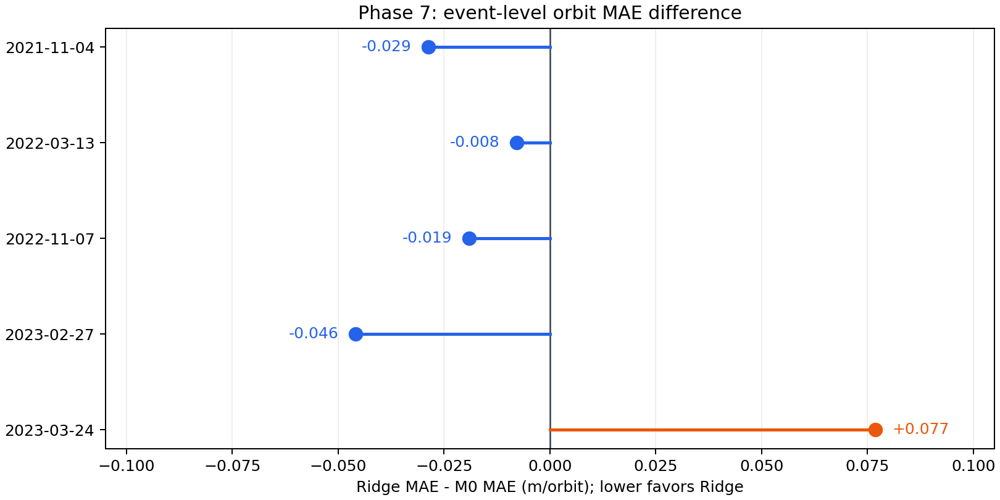
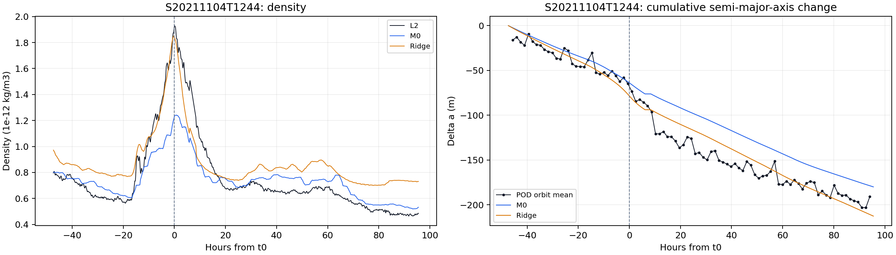
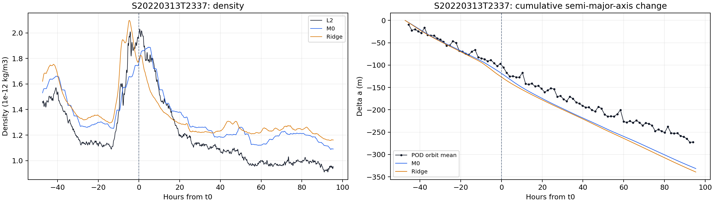
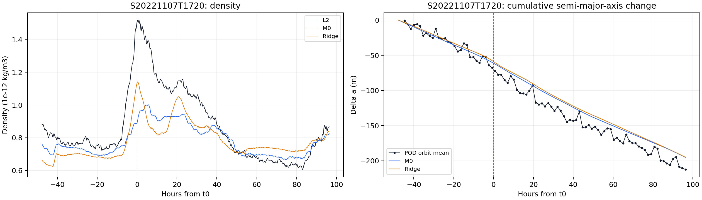
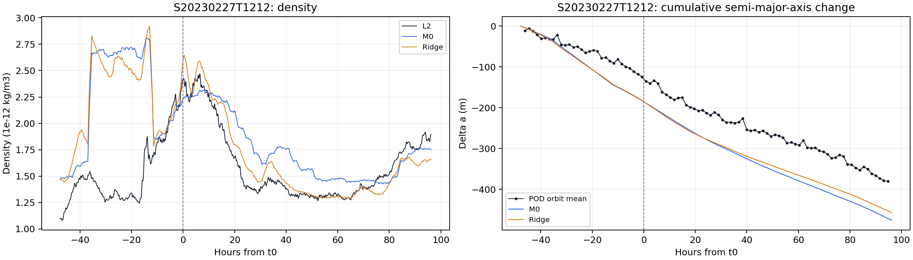
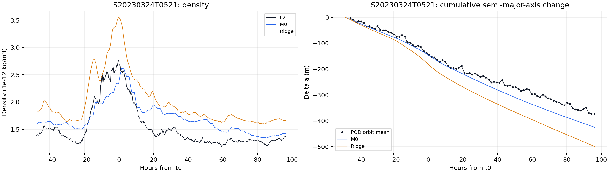

# Phase 7 最終報告：五場磁暴逐圈計分

## 結論

狀態：[done: descriptive]。五場磁暴各以該場所有有效圈的 MAE 決勝，一場一票。Ridge 勝 4 場，M0 勝 1 場，沒有平手。

| Model | 磁暴勝場 | 五場等權平均 orbit MAE |
| --- | ---: | ---: |
| Phase 3 M0 | 1 | 5.309 m/orbit |
| Phase 5 V2 Ridge | 4 | 5.304 m/orbit |

平均差距只有約 `0.005 m/orbit`。Ridge 勝場較多，但改善量極小；五場不足以支持穩定或明顯改善。453 個有效圈間區間是每場分數的底層資料，不是 453 場獨立磁暴。

## 研究問題與實驗設計

Phase 7 檢查 Phase 0–6 保存的方法，用於 25 場開發事件以外的較早磁暴時，Ridge 密度推得的逐圈半長軸下降是否比 M0 更接近 POD。

```text
Phase 0–5 保存的 M0 / Ridge density
  -> Phase 6 固定 B_eff 推得累積下降
  -> 相鄰完整 POD orbit 的局部下降誤差
  -> 每場 orbit MAE 決勝；五場等權
```

符號對照：本報告的 Ridge 密度使用 Phase 5 V2 全 25 場係數對新事件得到的 $\widehat R_k^{\mathrm{full25}}$，配合 Phase 4 V2 的 $G_{\mathrm{V2}}$ 與 $H_{\mathrm{V2}}$；下降計算沿用 Phase 6 固定的 $B_{\mathrm{eff}}$。它不是 Phase 6 留場的 $\widehat R_k^{\mathrm{LOO}}$。見[共用變數表](../../../VARIABLES.md)。

目前計分排除 `S20180826T0711`；只比較 2021-11 至 2023-03 的五場。2018 年資料與圖保留供歷史查核，不進分母、不參與排名。五場計分端點均早於 P6.1 的 `B_eff` 擬合起點 2023-07-01。Ridge 使用全 25 場係數，`B_eff` 固定為 `0.0092292068 m²/kg`，沒有對五場重新擬合。

## 逐圈計分方法

設第 $j$ 個完整 POD orbit 的平均半長軸為 $\bar a_j$，其終點對齊最近 UTC minute 的函數為 $m(t_j)$。相鄰兩圈的觀測變化、模型變化及誤差為：

$$
\Delta a_{\mathrm{POD},j}=\bar a_j-\bar a_{j-1},
$$

$$
\Delta a_{\mathrm{model},j}=\Delta a_{\mathrm{model}}(m(t_j))-\Delta a_{\mathrm{model}}(m(t_{j-1})),
$$

$$
e_{\mathrm{model},j}=\Delta a_{\mathrm{model},j}-\Delta a_{\mathrm{POD},j}.
$$

每場磁暴 $k$ 的有效圈間區間數為 $N_{\mathrm{orbit},k}$，正式分數為：

$$
\operatorname{MAE}_{\mathrm{model},k}=\frac{1}{N_{\mathrm{orbit},k}}\sum_{j=1}^{N_{\mathrm{orbit},k}}|e_{\mathrm{model},k,j}|.
$$

該場 MAE 較低的模型贏一票。$N_{\mathrm{orbit},k}$ 是圈數，不是 Phase 4 的有效相位分鐘數 $N_k$。單圈變化可能接近零，因此不用 MAPE。

每筆分數比較相鄰兩個完整 POD 圈平均的半長軸變化，以及其兩個終點各自對齊最近分鐘後的 M0／Ridge 累積預測差。兩個分鐘錨點須存在、同屬一個積分 block，中間分鐘連續；POD 圈不可跨 `chunk_id`。保存的 453 個圈間區間中，端點最大偏差 28 秒，模型與 POD 的兩端跨度最多差 50 秒；沒有時間插值。每場與全部圈間區間分別計算 MAE、RMSE。

本表 M0 沿用 Phase 0 的已完成 3 h 格／前一日 daily ap driver；這與 pymsis 標準七欄的當前格／當日 daily ap 定義不同。分數只描述這個固定輸入版本；差異與單點敏感度見[公式稽核 P0-A](../../../docs/formula_audit.md)。

## 五場結果



橫軸是每場 Ridge MAE 減 M0 MAE；負值表示 Ridge 較接近 POD，正值表示 M0 較接近。每場各佔一點，數字用未四捨五入的 SQLite 分數計算。差距都小於 `0.08 m/orbit`。

| 事件 | 計分圈數 | M0 MAE (m) | Ridge MAE (m) | Winner | 勝出差距 (m) |
| --- | ---: | ---: | ---: | --- | ---: |
| 2021-11-04 | 89 | 5.306 | 5.277 | Ridge | 0.029 |
| 2022-03-13 | 91 | 5.302 | 5.294 | Ridge | 0.008 |
| 2022-11-07 | 91 | 5.228 | 5.209 | Ridge | 0.019 |
| 2023-02-27 | 91 | 5.383 | 5.338 | Ridge | 0.045 |
| 2023-03-24 | 91 | 5.328 | 5.405 | M0 | 0.077 |

逐場 MAE 顯示 Ridge 勝 2021-11-04、2022-03-13、2022-11-07、2023-02-27；M0 勝 2023-03-24。Ridge 最大改善是 2023-02-27，依未四捨五入數值約降低 `0.046 m/orbit`；最大退步是 2023-03-24，增加約 `0.077 m/orbit`。2022-03-13 的差距小於 `0.01 m/orbit`，實質上接近平手。

453 圈直接合併的輔助指標為 M0／Ridge pooled MAE `5.309／5.305 m/orbit`、RMSE `7.283／7.287 m/orbit`。正式比較使用五場等權平均與勝場數，不讓 91 圈的事件比 89 圈的事件多一票。

## 五場個別圖

下列圖沿用各批次保存的 density 與累積半長軸變化。左圖比較 L2、M0、Ridge density；右圖比較 POD 圈平均與兩模型的累積變化，虛線為事件 `t0`。這些曲線供事件脈絡檢查；正式排名仍使用上方的相鄰圈局部誤差，不以累積終點決勝。

### 2021-11-04



### 2022-03-13



### 2022-11-07



### 2023-02-27



### 2023-03-24



## 可以主張與不能主張

### 可以主張

- 五場探索性事件中，Ridge 的逐場 orbit MAE 贏 4 場，M0 贏 1 場。
- 兩模型的五場等權平均逐圈 MAE 非常接近。

### 不能主張

- 不能把六天窗口或逐圈下降全歸因於磁暴；尚無 quiet counterfactual。
- 不能稱為事前預報。事件特徵與 quiet F10.7A 使用回溯資料；Ridge 特徵也曾由原 25 場結果選出。
- 不能稱 Ridge 對 M0 有穩定優勢，或把 `B_eff` 當成獨立量測的衛星物理係數。

## 資料品質與重現性

- 五場共有 453 個有效圈間區間，每場 89 至 91 圈；2018 年事件明確排除。
- M0 與 Ridge 使用相同 POD 圈、分鐘錨點和固定 `B_eff`。
- 計分不插值，也不跨 POD `chunk_id` 或 density block 缺口。
- 五場結果 SQLite 有 453 筆逐圈列、5 筆事件摘要及排除事件 metadata；`PRAGMA integrity_check=ok`。

## 正式輸出

| Output | 內容 |
| --- | --- |
| `data/sqlite/swarm_a_five_storm_orbit_scores_v1.sqlite` | 五場逐圈誤差與每場摘要；本機資料，不在 GitHub |
| `figures/phase7_five_storm_orbit_mae.png` | 五場等權計分的逐場 MAE 差圖 |
| [三場密度與下降報告](../runs/three_storms/reports/phase_7_late_2022_early_2023_three_storms_report.md) | 2022-11 至 2023-03 的上游結果 |
| [較早事件研究紀錄](../runs/earlier_storms/reports/earlier_three_storms.md) | 2021-11、2022-03 及排除的 2018 歷史結果 |

原[六場計分](../runs/earlier_storms/reports/six_storm_orbit_scores.md)保留為歷史版本。
