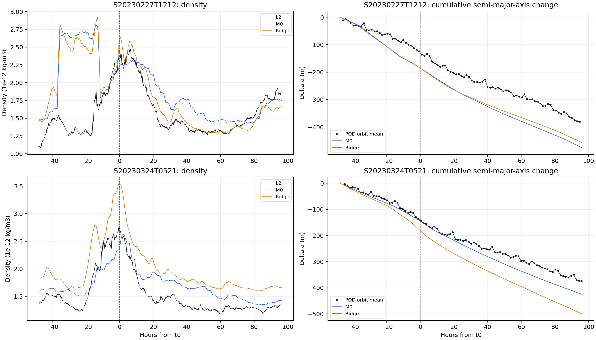

# Phase 7：2023 年初兩場磁暴外部事件結果

## 結論

狀態：[done: exploratory external-event validation]。兩場事件已依 Phase 0–6 的現行方法
跑完獨立 Phase 7 輸出。結果不支持直接把 Phase 5 V2 frozen Ridge 當成穩定的新事件密度修正：

- 2023-02-27 的 Ridge log-density RMSE 低於直接 M0；2023-03-24 則高於 M0。
- 六日窗口下降量只有 2023-02-27 是 Ridge 較接近 POD；2023-03-24 是 M0 較接近。
- 兩場 decay MAE 為 M0 `64.58 m`、Ridge `92.33 m`。樣本只有兩場，不能估一般化誤差。

兩場都是 compound storm。所有密度、R 與下降結果只作回溯描述，不是即時 forecast、
物理參數量測或 drag propagation。

## Phase 0–6 對應

| Phase 7 step | 沿用來源／方法 | 狀態 |
| --- | --- | --- |
| P7.0 | Phase 0 DNSAPOD、GFZ ap、SME、F10.7 | 18 天來源與 hash 已核對 |
| P7.1 | Phase 1R 10 s mean elements 與 `chunk_id` | 兩場完整分鐘 POD 已配對 |
| P7.2 | frozen Phase 2R 事件、相位與 L2／M0 | 兩場 coverage 都是 100% |
| P7.3 | Phase 3 near-zero quiet run 與 quiet NRLMSIS | pre/post R 已重算 |
| P7.4 | Phase 4 V2 固定 `tau=4.75 h`、固定 `G` | 外部事件回溯 `R_fit` 已計算 |
| P7.5 | Phase 5 V2 frozen 三因素 Ridge | 新事件 `R` 與 density 已預測 |
| P7.6 | Phase 6 固定 `B_eff=0.0092292068 m²/kg` | M0／Ridge 下降已比較 |

Frozen Phase 2／2R、Phase 3、Phase 4 V2、Phase 5 V2、Phase 6 都未修改。

## 事件與資料

| `storm_id` | `t0` UTC | SYM-H 最低值 | 有效相位分鐘 | POD blocks |
| --- | --- | ---: | ---: | ---: |
| `S20230227T1212` | 2023-02-27 12:12 | -161 nT | 8,635 | 1 |
| `S20230324T0521` | 2023-03-24 05:21 | -170 nT | 8,632 | 1 |

兩場的 Phase 2R L2 coverage 與 paired coverage 都是 1.0。Density 與 POD 使用
`{storm_id, time_us}` exact join，並要求每分鐘 2 筆 DNSAPOD 與 6 筆 POD；缺分鐘或
`chunk_id` 改變時才切 block，本次兩場都沒有切段。

## Quiet R 穩定性

| 事件 | pre quiet run UTC | `R_phase3` | post diagnostic R | post/pre 差 |
| --- | --- | ---: | ---: | ---: |
| 2023-02-27 | 2022-12-18 04:26–08:23 | 0.7263 | 1.0595 | +45.9% |
| 2023-03-24 | 2023-03-13 20:14–2023-03-14 00:00 | 1.0413 | 0.7376 | -29.2% |

兩場的 pre/post raw density coverage 都是 100%，但 R 差異很大。2023-02-27 的最近合格
pre quiet run 距第一個強 SYM-H minimum 約 71 天；這使 `R_phase3` 本身成為主要不確定來源。

## 外部事件 R 與密度

Phase 4 V2 的固定式為：

\[
\widehat\rho_{k,t}=\rho^q_{k,t}R_k\exp(GH_{k,t}),
\qquad \tau=4.75\ \mathrm{h}.
\]

`R_fit` 固定既有 `tau` 與 `G`，只用新事件自己的 L2 回溯計算，作為外部事件答案。
Ridge 完全使用既有 25 場保存的標準化、係數與截距；兩場新事件沒有參與訓練或選特徵。

| 事件 | `R_phase3` | external `R_fit` | external Ridge `R` | Ridge - fit |
| --- | ---: | ---: | ---: | ---: |
| 2023-02-27 | 0.7263 | 0.8160 | 0.9335 | +0.1175 |
| 2023-03-24 | 1.0413 | 0.8734 | 1.1376 | +0.2642 |

| 事件 | M0 log RMSE | fixed-tau fitted-R log RMSE | Ridge log RMSE |
| --- | ---: | ---: | ---: |
| 2023-02-27 | 0.3025 | 0.2387 | 0.2740 |
| 2023-03-24 | 0.1622 | 0.0591 | 0.2708 |

Ridge 兩場都高估 `R_fit`。2023-02-27 的 Ridge 比直接 M0 低，但仍差於同場 fitted-R；
2023-03-24 的 Ridge 是三條曲線中誤差最高。兩場不足以支持 Ridge 優於 M0。

## 六日窗口下降

| 事件 | POD (m) | M0 (m) | M0 error (m) | Ridge (m) | Ridge error (m) | 較接近 POD |
| --- | ---: | ---: | ---: | ---: | ---: | --- |
| 2023-02-27 | -406.09 | -475.97 | -69.88 | -457.03 | -50.94 | Ridge |
| 2023-03-24 | -366.23 | -425.52 | -59.29 | -499.93 | -133.71 | M0 |

| 兩場指標 | M0 | Ridge |
| --- | ---: | ---: |
| MAE | 64.58 m | 92.33 m |
| RMSE | 64.80 m | 101.18 m |

兩場模型都偏向多估下降。Ridge 對 2023-02-27 有改善，但在 2023-03-24 明顯惡化；兩場
合併後不支持 Ridge 已優於 M0。這是外部事件檢查，不改寫原本 25 場 in-sample 結果。



## 輸出與重算

| Output | 內容 |
| --- | --- |
| `data/raw/manifest_dnsapod_early_2023_two_storms.json` | 18 個 DNSAPOD 日檔與 hash |
| `data/sqlite/swarm_a_phase7_density_v1.sqlite` | 2 場事件、17,267 個有效相位分鐘 |
| `data/sqlite/swarm_a_phase7_decay_v1.sqlite` | 17,267 個 POD exact-paired 分鐘與 2 場總量 |
| `figures/phase7_early_2023_two_storms.png` | L2／M0／Ridge density 與 POD／預測下降 |

| Output | SHA-256 |
| --- | --- |
| `swarm_a_phase7_density_v1.sqlite` | `1c344ca8a2d6f67c194a9010514b1f68482ebeffbe9af89557093980b7153c87` |
| `swarm_a_phase7_decay_v1.sqlite` | `4e594e80968deccef9b1e24a95c422e6e65fda3ae218e22c895f1316cc3f5aa9` |
| DNSAPOD manifest | `4d3a873520902b1d5590b4dce36b309f3326a6607622bc63a547c883e6951ab4` |
| 比較圖 | `ff6a4fd73ff60924708b852c79c54dec0ddbdc5810fab203ed4e60869fdabe57` |

重算順序：

```powershell
python -m phases.phase7.code.down_phase7_dnsapod
python -m phases.phase7.code.prep_phase7_density
python -m phases.phase7.code.calc_phase7_decay
python -m phases.phase7.code.prep_phase7_figure
python -m pytest -q phases/phase7/tests/test_phase7_two_storms.py
```

既有輸出一律拒絕覆寫。完整 table、key、單位與來源見
[Phase 7 資料血緣](../docs/lineage/phase_7_early_2023_two_storms.md)。

## 研究界線

- `R_fit` 使用同場 L2，只是 retrospective validation target。
- Ridge 因素含回溯選出的 quiet run；目前仍不是即時預報流程。
- `B_eff` 由 2023-07 至 2026-06 的 L2/POD in-sample 擬合，不是獨立 ballistic coefficient。
- DNSAPOD L2 density 與 semi-major axis 都依賴 POD lineage，不是完全獨立量測。
- 六日窗口含背景下降，沒有 quiet counterfactual，不能把總下降全部歸因於磁暴。
- 本階段沒有加入新 machine learning、drag propagator、姿態模型或 XYZ prediction。
