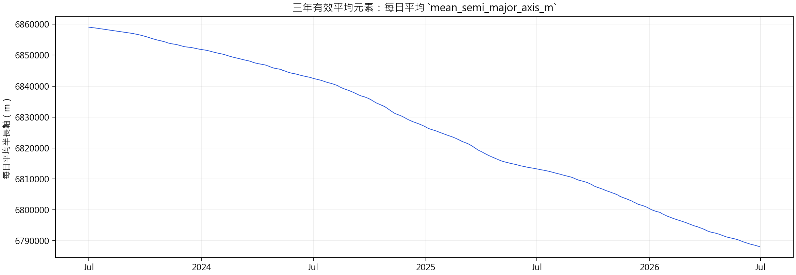
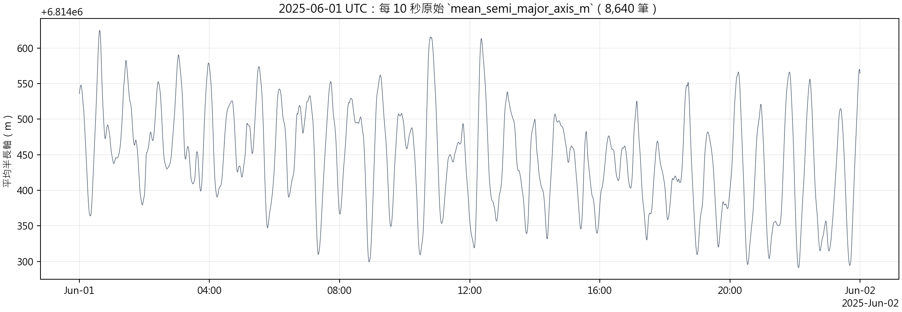
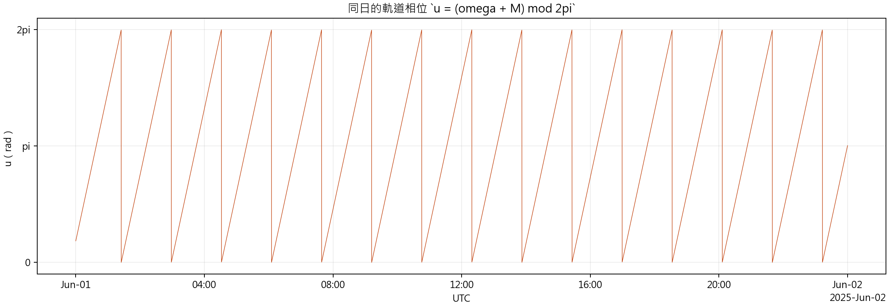
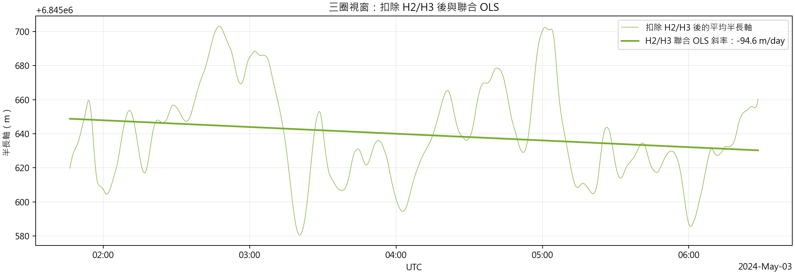
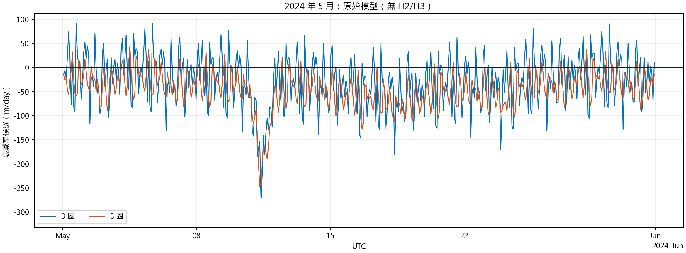
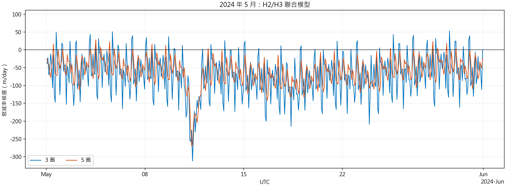

# Swarm-A 軌道分析流程報告草稿

## 研究定位

本研究要建立可追溯的 Swarm-A 軌道衰減候選資料集，供後續分析地磁活動與軌道衰減的關係。

本階段的交付物是資料處理流程與候選衰減率，不是「已證明地磁暴造成軌道衰減」的因果結論。已知軌道控制、資料來源差異與估計方法造成的異常仍須校準。

## 現行狀態

目前可展示的是 2023-07-01 至 2026-07-01 UTC 的三年工作資料集（working bench）。

| 資料層 | 計數單位 | 筆數 | 關係 |
| --- | --- | ---: | --- |
| 可用平均軌道元素 | 10 秒時間點 | 9,469,438 | 3 年共 1,096 日；均勻 10 秒網格應有 9,469,440 個時間點，實際列數少 2 |
| 舊版完整相位軌道紀錄 | 每圈一列 | 16,844 | 僅供 H2/H3 診斷；不是新版逐點候選的輸出頻率 |
| 原始平均元素，3 圈結果 | 10 秒時間點 | 9,469,438 列；9,464,376 個有效斜率 | 其餘列保留空值與拒絕原因 |
| 原始平均元素，5 圈結果 | 10 秒時間點 | 9,469,438 列；9,461,003 個有效斜率 | 其餘列保留空值與拒絕原因 |
| H2/H3 聯合模型，3 圈結果 | 10 秒時間點 | 9,469,438 列；9,464,376 個有效斜率 | 與原始 3 圈使用相同時間點與視窗 |
| H2/H3 聯合模型，5 圈結果 | 10 秒時間點 | 9,469,438 列；9,461,003 個有效斜率 | 與原始 5 圈使用相同時間點與視窗 |
| 舊版對齊後分析列 | 每圈右端點的候選一列 | 67,328 | 尚未遷移至新版逐 10 秒結果，不可視為現行四種結果的總數 |

以上計數來自 `swarm_a_analysis_2023_2026_phase_candidate_working_v1.sqlite`：新版 `raw_b_l_sets_v2` 與 `joint_h2_h3_sets_v2` 各有 9,469,438 列，各列包含 3 圈與 5 圈結果。也就是每個可用的 10 秒輸入點都保留四個結果位置；有效視窗給斜率，尚未累積足夠 3/5 圈或遇到切段時給空值與拒絕原因。四組有效斜率合計 37,850,758 個，不是 37,850,758 個不同時間點。單靠總列數少 2，也不能斷定剛好只有兩個缺失 epoch。

舊版每圈端點候選表曾出現重複軌道起點及不完整視窗；該問題屬於舊版路徑，不能用其 16,836／16,828 筆來描述新版逐點結果。新版逐點表、共用 P1.6 v2 feature 與 P1.7 v2 audit 均已寫入；6 項資料契約 violation 全為 0。這不代表物理斜率已校準。

三年資料集的用途是先固定方法、確認資料契約，並檢查估計器的行為。它不是研究範圍的最終上限，也不是十二年資料集的縮小版結論。

2014--2026 的工作資料集也已建立並通過相同 v2 資料契約稽核；其報告採 2014-07-01 至 2026-06-30 的十二年分析範圍。三年與十二年輸出分別保存，不可混成同一個 release。

## 主流程

```text
ESA 精密軌道資料（POD）
  -> 國際地球參考框架（ITRF）原始狀態向量（state）
  -> 地心天球參考框架（GCRF）與平均軌道元素
  -> 資料品質判定與連續資料段（chunk）
  -> 可用平均元素的軌道相位；完整軌道供診斷
  -> 二、三階諧波（H2/H3）診斷
  -> 3 圈與 5 圈最小平方法（OLS）衰減率候選
  -> 地磁與太空天氣特徵對齊
  -> 資料產品稽核
```

## 1. 精密軌道資料轉換為平均軌道元素

歐洲太空總署（ESA）的精密軌道資料提供每 10 秒的衛星位置與速度。原始狀態向量（state）位於國際地球參考框架（ITRF）；時間從 GPS 轉為 UTC，位置與速度統一轉為 SI 單位。

處理步驟如下：

1. 讀取每個 POD epoch 的位置與速度，保留來源檔案與原始時間對應。
2. 將 ITRF 狀態向量轉到地心天球參考框架（GCRF），使軌道力學計算使用一致的慣性座標。
3. 由 GCRF 的位置與速度計算瞬時軌道元素，先確認該狀態向量代表有效的束縛軌道（bound orbit）。
4. 使用 Orekit 的布勞威爾－里登平均化（Brouwer-Lyddane mean elements）取得平均軌道元素，包括平均半長軸 `mean_semi_major_axis_m`、平均近地點幅角 `omega` 與平均近點角 `M`。

5. 保留每筆輸入的 `time_us`，使平均元素可追溯回 POD 來源檔案（source file）與原始狀態向量。

這一步的目的不是直接量到大氣阻力，而是把短週期軌道變化與較慢的軌道趨勢分開，建立後續估計可以使用的表示方式。

下一步由平均近地點幅角與平均近點角定義軌道相位：

```text
u = omega + M
```

`u` 表示觀測點在該圈軌道中的位置。它不是固定 UTC 時鐘，而是用來辨識隨軌道位置重複出現的週期訊號。報告中使用包回 `0` 到 `2pi` 的表示；每次由接近 `2pi` 回到 `0`，就是下一圈的開始。







圖 2a 是三年有效 `mean_semi_major_axis_m` 的每日平均；圖 2b 是 2025-06-01 UTC 的全部 8,640 筆每 10 秒原始平均元素；圖 2c 是同日的 `u` 對 UTC。三張圖刻意分開輸出，讓報告或投影片可自行決定是否並排。原始資料的圈內波動與 `u` 的鋸齒週期，是後續處理 H2/H3 的原因。

## 2. 資料品質判定與連續資料段

這一步要清楚區分「排除資料」與「切斷計算」。兩者都保留在資料庫中，並不修改原始觀測資料。

### 排除資料

下列 state 不可進入後續估計：

- 時間未嚴格遞增。
- 位置或速度為空值、NaN 或 infinity。
- 瞬時軌道元素不存在、軌道能量無效，或半長軸不是有限正值。
- 落在 ESA 已公告的軌道控制操作（orbit-control maneuver）、碰撞迴避操作（collision-avoidance maneuver）或軌道抬升任務（orbit-raise campaign）時段。

每筆結果寫入 `swarm_a_pod_quality` 的 `is_usable` 與 `rejection_reason`。原始 POD state 不會被刪除或覆寫。

### 切斷計算

可用資料仍必須依 `chunk_id` 分段。出現下列條件時，下一筆可用資料會開始新的資料段（chunk）：

- 前一筆資料不可用。
- SP3 資料產品流（product stream）改變。
- SP3 參考框架（frame）改變。
- 資料取樣間隔（cadence）改變，或來源溯源資料（source provenance）不完整。
- 相鄰狀態向量的時間差不等於該來源的取樣間隔。

`chunk_id` 不是品質分數。它是估計器的邊界：後續完整軌道、平均與最小平方法視窗都不能跨越資料缺口、產品切換、座標框架切換或已知操作時段。


圖 3 使用全任務原始資料庫中的 2023 Phase II 軌道抬升事件，作為 `chunk` 規則的實例；它不納入本報告的三年工作資料集統計。單一時間軸涵蓋 4--8 月：藍色是事件前正常下降的 `chunk 10`，綠色是事件後另起的 `chunk 11`。兩條實心垂直線之間是 4/26--6/8 的排除區間；橘色折線是 campaign 期間的實際日平均半長軸，可看見多次上升。完整軌道與 OLS 視窗不得跨越這兩條邊界，campaign 內也不建立候選列。官方公告沒有逐次 firing UTC，故不能把圖中的個別跳點稱為個別 maneuver。


## 3. 完整軌道相位與 H2/H3 診斷

一圈軌道只有在下列條件都滿足時，才視為完整軌道：

- 至少 500 個 POD 資料點（samples）。
- 相位涵蓋至少 `2pi - 0.05 rad`。
- 最大相鄰資料缺口（gap）不超過 10 秒。
- 不跨越 `chunk_id` 或來源資料缺口。

對每一個完整軌道，程式以相位加權平均得到一圈的平均半長軸，並估計二階與三階諧波（H2/H3）的振幅。H2/H3 描述半長軸中隨軌道相位重複出現的週期成分。

這一步不把 H2/H3 直接解釋為大氣阻力。它的作用是量化：若直接對半長軸估計斜率，軌道相位相關的週期訊號會造成多少干擾。


圖 4a 是實際完整軌道的原始偏差與 H2/H3 諧波重建；圖 4b 是原始值扣除該重建後的殘差。兩張圖分開輸出。術語上這不是「傅立葉轉換」：本流程是在固定的二、三階頻率上做傅立葉諧波迴歸（Fourier harmonic regression），再用估得的 H2/H3 項修正同一筆原始資料。

## 4. 三圈與五圈軌道的衰減率候選估計

每個可用的 10 秒輸入時間點，都以該點為右端點，沿連續相位向前回看精確 3 圈與 5 圈。兩個模型各算這兩種視窗，因此同一時間點有四個結果位置。視窗不能跨越資料段（chunk）或來源缺口；在段首尚未累積足夠圈數時，該時間點仍保留，但相應斜率為空並記錄拒絕原因。完整軌道的每圈統計用於上一節診斷，不決定新版候選的輸出頻率。

三圈與五圈不是兩個互相競爭的「正確答案」，而是兩個不同的局部時間尺度。三圈視窗對短時間變化較敏感，也較容易受殘留週期或局部異常影響；五圈視窗使用更多資料點，通常較穩定，但可能降低對快速變化的反應。兩者都必須保留，才能檢查結果是否只由特定視窗長度造成。

每個視窗保留兩種估計方法：

```text
原始平均元素模型：
a(t) = b0 + b1(t - t0)

H2/H3 聯合模型：
a(t) = b0 + b1(t - t0) + H2(u) + H3(u) + residual
```

圖 6a、6b 固定以藍色表示 3 圈、橘色表示 5 圈；標題區分是否包含 H2/H3，避免同一視窗尺度換色。兩圖使用相同縱軸範圍，便於比較模型差異。




圖 5 選用 2024-05-03 01:46:22 至 06:28:22 UTC 的同一三圈視窗，作為兩模型差異清楚的機制示例。圖 5a 的原始 OLS 斜率為 `-4.5 m/day`；圖 5b 的 H2/H3 聯合 OLS 斜率為 `-94.6 m/day`。這兩張圖仍取自舊版每圈端點視窗，只能說明模型差異；匯出新版結果報告前須改用逐 10 秒 v2 的同一視窗重繪。


兩個模型的 `b1` 都以 `m/s` 存入新版資料表；繪圖與報告可換算為 `m/day`。每個有效結果還保留：

- `decay_rate_1sigma_m_s`：斜率不確定度。
- `fit_residual_std_m`：模型殘差標準差。
- `sample_count`：實際用於估計的資料點數。
- `window_start_time_us`、`time_us` 與 `chunk_id`：視窗邊界與來源追溯資訊。

同一段資料同時保留原始模型與 H2/H3 聯合模型，而不是只選看起來較平滑的一種。這可直接比較相位修正對斜率、不確定度與殘差的影響。

### 為什麼這是本研究的核心方法

#### 為什麼同時使用原始模型與 H2/H3 聯合模型？

原始模型回答「若忽略軌道相位週期項，資料給出的局部斜率是什麼」。H2/H3 聯合模型回答「若將已量測到的二、三階相位週期項一併納入，局部斜率如何改變」。兩者使用同一個資料視窗，因此斜率差異可以歸因於模型是否處理相位結構，而不是資料範圍不同。

#### 為什麼每筆候選不能只保留衰減率？

一個斜率本身沒有足夠資訊判斷可靠性。因此每筆候選列（candidate）必須連同不確定度、殘差、樣本數與視窗邊界保存。斜率相近但殘差很大，或只由過少資料點支持的結果，不應和資料完整、殘差較小的結果有同等解讀地位。

#### 為什麼仍稱為「候選」？

此處的 `b1` 是在有限的局部視窗中估計出的半長軸趨勢。它尚未校正未知 maneuver、資料來源差異與方法限制，因此可以描述與比較，但不能直接宣稱是真實大氣阻力造成的衰減率。

目前三年工作資料集有四種候選組合：

```text
原始平均元素：3 圈、5 圈
H2/H3 聯合模型：3 圈、5 圈
```





圖 6a 只比較原始模型的 3 圈與 5 圈；圖 6b 只比較 H2/H3 聯合模型的 3 圈與 5 圈。兩張圖仍取自舊版每圈端點候選，只保留版面示例；逐 10 秒 v2 圖尚未重繪，不可將現圖稱為新版資料的結果。

## 5. 地磁與太空天氣資料對齊

目前已為每個逐 10 秒 `time_us` 寫入一筆共用的 P1.6 v2 feature，對齊 SYM-H、Ap、F10.7 與 F10.7A。舊版對齊表不能代替新版結果。對齊規則禁止使用候選時間之後的太空天氣資料：

- Ap 使用候選所在的 3 小時區塊。
- F10.7 與 F10.7A 使用前一個 UTC 日的資料。
- SYM-H 優先使用同時刻觀測；若插值，右端點最多只能晚於候選 120 秒。

這一步把地磁與太空天氣值寫入獨立的 feature table，以 `time_us` 與兩張 rate table 對齊；它本身不構成地磁暴造成衰減的因果證明。

【圖 7：放置處為本節後。生成提示：繪製簡潔的時間對齊概念圖，繁體中文。中央為候選時間 t；左側標示可使用的 Ap 與前一日 F10.7、F10.7A；SYM-H 顯示同時刻值或左右相鄰觀測的有限插值，右端點最多晚於 t 120 秒。以紅色叉號標示不可使用 t 之後的太空天氣資料。不要畫實際風暴數據。】


## 6. 資料產品稽核

稽核不是主要研究結果。舊版 v1 候選與分析表曾通過以下舊契約檢查；其結果不適用於新版 v2：

- 候選 key `(time_us, decay_method, orbit_window)` 與分析 key 是否一對一對應。
- 所有候選列與分析列的數值是否為有限值。
- 候選列是否位於指定分析範圍，且每筆的 `chunk_id` 是否一致。
- Ap、F10.7、F10.7A 是否引用候選時間之後的資料；SYM-H 插值右端點是否超過 120 秒限制。
- 必填欄位是否缺漏，候選列與分析列欄位是否不一致。
- P1.6 外來鍵（foreign key）與 SQLite 完整性檢查（integrity check）是否通過。

舊版 67,328 筆候選與分析列的一對一稽核，不適用於新版逐 10 秒結果。新版兩張 rate table 與 feature table 各有 9,469,438 列。P1.7 v2 已檢查三表時間鍵、raw/joint rate 有效性一致、feature source time、非有限斜率與 SQLite integrity；6 項 violation 全為 0。精確 phase span、視窗不跨 source gap、maneuver 與模型偏差不在這 6 項 audit 的證明範圍。

【圖 8：待產出。應把 P1.7 v2 已通過的 6 項資料契約檢查與尚未完成的 phase span、maneuver、source、model calibration 分開呈現；不得把 v1 audit 套用到 v2。】

## 報告應呈現的圖表

1. 表 1：各資料層的計數單位與筆數；不把不同資料粒度誤寫成單一路徑。
2. 圖 2：三年與單日原始平均半長軸，以及單日 `u` 對時間，先讓讀者看見資料與週期。
3. 圖 3：資料涵蓋與 `chunk` 時間線，明確標出估計器不可跨越的計算切段。
4. 圖 4：單一完整軌道的 H2/H3 諧波重建與扣除後殘差，說明為何不能直接估斜率。
5. 圖 5：同一三圈資料視窗中，原始與扣除 H2/H3 後的實際折線與 OLS 斜率。
6. 圖 6a、6b：將無 H2/H3 與含 H2/H3 的衰減率分開，各圖比較 3 圈與 5 圈。
7. 圖 7：地磁與太空天氣的因果時間對齊規則。
8. 圖 8：稽核項目與通過結果。
9. 圖 9：候選資料集的 coverage、sample count、不確定度與殘差分布資料圖。
10. 圖 10：一個地磁擾動個案中，候選衰減率、SYM-H、Ap 的共同時間序列；只呈現描述性個案研究（descriptive case study）。

【圖 9：放置處為本節後。資料圖生成提示：使用實際 SQLite 分析資料表，繪製四面板品質總覽：候選時間涵蓋範圍、樣本數分布、衰減率 1-sigma 不確定度分布、擬合殘差標準差分布。依 3/5 圈與原始/H2H3 方法使用一致顏色或分面。不以生成模型虛構資料。】

【圖 10：放置處為個案分析章節。資料圖生成提示：選定一個已定義的地磁擾動視窗，以共同 UTC 時間軸繪製三列：H2/H3 3/5 圈候選衰減率與不確定度、SYM-H、Ap。清楚標注這是描述性個案研究（descriptive case study），不加因果箭頭或「地磁暴造成衰減」文字。數值只能來自 SQLite。】


## 目前不可宣稱的結論

- 衰減率候選不等於已校準的真實大氣阻力衰減率。
- H2/H3 修正降低週期訊號，不代表已證明剩餘訊號全是物理衰減。
- 與 SYM-H、Ap、F10.7 或 F10.7A 同時出現的變化，不等於已證明地磁暴是原因。
- 十二年資料集建立前，不應把三年工作資料集的統計量宣稱為全任務期結果。

## Memo（內部備忘，不納入評審版）

- 十二年資料完成後另寫獨立報告；不直接延長本三年版本。
- 將圖 5、圖 6 與 P1.6 特徵對齊改用逐 10 秒 v2 結果；現有圖仍取自舊版每圈端點表，不可當作新版結果圖。
- 新版三表時間鍵與 raw/joint rate 有效性已由 P1.7 v2 稽核；四組拒絕原因、精確 3／5 圈相位覆蓋與 source gap 邊界仍須另驗。舊版重複軌道起點問題另行保留追查。
- 匯出評審版前移除本節，但保留 `research_workspace/phases/phase1/figures/test/` 的舊圖與試作圖，以便回查。
- 舊版四張單線候選圖與四線合併圖保留在 `research_workspace/phases/phase1/figures/test/`；主文只使用拆開的圖 6a、6b。
- 圖 6 固定藍色為 3 圈、橘色為 5 圈；有無 H2/H3 由圖標題區分。
